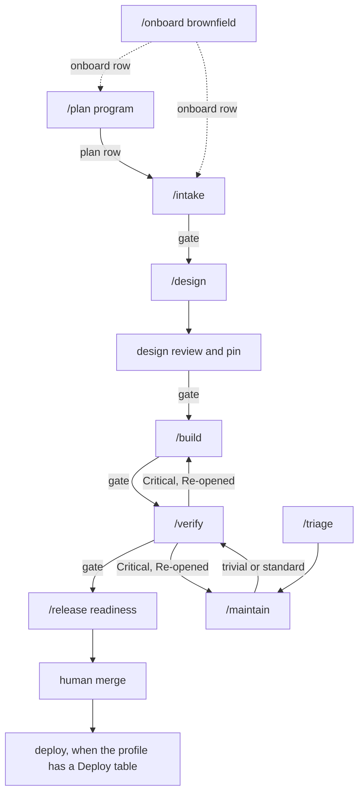

# Kit reference

Engineer's map of the agents-v0 delivery kit: the workflow, the records, and what is actually checked. Approvers use [user-guide.md](user-guide.md). This file describes the kit as installed; each phase command (`core/commands/`) is the procedure, and this page is how the pieces fit.

The kit is vendor-neutral. `scripts/install.sh` copies one core into Cursor, Kilo Code, and Claude Code. Gates, approvals, and CI checks are the same in all three. The default git host is on-prem GitLab (`glab`). GitHub (`gh`) is the other supported host.

## Workflow



A standard story is the solid path: Intake, Design, Build, Verify, Release, then a person merges. `/deliver` runs that path by following each phase command and stopping at every gate. It holds no phase steps of its own.

| Edge | What it means |
|------|----------------|
| Onboard, dotted | An existing repo is documented as it is before any feature work. A new repo skips this. |
| Plan, dotted into the story path | A goal larger than one story is split into milestones and ordered stories first. One story skips Plan. |
| Design review and pin | `design-reviewer` writes `review.md`. The approved design is hashed into `design.lock`. |
| Verify back to Build | A Critical finding sets that phase's approval to `Re-opened`. It is open until the user approves the re-run. |
| Maintain into Verify | A fix, patch, upgrade, or hotfix has its own note and then Verify. Trivial uses the abbreviated Verify. |
| Verify back to Maintain | A Critical finding on a fix re-opens Maintain, not the original feature's Build. |
| Triage | Docs-only or version-only, and only when `ci/classify-change.sh` says so and a person confirms. |
| Deploy | Optional, after the merge, one environment at a time. Records go in a later docs-only merge request. |

`/status` does not move the work. It reads the state file and names the next command.

## Commands

| Command | When | Record |
|---------|------|--------|
| `/onboard` | An existing repo, once | `docs/onboarding/report.md` |
| `/plan` | More than one story | `docs/milestones/<milestone>.md`, `docs/design/system/context-map.md` |
| `/intake` | One story's requirements | `docs/requirements/<feature>.md` |
| `/design` | Contract and design before code | `docs/design/<feature>/` |
| `/build` | Implement against the approved design | `docs/build/<feature>/` |
| `/verify` | Tests, security, review | `docs/verify/<feature>/` |
| `/release` | Merge request, then a human merge | `release` row, then the merge |
| `/maintain` | Fix, CVE, upgrade, refactor, doc drift | `docs/maintain/<id>/note.md` |
| `/triage` | A change the classifier calls trivial | the same note, `Tier: trivial` |
| `/deliver` | One story, every gate | the feature's state file |
| `/status` | Where the work is, and what to run next | read only |

Resume is the same in every phase. `scripts/sync-feature-state.sh` writes the state file. `lastApprovedPhase` comes only from an `Approved` row. `activeStatus` is `in_progress`, `awaiting_approval`, or `blocked`. Re-entering a command continues from the files on disk. It does not recreate them and it does not approve anything. Two features in one checkout stop when they would edit the same shared file. The usual fix is `scripts/feature-worktree.sh <feature>`, which needs one explicit authorization.

## Records

| Work | State file | Approval lives in |
|------|------------|-------------------|
| Feature | `docs/requirements/<feature>.state.json` | the requirements artifact, one row per phase |
| Onboarding | `docs/onboarding/state.json` | `docs/onboarding/report.md`, phase `onboard` |
| Maintenance | `docs/maintain/<id>/state.json` | the note, phases `maintain` and `verify` |
| Program | none | a `plan` row on each milestone manifest |
| Milestone go/no-go | none | a `milestone` row on the manifest |

The approvals table is five columns: Phase, Artifacts, Approver, Decision, Date. CI accepts `Approved`, `approved`, `yes`, or `pass` as the decision, and rejects `Not approved` and `Re-opened`. The Approver cell is the person's GitLab username (`@ada`), because the final job matches it to the real merge-request approval. Build and Verify evidence paths in that row must exist on disk and start with a `commit:` line for the tree that was tested. A later code change makes the line stale, and CI rejects it until the phase is re-run on the new commit.

`docs/requirements/<feature>.phase-result.md` is the handoff the next phase reads. It names the phase, the status, the artifacts, and one blocker per line.

## Change tiers

| Tier | Fits when | Path |
|------|-----------|------|
| Trivial | `ci/classify-change.sh` says eligible: docs only, or a version bump that replaces lines one for one. No security surface, schema, major bump, or delivery artifact. A person confirms. | `/triage`, then abbreviated Verify |
| Standard | A feature, or a fix within 800 changed source lines | Full chain, or `/maintain` then full Verify |
| Major | A new service, an auth model, or a cross-cutting change | Standard, plus system design and threat-model notes |
| Emergency | A production incident. A person confirms. Rollback and a follow-up date are required. | May merge on the `maintain` row. Full Verify is owed by that date |

The classifier reads the diff. An agent does not get to call a code change trivial. CI runs the classifier again on the merge request.

## Design

Design writes, and does not touch the org catalog:

| File | Contents |
|------|----------|
| `docs/design/<feature>/openapi.yaml` | The feature's contract fragment. OpenAPI 3.0, `/api/v1/`, unique `operationId`s, security, `Idempotency-Key` on POST, one error envelope |
| `docs/design/<feature>/events/` | Event schemas with `eventVersion`. Changes are additive |
| `docs/design/<feature>/design.md` | Every AC traced, data model, one authorization row per operation, failure modes, observability, rollout |
| `docs/adr/<NN>-<slug>.md` | A decision with at least two alternatives |
| `docs/design/<feature>/ux-spec.md` and `mockups/` | UI only. Every control has `data-component` and a row. Mockups do not call the API |
| `docs/design/<feature>/review.md` | `design-reviewer`. No open Critical, and the hash matches this design |
| `docs/design/<feature>/design.lock` | Written after the user approves: date, hash, reason |

`ci/check-openapi.sh lint` checks the draft. `compat` checks it against the catalog it will merge into. Build merges with `ci/check-openapi.sh merge` and proves it with `merged`. A service repo uses `openapi/<service>-v1.yaml`. A single-service repo uses `openapi/api-v1.yaml`.

A later edit to an approved design is an amendment, not a quiet change. Build or Verify stops, the design files change, the reviewer runs again, the user approves a row in `amendments.md`, and `ci/check-design.sh --pin` records the new hash. CI rejects a design that drifted from its lock.

## Build and verify

Build starts from a green baseline, writes `docs/build/<feature>/plan.md` with one row per approved `AC-*`, and works red then green. Each attempt appends a card to `build-report.md`. The same test red twice goes to `debug-investigator` before a third try. A third red stops. The phase also has a total budget of failed attempts, default 8 (`scripts/check-attempt-budget.sh`).

The Build gate is not only the agent's report. CI checks:

| Check | Fails when |
|-------|------------|
| `ci/check-build-plan.sh` | An AC has no row, a done row names a test that does not exist, or that test was never red first |
| `ci/check-endpoint-auth.sh` | A new Spring mapping has no security annotation. `@PermitAll` marks a public one on purpose |
| `ci/check-frontend-calls.sh` | The frontend calls an `/api/` path the catalog does not list |
| `ci/check-openapi.sh merged` | The catalog is missing an operation or component from the approved draft |
| `ci/check-design.sh --verify-lock` | The design changed after it was approved |
| `ci/check-gate-metrics.sh` | No tests ran, tests failed, changed-line coverage is under 80%, or an unsuppressed HIGH or CRITICAL CVE remains |

Verify runs `test-engineer` first. Then `security-reviewer` and `code-reviewer` run together and write separate reports. Any applicable VAPT item left unchecked is Critical. A Critical list goes back to Build or Maintain. The reports are stamped with the commit that contains the tests, so the commit happens before the stamp. A trivial maintenance note skips the two reviewers and the UX and end-to-end checks. It still runs the build, the gate metrics, and a CVE scan.

## Release

`/release` renders the merge-request body from the evidence (`scripts/render-mr-body.sh`) and runs `ci/check-delivery-linkage.sh` locally before the push. The body names either `Feature-Artifact:` or `Maintain-Note:`, not both. Opening the merge request, and every commit and push, each need their own authorization. The CI fix loop stops after three rounds. A code fix in that loop goes back through Verify, because it makes the evidence commit stale.

The `release` row is written on the merge-request branch before the merge, with the GitLab username of the person who will approve it. A person merges. `glab mr merge` and `glab mr approve` are blocked. After the approval, someone plays the manual `delivery-approval` job (`glab ci trigger delivery-approval`). It matches that username to the `release` or `verify` row, using the CI scripts from the default branch.

The merge is the completion of the change. When the profile has a Deploy table, each environment after that needs its own authorization, a smoke check, and a rollback. Those records are a later docs-only merge request, not a commit on the default branch. The release owner picks the version and tag. `scripts/release-notes.sh` fills `CHANGELOG.md` from stories that have an Approved release row.

## Onboarding an existing repo

`/onboard` does not move source and does not invent a future design. It runs the baseline, then `scripts/generate-repo-map.sh`, `scripts/collect-dependency-graphs.sh`, and `scripts/discover-codebase.sh`. The discovery files under `docs/discovery/` list endpoints, entities, migrations, messaging, configuration key names, frontend routes, and a security snapshot. Values of secrets are never written.

Each module gets `docs/onboarding/modules/<module>.md`. Every statement cites `path/File.java:42` or says `UNVERIFIED`. `scripts/check-onboarding-docs.sh` rejects a citation that does not resolve and any leftover `TEMPLATE:` line. Architecture, network, the context map, inherited decisions, and the flows the user names are written as they are. `/intake` and `/plan` wait for the `onboard` row.

## Maintenance

`docs/maintain/<id>/note.md` is the record. It has the tier, the trigger, what "done" means, the classifier output, and its own approvals. Evidence is `docs/build/<id>/` and `docs/verify/<id>/`. The merge request says `Maintain-Note:`. A code change that only points at an old feature artifact is rejected: that artifact's old Build row is not evidence for this fix.

| Tier | CI requires |
|------|-------------|
| trivial | A person's confirmation, the classifier still agrees, an Approved `verify` row |
| standard | Size within the limit, an Approved `verify` row |
| emergency | A person's confirmation, a rollback, a `Follow-up verify due` date. The `verify` row may come after the merge. `scripts/delivery-metrics.sh` marks it OVERDUE once the date passes |

A bug fix writes the reproducing test and shows it fail before the fix. A dependency upgrade records the release notes and a before/after dependency graph. A doc sync re-checks onboarding citations, because a code edit moves line numbers.

## Multi-service repos

The profile Layout lists `Service roots` (for example `services/order, services/inventory`). CI builds, measures, and scans each root. Each service has its own catalog, `openapi/<service>-v1.yaml`, and its own database. A story names `Service root:` and stays in one service. A call between two services is a third story, the integration story, and it depends on both. `docs/workspace.manifest.json` lists other git repositories. CI does not cross repository boundaries.

## Agents and models

The model is chosen by role. The matrix is `docs/model-routing-matrix.md`.

| Role | Does | Cursor model |
|------|------|----------------|
| Plan | Planning, requirements, architecture, UX, orchestration | the stronger model |
| Build | Implementation, tests, maintenance, release | the fast model |
| Build (critical) | Auth, uploads, public routes, sagas, consumers | the Plan model, passed for that launch |
| Review | Design review, security review, code review | the stronger model. On Claude Code, `opus`, so the reviewer is not the builder |
| Explore, Debug, Schemas, Docs | Repo mapping, a failing test, contracts, doc drafts | fast, except Debug |

Phase agents do not launch other agents. They write a helper brief and return. The main session launches `explore-researcher`, `schema-author`, `debug-investigator`, or `docs-author`, and passes the result back. The same brief a second time is a loop, and the session stops.

## What CI checks at merge

`ci/check-delivery-linkage.sh` is the front door. A merge request that changes code names a feature artifact or a maintenance note.

| Script | Checks |
|--------|--------|
| `check-approvals.sh` | The named phase has an explicit approval |
| `check-evidence.sh` | Recorded evidence exists, has `commit:`, and is not stale |
| `check-approver-gitlab.sh` / `check-approver-github.sh` | The Approver matches a human who approved the merge request |
| `check-milestone.sh` | Every story in a manifest has the phase approval, in dependency order |
| `check-design.sh` | The design is complete, and still matches its lock |
| `check-openapi.sh` | The contract lints, is compatible, and was merged |
| `check-ux-spec.sh` | Spec rows and mockups agree |
| `check-build-plan.sh` | The plan matches the ACs and the tests were red first |
| `check-endpoint-auth.sh` | No new unannotated endpoint |
| `check-frontend-calls.sh` | Frontend calls match the catalog |
| `check-event-schemas.sh` | Event schemas stay additive |
| `check-gate-metrics.sh` | Tests, diff coverage, CVEs, from the build output |
| `classify-change.sh` | Whether a trivial note is still trivial |
| `check-layout-roots.sh` | A build with a `pom.xml` resolved a module to build |
| `check-coverage-ratchet.sh` | A coverage exception is approved and not expired |
| `check-known-failures.sh` | Failures stay inside the documented budget |

On GitLab the gate scripts are read from the default branch, so a merge request cannot rewrite the check that judges it. `CODEOWNERS` covers the delivery records, `docs/design/`, `docs/adr/`, `openapi/`, `ci/`, and the installed commands, skills, agents, and rules.

## Hooks

Cursor and Claude Code run the hook scripts. They block force-push, hard reset, recursive delete, reading secret files, edits to `ci/*.sh`, and edits to the installed commands, skills, agents, and rules. They block `glab mr merge`, `glab mr approve`, and `gh pr merge`. They ask before commit, push, a new branch or worktree, `glab mr create`, `git tag`, and a mutating `glab api` call. `after-edit.sh` warns on common VAPT mistakes. It does not pass or fail them. Kilo has no hook runtime. The same denials are in `kilo.json`, and the rest is CI plus `CODEOWNERS`.

## Rules and skills

Three rules load in every Cursor session: `workflow-orchestration.mdc`, `project-delivery-core.mdc`, and `ai-agent-conduct.mdc`, plus `AGENTS.md`. Their combined size is capped at 32 KB. The other rules load with the files they apply to: Java, frontend, API and events, security, VAPT, quality, architecture, UX, code review. Kilo and Claude Code load every rule.

Skills are the phase playbooks (`core/skills/*/SKILL.md`). The command names the skill. The skill does not restate the whole command.

## Install

```bash
./scripts/install.sh --tool cursor /path/to/repo
./scripts/install.sh --tool all --with-starters /path/to/repo
./scripts/install.sh --update /path/to/repo
./scripts/validate-kit.sh
```

`--with-starters` adds Maven quality snippets, Dockerfiles, and an OpenAPI starter. Without it, the repo gets the rules, the commands, CI, and this documentation. `--update` refreshes kit-managed files and does not overwrite a project's `AGENTS.md`, profile, or templates that the project already has.

A new repo starts with `scripts/bootstrap-greenfield.sh` ([greenfield-onboarding.md](greenfield-onboarding.md)). An existing repo starts with install, then `/onboard` ([brownfield-onboarding.md](brownfield-onboarding.md)).

## Read next

| Question | Document |
|----------|----------|
| How do I approve a phase? | [user-guide.md](user-guide.md) |
| Which check enforces which rule? | [compliance-matrix.md](compliance-matrix.md) |
| Which model runs which role? | [model-routing-matrix.md](model-routing-matrix.md) |
| How do we measure a first run? | [benchmark/reference-project.md](benchmark/reference-project.md) |
| What command do I run? | `core/commands/<phase>.md` |
