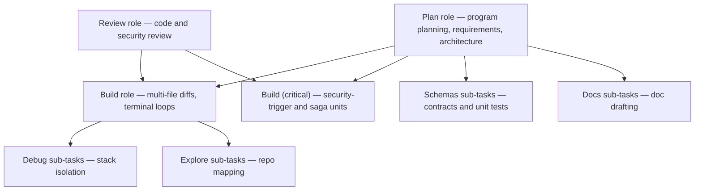

# Model routing matrix (agents-v0)

The kit routes by **role**. Each row lists the Cursor model ID for that role. Agent frontmatter carries `model:`; `scripts/validate-kit.sh` checks it against this matrix. Live model availability in Cursor is not verified.

| Role                 | Purpose                                                              | Cursor ID                |
| -------------------- | -------------------------------------------------------------------- | ------------------------ |
| **Plan**             | program planning, requirements, architecture, UX design              | `claude-sonnet-5-5-high` |
| **Build**            | services, BFF, frontend, tests, maintenance, release                 | `composer-2.5`           |
| **Build (critical)** | units that hit a security-review trigger, and sagas or consumers     | `claude-sonnet-5-5-high` |
| **Review**           | code review and security review, independent of the Build role       | `claude-sonnet-5-5-high` |
| **Explore**          | repo exploration sub-tasks                                           | `composer-2.5`           |
| **Debug**            | runtime failure root-cause                                           | `grok-4.7-xhigh`         |
| **Schemas**          | schema/unit-test sub-tasks                                           | `composer-2.5`           |
| **Docs**             | doc drafting sub-tasks                                               | `composer-2.5`           |

## Task execution architecture

## Critical units

The Build role is a fast, inexpensive model. Some units are where a wrong answer is costly: authentication and authorization, uploads, public routes, sagas, and event consumers. A unit is **critical** when the requirements artifact lists a security-review trigger for it, or when the story implements a saga or a consumer (`implement-messaging`). `/build` launches the build agent for a critical unit, and `/maintain` the maintenance agent for a fix that touches one, with the **Build (critical)** row: pass the Plan-role model ID as the model override of that launch. The agent file is unchanged. Other units stay on the Build role.

## Independence of the reviewers

A reviewer should not be the model that wrote the code. The Review role uses the same stronger Cursor model as Plan (`claude-sonnet-5-5-high`). The test author (`test-engineer`) stays on the Build role; the Review role judges its tests in the code review.

## Kit agent mapping (19 agents)

| Kit agent            | Role    | `model:` (Cursor)        |
| -------------------- | ------- | ------------------------ |
| program-planner      | Plan    | `claude-sonnet-5-5-high` |
| codebase-documenter  | Plan    | `claude-sonnet-5-5-high` |
| requirements-analyst | Plan    | `claude-sonnet-5-5-high` |
| solution-architect   | Plan    | `claude-sonnet-5-5-high` |
| ux-designer          | Plan    | `claude-sonnet-5-5-high` |
| security-reviewer    | Review  | `claude-sonnet-5-5-high` |
| code-reviewer        | Review  | `claude-sonnet-5-5-high` |
| design-reviewer      | Review  | `claude-sonnet-5-5-high` |
| backend-engineer     | Build   | `composer-2.5`           |
| bff-engineer         | Build   | `composer-2.5`           |
| frontend-engineer    | Build   | `composer-2.5`           |
| test-engineer        | Build   | `composer-2.5`           |
| maintenance-engineer | Build   | `composer-2.5`           |
| release-manager      | Build   | `composer-2.5`           |
| explore-researcher   | Explore | `composer-2.5`           |
| debug-investigator   | Debug   | `grok-4.7-xhigh`         |
| schema-author        | Schemas | `composer-2.5`           |
| docs-author          | Docs    | `composer-2.5`           |
| orchestrator         | Plan    | `claude-sonnet-5-5-high` |

## Skill-launched tasks (no agent file)

| Skill                               | Purpose                          | Cursor ID        |
| ----------------------------------- | -------------------------------- | ---------------- |
| spec-intake, bugfix-triage          | repo exploration                 | `composer-2.5`   |
| bugfix-triage                       | runtime failure root-cause       | `grok-4.7-xhigh` |
| contract-first-design, quality-gate | schemas + single-file unit tests | `composer-2.5`   |
| ux-design                           | UX spec authoring                | `composer-2.5`   |
| doc-sync                            | doc drafting                     | `composer-2.5`   |

## Notes

- Chat-mode / picker models in Cursor cannot be enforced by the kit — agent frontmatter and command routing hold regardless of the picker.
- The Build (critical) override is applied by the launcher (`/build`), not by a second agent file. The override ID is the `plan` value in `.cursor/model-config.json` when that file exists, otherwise the Plan row above.
- Copy `templates/.cursor/model-config.json.example` to `.cursor/model-config.json` to remap role IDs. `scripts/install.sh` rewrites each installed agent's `model:` from that file. `KIT_MODEL_PLAN`, `KIT_MODEL_BUILD`, `KIT_MODEL_REVIEW`, `KIT_MODEL_EXPLORE`, `KIT_MODEL_DEBUG`, `KIT_MODEL_SCHEMAS`, and `KIT_MODEL_DOCS` override the file. Kit source agents keep the IDs in this matrix.
- `/deliver` prefers the `orchestrator` (Plan role), which launches phase agents so Plan/Build routing holds regardless of the picker.
- Rules and skills reference roles and `docs/model-routing-matrix.md`, not concrete model IDs in prose.
