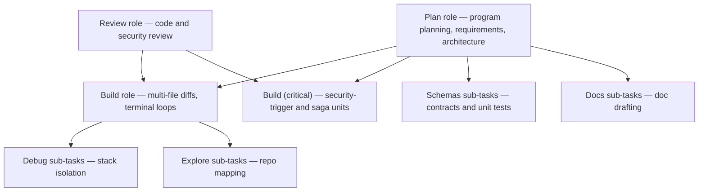

# Model routing matrix (agents-v0)

The kit routes by **role**, not by vendor. Each row lists the model ID per platform. Provider-qualified Kilo IDs are examples — adapt them to your `kilo.json` providers (`kilo`, `anthropic`, `openrouter`, `google`, ...). Claude Code uses model aliases. The agent frontmatter carries all three (`model:`, `model_kilo:`, `model_claude:`) and each tool's adapter emits its own.

| Role                 | Purpose                                                              | Cursor ID                | Kilo ID (`provider/model`)           | Claude Code |
| -------------------- | -------------------------------------------------------------------- | ------------------------ | ------------------------------------ | ----------- |
| **Plan**             | program planning, requirements, architecture, UX design              | `claude-sonnet-5-5-high` | `anthropic/claude-sonnet-5.5`        | `sonnet`    |
| **Build**            | services, BFF, frontend, tests, maintenance, release                 | `composer-2.5`           | `z-ai/glm-5.3-flash`                 | `sonnet`    |
| **Build (critical)** | units that hit a security-review trigger, and sagas or consumers     | `claude-sonnet-5-5-high` | `anthropic/claude-sonnet-5.5`        | `opus`      |
| **Review**           | code review and security review, independent of the Build role       | `claude-sonnet-5-5-high` | `anthropic/claude-sonnet-5.5`        | `opus`      |
| **Explore**          | repo exploration sub-tasks                                           | `composer-2.5`           | `z-ai/glm-5.3-flash`                 | `haiku`     |
| **Debug**            | runtime failure root-cause                                           | `grok-4.7-xhigh`         | `x-ai/grok-4.7`                      | `sonnet`    |
| **Schemas**          | schema/unit-test sub-tasks                                           | `composer-2.5`           | `z-ai/glm-5.3-flash`                 | `sonnet`    |
| **Docs**             | doc drafting sub-tasks                                               | `composer-2.5`           | `z-ai/glm-5.3-flash`                 | `haiku`     |

## Task execution architecture

## Critical units

The Build role is a fast, inexpensive model. Some units are where a wrong answer is costly: authentication and authorization, uploads, public routes, sagas, and event consumers. A unit is **critical** when the requirements artifact lists a security-review trigger for it, or when the story implements a saga or a consumer (`implement-messaging`). `/build` launches the build agent for a critical unit, and `/maintain` the maintenance agent for a fix that touches one, with the **Build (critical)** row: pass the Plan-role model ID for the tool as the model override of that launch. The agent file is unchanged. Other units stay on the Build role.

## Independence of the reviewers

A reviewer should not be the model that wrote the code. In Cursor and Kilo the Review role is stronger than the Build role. In Claude Code every Build role is `sonnet`, so the Review role is `opus`; `security-reviewer`, `code-reviewer`, and `design-reviewer` carry `model_claude: opus`. The test author (`test-engineer`) stays on the Build role; the Review role judges its tests in the code review.

## Kit agent mapping (19 agents)

| Kit agent            | Role    | `model:` (cursor)        | `model_kilo:`                        | `model_claude:` |
| -------------------- | ------- | ------------------------ | ------------------------------------ | --------------- |
| program-planner      | Plan    | `claude-sonnet-5-5-high` | `anthropic/claude-sonnet-5.5`        | `sonnet`        |
| codebase-documenter  | Plan    | `claude-sonnet-5-5-high` | `anthropic/claude-sonnet-5.5`        | `sonnet`        |
| requirements-analyst | Plan    | `claude-sonnet-5-5-high` | `anthropic/claude-sonnet-5.5`        | `sonnet`        |
| solution-architect   | Plan    | `claude-sonnet-5-5-high` | `anthropic/claude-sonnet-5.5`        | `sonnet`        |
| ux-designer          | Plan    | `claude-sonnet-5-5-high` | `anthropic/claude-sonnet-5.5`        | `sonnet`        |
| security-reviewer    | Review  | `claude-sonnet-5-5-high` | `anthropic/claude-sonnet-5.5`        | `opus`          |
| code-reviewer        | Review  | `claude-sonnet-5-5-high` | `anthropic/claude-sonnet-5.5`        | `opus`          |
| design-reviewer      | Review  | `claude-sonnet-5-5-high` | `anthropic/claude-sonnet-5.5`        | `opus`          |
| backend-engineer     | Build   | `composer-2.5`           | `z-ai/glm-5.3-flash`                 | `sonnet`        |
| bff-engineer         | Build   | `composer-2.5`           | `z-ai/glm-5.3-flash`                 | `sonnet`        |
| frontend-engineer    | Build   | `composer-2.5`           | `z-ai/glm-5.3-flash`                 | `sonnet`        |
| test-engineer        | Build   | `composer-2.5`           | `z-ai/glm-5.3-flash`                 | `sonnet`        |
| maintenance-engineer | Build   | `composer-2.5`           | `z-ai/glm-5.3-flash`                 | `sonnet`        |
| release-manager      | Build   | `composer-2.5`           | `z-ai/glm-5.3-flash`                 | `sonnet`        |
| explore-researcher   | Explore | `composer-2.5`           | `z-ai/glm-5.3-flash`                 | `haiku`         |
| debug-investigator   | Debug   | `grok-4.7-xhigh`         | `x-ai/grok-4.7`                      | `sonnet`        |
| schema-author        | Schemas | `composer-2.5`           | `z-ai/glm-5.3-flash`                 | `sonnet`        |
| docs-author          | Docs    | `composer-2.5`           | `z-ai/glm-5.3-flash`                 | `haiku`         |
| orchestrator         | Plan    | `claude-sonnet-5-5-high` | `anthropic/claude-sonnet-5.5`        | `sonnet`        |

## Skill-launched tasks (no agent file)

| Skill                               | Purpose                          | Cursor ID        | Kilo ID                              | Claude Code |
| ----------------------------------- | -------------------------------- | ---------------- | ------------------------------------ | ----------- |
| spec-intake, bugfix-triage          | repo exploration                 | `composer-2.5`   | `z-ai/glm-5.3-flash`                 | `haiku`     |
| bugfix-triage                       | runtime failure root-cause       | `grok-4.7-xhigh` | `x-ai/grok-4.7`                      | `sonnet`    |
| contract-first-design, quality-gate | schemas + single-file unit tests | `composer-2.5`   | `z-ai/glm-5.3-flash`                 | `sonnet`    |
| ux-design                           | UX spec authoring                | `composer-2.5`   | `z-ai/glm-5.3-flash`                 | `haiku`     |
| doc-sync                            | doc drafting                     | `composer-2.5`   | `z-ai/glm-5.3-flash`                 | `haiku`     |

## Notes

- Chat-mode / picker models (Plan, Ask, Debug in Cursor; model switch in Kilo and Claude Code) cannot be enforced by the kit in any tool — the agent frontmatter and command routing hold regardless of the picker.
- A subagent file carries one model per tool; matrix fallbacks are manual. The Build (critical) override is applied by the launcher (`/build`), not by a second agent file.
- `/deliver` prefers the `orchestrator` (Plan role), which launches phase agents so Plan/Build routing holds regardless of the picker.
- Rules and skills reference roles and `docs/model-routing-matrix.md`, never tool-specific model IDs; only this matrix and the adapters carry concrete IDs.
- `scripts/validate-kit.sh` checks each agent's Cursor ID against its exact matrix row and requires the `model_kilo:`/`model_claude:` fields; it does not verify live model availability in any tool.
