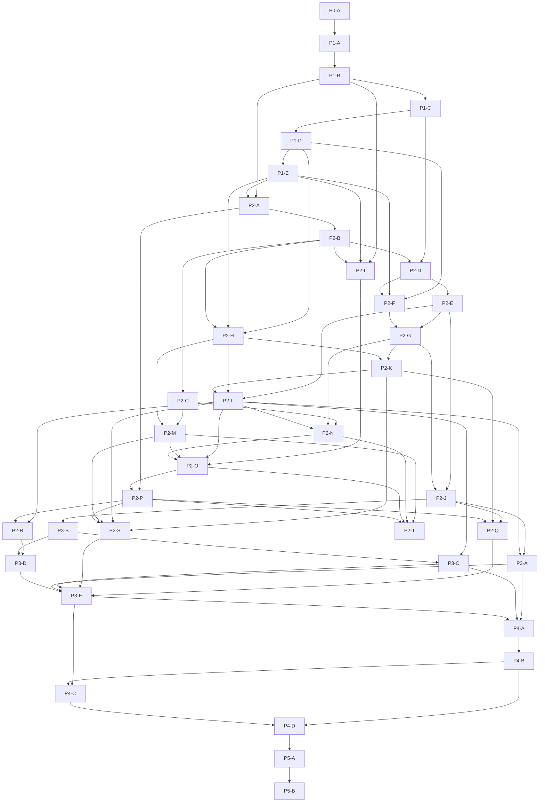

I have launched the `program-planner` subagent to decompose the approved roadmap and system architecture into concrete milestone manifests and `docs/agents-v0/milestones/plan.md`. Waiting for the subagent to complete.
Program planning (`/v0-plan`) is complete and is now **awaiting your approval**.

### Updated Artifacts
- **Program Plan Index:** [plan.md](file:///home/e2e/agents-v0-e2e/run-20261029-1629/work/portal/docs/agents-v0/milestones/plan.md)
- **Phase Result:** [plan.phase-result.md](file:///home/e2e/agents-v0-e2e/run-20261029-1629/work/portal/docs/agents-v0/milestones/plan.phase-result.md)
- **Program State:** [program.state.json](file:///home/e2e/agents-v0-e2e/run-20261029-1629/work/portal/docs/agents-v0/program.state.json) (`activePhase: "plan"`, `activeStatus: "awaiting_approval"`)
- **Milestone Manifests:**
  - [p0-platform-skeleton.md](file:///home/e2e/agents-v0-e2e/run-20261029-1629/work/portal/docs/agents-v0/milestones/p0-platform-skeleton.md) (`P0-A`)
  - [p1-contracts-and-data-models.md](file:///home/e2e/agents-v0-e2e/run-20261029-1629/work/portal/docs/agents-v0/milestones/p1-contracts-and-data-models.md) (`P1-A` – `P1-E`)
  - [p2-mvp-core-features.md](file:///home/e2e/agents-v0-e2e/run-20261029-1629/work/portal/docs/agents-v0/milestones/p2-mvp-core-features.md) (`P2-A` – `P2-T`, including cross-context integration stories `P2-J` – `P2-O` and React SPA stories `P2-P` – `P2-T`)
  - [p3-feature-expansion.md](file:///home/e2e/agents-v0-e2e/run-20261029-1629/work/portal/docs/agents-v0/milestones/p3-feature-expansion.md) (`P3-A` – `P3-E`, `Next` and `Later` horizons)
  - [p4-hardening.md](file:///home/e2e/agents-v0-e2e/run-20261029-1629/work/portal/docs/agents-v0/milestones/p4-hardening.md) (`P4-A` – `P4-D`, closing all 8 SLO and RPO/RTO rows in [nfr-slo.md](file:///home/e2e/agents-v0-e2e/run-20261029-1629/work/portal/docs/agents-v0/design/system/nfr-slo.md), VAPT retest, and rollback/fault injection)
  - [p5-release-readiness.md](file:///home/e2e/agents-v0-e2e/run-20261029-1629/work/portal/docs/agents-v0/milestones/p5-release-readiness.md) (`P5-A` – `P5-B`, closing all 10 items in [ops-readiness.md](file:///home/e2e/agents-v0-e2e/run-20261029-1629/work/portal/docs/agents-v0/design/system/ops-readine
<truncated 1423 bytes>
ace propagation, capacity baseline, backup restore drills, CI supply-chain audit, and 10-item ops-readiness go/no-go closure. |

---

Please review [plan.md](file:///home/e2e/agents-v0-e2e/run-20261029-1629/work/portal/docs/agents-v0/milestones/plan.md) and the milestone manifests under `docs/agents-v0/milestones/`. Reply with your explicit approval (including your approver name) so I can append the `plan` approval rows to each manifest and record the approval in `docs/agents-v0/program.state.json`.
Program planning (`/v0-plan`) is complete and is now **awaiting your approval**.

### Updated Artifacts
- **Program Plan Index:** [plan.md](file:///home/e2e/agents-v0-e2e/run-20261029-1629/work/portal/docs/agents-v0/milestones/plan.md)
- **Phase Result:** [plan.phase-result.md](file:///home/e2e/agents-v0-e2e/run-20261029-1629/work/portal/docs/agents-v0/milestones/plan.phase-result.md)
- **Program State:** [program.state.json](file:///home/e2e/agents-v0-e2e/run-20261029-1629/work/portal/docs/agents-v0/program.state.json) (`activePhase: "plan"`, `activeStatus: "awaiting_approval"`)
- **Milestone Manifests:**
  - [p0-platform-skeleton.md](file:///home/e2e/agents-v0-e2e/run-20261029-1629/work/portal/docs/agents-v0/milestones/p0-platform-skeleton.md) (`P0-A`)
  - [p1-contracts-and-data-models.md](file:///home/e2e/agents-v0-e2e/run-20261029-1629/work/portal/docs/agents-v0/milestones/p1-contracts-and-data-models.md) (`P1-A` – `P1-E`)
  - [p2-mvp-core-features.md](file:///home/e2e/agents-v0-e2e/run-20261029-1629/work/portal/docs/agents-v0/milestones/p2-mvp-core-features.md) (`P2-A` – `P2-T`, including cross-context integration stories `P2-J` – `P2-O` and React SPA stories `P2-P` – `P2-T`)
  - [p3-feature-expansion.md](file:///home/e2e/agents-v0-e2e/run-20261029-1629/work/portal/docs/agents-v0/milestones/p3-feature-expansion.md) (`P3-A` – `P3-E`, `Next` and `Later` horizons)
  - [p4-hardening.md](file:///home/e2e/agents-v0-e2e/run-20261029-1629/work/portal/docs/agents-v0/milestones/p4-hardening.md) (`P4-A` – `P4-D`, closing all 8 SLO and RPO/RTO rows in [nfr-slo.md](file:///home/e2e/agents-v0-e2e/run-20261029-1629/work/portal/docs/agents-v0/design/system/nfr-slo.md), VAPT retest, and rollback/fault injection)
  - [p5-release-readiness.md](file:///home/e2e/agents-v0-e2e/run-20261029-1629/work/portal/docs/agents-v0/milestones/p5-release-readiness.md) (`P5-A` – `P5-B`, closing all 10 items in [ops-readiness.md](file:///home/e2e/agents-v0-e2e/run-20261029-1629/work/portal/docs/agents-v0/design/system/ops-readine
<truncated 1423 bytes>
ace propagation, capacity baseline, backup restore drills, CI supply-chain audit, and 10-item ops-readiness go/no-go closure. |

---

Please review [plan.md](file:///home/e2e/agents-v0-e2e/run-20261029-1629/work/portal/docs/agents-v0/milestones/plan.md) and the milestone manifests under `docs/agents-v0/milestones/`. Reply with your explicit approval (including your approver name) so I can append the `plan` approval rows to each manifest and record the approval in `docs/agents-v0/program.state.json`.
