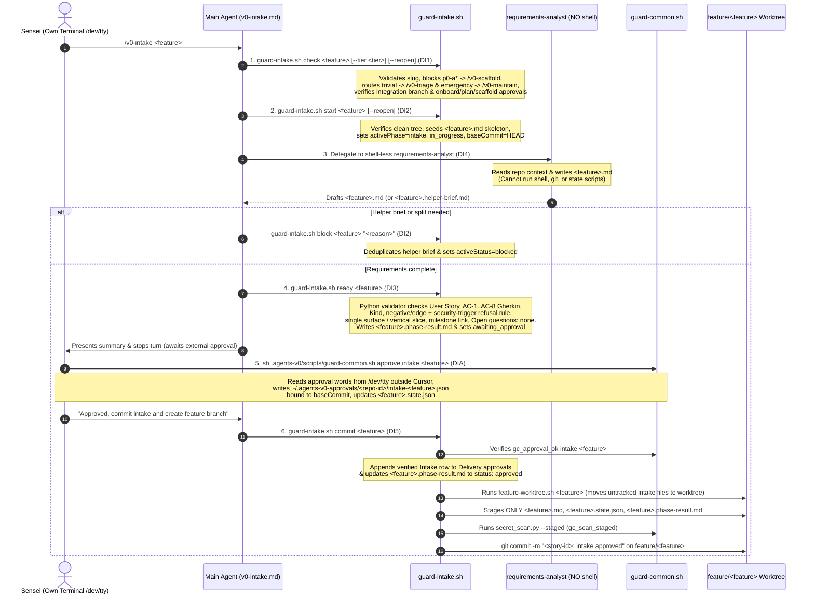

# Sai's 1-Page Design Specification: /v0-intake Redesign

**Date:** 2026-11-05 (Manila UTC+8)  
**Author:** Sai (Architecture & Design Spec, Team 7c)  
**Context:** Redesigning `/v0-intake` (`core/common/commands/v0-intake.md`, `templates/.agents-v0/scripts/guard-intake.sh`, `core/common/agents/requirements-analyst.md`, and `core/common/skills/spec-intake/SKILL.md`) to enforce the Guard + External Approval architecture across parameterized feature stories (`<feature>`).

---

## 1. Problem Statement & Findings Addressed

Unlike program-level phases (`onboard`, `roadmap`, `architecture`, `plan`, `scaffold`) which operate on singleton repository state files, **`/v0-intake` is the entry gate to the parameterized per-story lifecycle (`<feature>`)** and bridges the integration branch (`main`) to the isolated story worktree (`feature/<feature>`). Our audit identified 8 findings (`FI1`–`FI8`):

1. **FI1 (Agent Self-Approval Vulnerability):** `v0-intake.md` step 6 currently instructs the agent to append the `Intake` row to `## Delivery approvals` and run `sync-feature-state.sh --approve intake --clear-active`. Sensei must approve in his own terminal outside Cursor (`sh .agents-v0/scripts/guard-common.sh approve intake <feature>`), recording `~/.agents-v0-approvals/<repo-id>/intake-<feature>.json` bound to `baseCommit`.
2. **FI2 (Unsafe `git add -A` & Split-Turn Worktree Drift):** `v0-intake.md` step 7 currently instructs the agent to run `feature-worktree.sh <feature>` and `git add -A && git commit -m "<story>: intake approved"`. `guard-intake.sh commit <feature>` must deterministically verify Sensei's external approval record, write the verified `Intake` approval row into `docs/agents-v0/requirements/<feature>.md`, update `<feature>.phase-result.md` to `status: approved`, create/attach the `feature/<feature>` worktree via `feature-worktree.sh <feature>`, move untracked intake artifacts into the worktree, stage only the story's explicit intake paths, run `secret_scan.py --staged`, and commit `"<story-id>: intake approved"` on `feature/<feature>`.
3. **FI3 (Prose-Only Requirements & Gherkin AC Validation):** Gherkin acceptance criteria (`AC-1`..`AC-8`), `Kind: happy | negative | edge`, negative/edge scenario enforcement, security-review trigger refusal checks, vague `Then` clause detection, single-surface / vertical-slice budgets, milestone link checks, and `Open questions: none` are currently enforced only by prompt prose. `guard-intake.sh ready <feature>` must validate all of them deterministically in Python before setting `awaiting_approval`.
4. **FI4 (`requirements-analyst` Subagent Has Shell Access):** `core/common/agents/requirements-analyst.md` currently grants `- shell` in its frontmatter tools list. The subagent only reads repository markdown/code and writes `docs/agents-v0/requirements/<feature>.md` (or `<feature>.helper-brief.md`). Removing `- shell` enforces least privilege.
5. **FI5 (Unenforced Upstream Program/Scaffold/Brownfield Prerequisites):** Starting `/v0-intake` currently relies on agent prose to check whether brownfield onboarding (`/v0-onboard`), milestone planning (`/v0-plan`), or greenfield platform scaffolding (`/v0-scaffold`) is approved, or whether `<feature>` is `p0-a*` (which now belongs to `/v0-scaffold`) or already released. `guard-intake.sh check <feature>` must enforce these prerequisites fail-closed on the integration branch.
6. **FI6 (Change-Tier Routing & Helper-Brief Deduplication):** Trivial changes (`--tier trivial` $\to$ `/v0-triage`) and production hotfixes (`--tier emergency` $\to$ `/v0-maintain`) must be routed deterministically before creating story artifacts, and repeated helper briefs (`<feature>.helper-brief.md`) must be deduplicated by the guard.
7. **FI7 (Internal Script Exposure in `v0-intake.md`):** `core/common/commands/v0-intake.md` exposes `sync-feature-state.sh`, `check-gate-commit.sh`, and `git add -A`. Its command steps should be generated byte-for-byte from `guard-intake.sh steps` via `scripts/generate-intake-steps.sh`.
8. **FI8 (Unverified External Approval on `/v0-design` Entry):** `/v0-design` (`v0-design.md` and `sync-feature-state.sh`) must verify that the `intake` phase has a valid external approval record (`gc_approval_ok intake <feature>`) and committed gate on `feature/<feature>` before starting design.

---

## 2. Architecture & Sequential Design Lines (`DI1`–`DI8`, `DIA`)

- **`DI1` (`Design: DI1`): Guard Check, Parameterized Gate Rules, and Prerequisite Enforcement**
  - Add `[intake]` section to `templates/.agents-v0/gate-rules` with `<feature>` placeholder paths (`docs/agents-v0/requirements/<feature>.state.json`, `docs/agents-v0/requirements/<feature>.md`, `docs/agents-v0/requirements/<feature>.phase-result.md`).
  - Implement `guard-intake.sh check <feature> [--tier trivial|emergency|standard|major] [--reopen]`:
    - Validates `<feature>` slug (`^[a-z0-9][a-z0-9-]*$`); rejects `p0-a*` with redirect to `/v0-scaffold`.
    - Routes `--tier trivial` to `/v0-triage` and `--tier emergency` to `/v0-maintain` before touching disk.
    - Verifies current checkout is on the integration branch (`resolve-integration-branch.sh`).
    - Brownfield check: if `docs/agents-v0/onboarding/state.json` exists, requires `gc_approval_ok onboard`.
    - Program/Scaffold check: if `docs/agents-v0/program.state.json` or `docs/agents-v0/milestones/plan.md` exists, requires `plan` approved (`gc_approval_ok plan`); if greenfield (`docs/agents-v0/milestones/p0-platform-skeleton.md` present and not brownfield), requires `scaffold` approved (`gc_approval_ok scaffold`).
    - Story state check: refuses if `<feature>` already has `release` in `approvedPhases`; refuses if `intake` is already in `approvedPhases` unless `--reopen` is passed.
  - Register `.agents-v0/scripts/guard-intake.sh` in `scripts/install.sh` and extend `commit-msg` / `validate-kit.sh` for `Design: DI[0-9]+|DIA`.

- **`DI2` (`Design: DI2`): Guard Start, Helper-Brief Check, and Block State Transitions**
  - Implement `guard-intake.sh start <feature> [--reopen]`: runs `check`, verifies clean or intake-scoped working tree, seeds `docs/agents-v0/requirements/<feature>.md` skeleton if absent, records `baseCommit`, `activePhase=intake`, `activeStatus=in_progress` in `docs/agents-v0/requirements/<feature>.state.json`.
  - Implement `guard-intake.sh block <feature> "<reason>"`: records `activeStatus=blocked` and `blockedReason` (and checks `<feature>.helper-brief.md` deduplication when a helper brief is present).

- **`DI3` (`Design: DI3`): Guard Ready — Deterministic Requirements & Gherkin AC Validator**
  - Implement `guard-intake.sh ready <feature>`:
    - Verifies `As a <role>, I want <goal>, so that <benefit>.` user story sentence with no unresolved placeholders (`<...>`, `[role]`, `TBD`, `TODO`).
    - Verifies Gherkin acceptance criteria `### AC-1`..`### AC-N` ($1 \le N \le 8$, contiguous numbering), each with `Kind: happy | negative | edge` and `Given` / `When` / `Then` lines, rejecting vague `Then` clauses (`works as expected`, `is handled properly`, `is processed`, `succeeds`).
    - Enforces negative/edge rule: at least one `Kind: negative` or `Kind: edge` (or `Negatives: N/A: <reason>` when all security triggers are `no`); if any security trigger (auth, untrusted input, sensitive data, external call, state-changing endpoint) is `yes`, requires at least one refusing `Kind: negative` AC and forbids `Negatives: N/A`.
    - Enforces story size & surface rule: `Surfaces:` lists one surface (`backend`, `bff`, or `frontend`) unless `Vertical slice: yes`; refuses if `## Proposed split` is present (directs to `block`); checks milestone story ID and size alignment when a milestone file links `<feature>`.
    - Verifies mandatory sections (`## Preconditions`, `## Desk check` with `Material: yes | no`, `## Out of scope`, `## Non-functional requirements`, `## Applicable regulations`, `## Security-review triggers`, `## UX requirements` when `frontend` surface is in scope, and `Open questions: none`).
    - Writes `docs/agents-v0/requirements/<feature>.phase-result.md` (`status: awaiting_approval`) and transitions `<feature>.state.json` to `awaiting_approval` with `baseCommit=HEAD`.

- **`DIA` (`Design: DIA`): Parameterized External Approval Gate in `guard-common.sh` & `sync-feature-state.sh`**
  - Extend `guard-common.sh` (`gc_rule`, `gc_approval_file`, `gc_approve`, `gc_approval_ok`) to accept an optional `<feature>` parameter for story-scoped commands (`sh .agents-v0/scripts/guard-common.sh approve intake <feature>`), writing `~/.agents-v0-approvals/<repo-id>/intake-<feature>.json` and updating `docs/agents-v0/requirements/<feature>.state.json`.
  - In `sync-feature-state.sh`: refuse `--approve intake` when `AGENTS_V0_REQUIRE_EXTERNAL_APPROVAL=1` or when `<feature>.phase-result.md` was generated by `guard-intake.sh` unless `gc_approval_ok intake <feature>` succeeds (preserving legacy fixture compatibility when `guard-intake.sh` was not used).

- **`DI4` (`Design: DI4`): Shell-less `requirements-analyst` Subagent**
  - Remove `- shell` from `core/common/agents/requirements-analyst.md` frontmatter and add `requirements-analyst` to the shell-less subagent enforcement list in `scripts/validate-kit.sh`.
  - Update `core/common/skills/spec-intake/SKILL.md` so the subagent focuses purely on authoring `docs/agents-v0/requirements/<feature>.md` (or `<feature>.helper-brief.md`) without running shell scripts or writing `Delivery approvals` rows.

- **`DI5` (`Design: DI5`): Guard Commit with Worktree Handoff, Safe Path Staging, and Secret Scan**
  - Implement `guard-intake.sh commit <feature>`:
    - Verifies `gc_approval_ok intake <feature>` and `lastApprovedPhase=intake`.
    - Appends the verified `| Intake | Approved | <approver> (<words>) | <date> |` row to `## Delivery approvals` in `docs/agents-v0/requirements/<feature>.md` and updates `<feature>.phase-result.md` to `status: approved`.
    - Invokes `feature-worktree.sh <feature>` from the integration branch to create/attach the `../<repo>-<feature>` worktree on branch `feature/<feature>` and relocate the untracked intake files into the worktree.
    - Inside the `feature/<feature>` worktree, stages only `docs/agents-v0/requirements/<feature>.md`, `docs/agents-v0/requirements/<feature>.state.json`, and `docs/agents-v0/requirements/<feature>.phase-result.md`, runs `secret_scan.py --staged`, and commits `"<story-id>: intake approved"` (resolving `<story-id>` from the milestone table or defaulting to `<feature>`).

- **`DI6` (`Design: DI6`): Generated Step Block in `/v0-intake` Command Prose**
  - Implement `guard-intake.sh steps` and `scripts/generate-intake-steps.sh`.
  - Regenerate `core/common/commands/v0-intake.md` with the generated step block and no internal script leakage.

- **`DI7` (`Design: DI7`): Harden `/v0-design` Handoff**
  - Update `core/common/commands/v0-design.md` and `templates/.agents-v0/scripts/sync-feature-state.sh` so starting `design` verifies the committed intake gate on `feature/<feature>` and checks `gc_approval_ok intake <feature>` when an intake phase-result is present.

- **`DI8` (`Design: DI8`): Automated Test Suites & Tier 1 Validation**
  - Create `scripts/test-intake-steps.sh` and `scripts/test-guard-intake.sh`.
  - Wire step drift checks, forbidden-internal-token checks, and guard tests into `scripts/validate-kit.sh`.

---

## 3. Current State vs. Future State Diagrams for `/v0-intake`

### 3.1 Current State Flow (`/v0-intake` Before Redesign)

```mermaid
sequenceDiagram
    autonumber
    actor Sensei as Sensei (Developer)
    participant Orch as Main Agent (v0-intake.md)
    participant Sub as requirements-analyst (HAS - shell)
    participant Sync as sync-feature-state.sh
    participant Git as Git / feature-worktree.sh

    Sensei->>Orch: /v0-intake <feature>
    Note over Orch: Prose-only checks for tier, onboard/plan/scaffold,<br/>and whether story is already released (FI5, FI6)
    Orch->>Sync: sync-feature-state.sh <feature>.md --active-phase intake --status in_progress
    Orch->>Sub: Delegate to requirements-analyst (spec-intake)
    Note over Sub: Subagent has - shell tool access (FI4)<br/>Drafts <feature>.md; Gherkin AC & security triggers<br/>checked only by LLM self-review (FI3)
    Sub-->>Orch: Returns draft <feature>.md (or .helper-brief.md)
    Orch->>Sync: sync-feature-state.sh <feature>.md --active-phase intake --status awaiting_approval
    Orch->>Sensei: Presents requirements summary in chat
    Sensei->>Orch: Replies "Approved" in chat
    Note over Orch,Sync: VULNERABILITY (FI1): Agent self-writes Delivery approvals row<br/>and runs --approve intake without external /dev/tty record!
    Orch->>Sync: sync-feature-state.sh <feature>.md --approve intake --clear-active
    Orch->>Sensei: Asks to authorise branch feature/<feature>
    Sensei->>Orch: Authorises branch
    Orch->>Git: sh .agents-v0/scripts/feature-worktree.sh <feature>
    Note over Orch,Git: RISK (FI2): Agent runs `git add -A` inside worktree<br/>with no secret_scan.py --staged check!
    Orch->>Git: cd ../<repo>-<feature> && git add -A && git commit -m "<story>: intake approved"
```

### 3.2 Future State Flow (`/v0-intake` After Redesign — `DI1`–`DI8`, `DIA`)



### 3.3 Story Intake State Machine & Approval Binding

```mermaid
stateDiagram-v2
    [*] --> Checked: guard-intake.sh check <feature>\n(Integration branch + upstream gates verified)
    Checked --> InProgress: guard-intake.sh start <feature>\n(activePhase=intake, activeStatus=in_progress, baseCommit=HEAD)
    InProgress --> Blocked: guard-intake.sh block <feature> "<reason>"\n(Helper brief / Proposed split / Scope conflict)
    Blocked --> InProgress: guard-intake.sh start <feature>\n(After Sensei answers helper brief / confirms split)
    InProgress --> AwaitingApproval: guard-intake.sh ready <feature>\n(All Gherkin ACs, security triggers & sections pass;\nwrites <feature>.phase-result.md)
    AwaitingApproval --> ExternallyApproved: Sensei runs in /dev/tty:\nguard-common.sh approve intake <feature>\n(Writes intake-<feature>.json + lastApprovedPhase=intake)
    ExternallyApproved --> CommittedOnFeatureBranch: guard-intake.sh commit <feature>\n(Creates feature/<feature> worktree, stages 3 paths,\nscans secrets, commits "<story-id>: intake approved")
    CommittedOnFeatureBranch --> [*]: Ready for /v0-design in ../<repo>-<feature>
```
