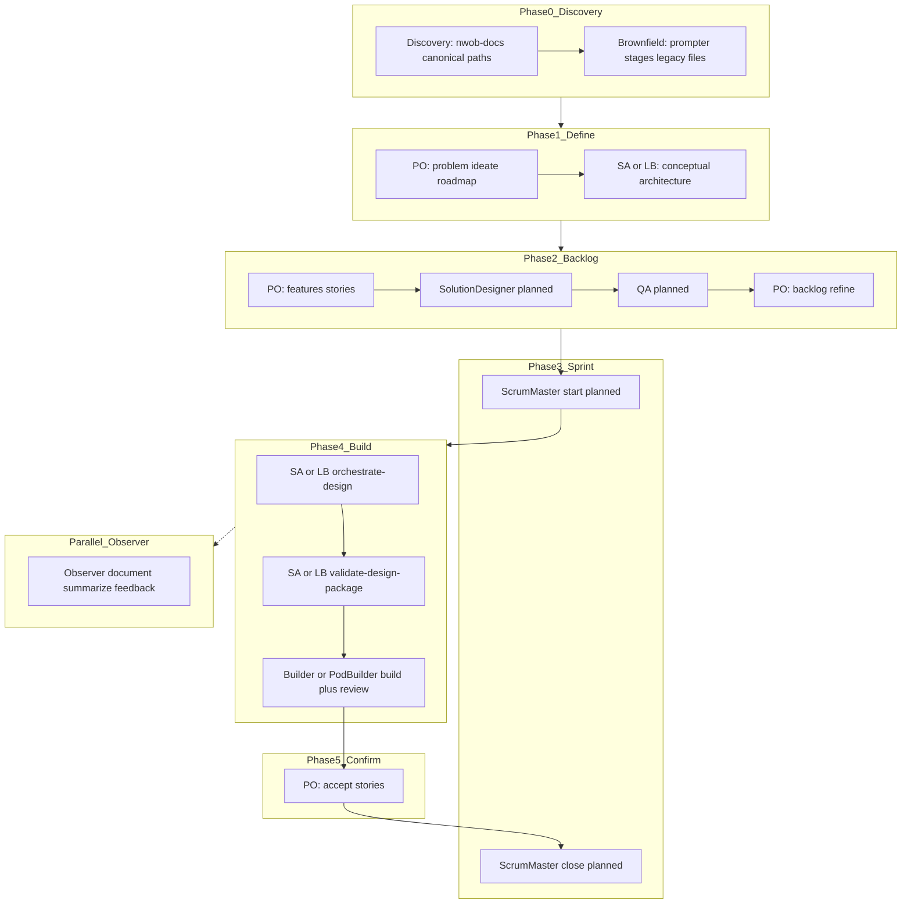

# NWOB Agent Skills

**Enterprise Product Owner, Solution Architect, Lead Builder, Builder, Pod Builder, and Observer skills for AI coding agents.**

Skills encode constitution-compliant workflows for spec-driven delivery, backlog management, enterprise architecture, leader-facing presentations, AI-assisted implementation, pod co-design/audit, and pilot observation. Packaged so AI agents follow them consistently across product, architecture, presentation, build, and pilot engagements.

See [Agent Orchestration Workflow](#agent-orchestration-workflow) for how personas collaborate across the SDLC, including brownfield discovery and the `nwob-docs/` artifact standard. Cross-persona SDLC reference: [references/rules/sdlc-role-matrix.md](references/rules/sdlc-role-matrix.md). **Get started:** [Project initialization](#project-initialization) · **Cursor IDE:** [Cursor setup](#cursor-setup).

---

## Commands

Slash commands are user-facing entry points. Each activates the corresponding skill.

### Product Owner


| What you're doing                              | Command     | Skill                               | Key principle                                                             |
| ---------------------------------------------- | ----------- | ----------------------------------- | ------------------------------------------------------------------------- |
| Define the business problem (+ initial intake) | `/problem`  | `business-problem-identification`   | Problem before solution; intent interview when vague                      |
| Generate viable solutions                      | `/ideate`   | `product-ideation`                  | Constrain before commit; structured ideation frameworks                   |
| Plan strategic direction                       | `/roadmap`  | `product-roadmap-creation`          | Foundation before features                                                |
| Break down into stories                        | `/features` | `feature-definition`                | Net-new stories; numbered AC in `epic-spec.md` (backlog index)                                 |
| Groom backlog / Jira CSV                       | `/backlog`  | `backlog-management-and-refinement` | Refine stories; parameterized `tickets.csv` for Jira                      |
| Optimize delivery flow                         | `/value`    | `value-stream-mapping`              | SDD gates are value, not waste                                            |
| Update presentation delivery params            | `/intake`   | `presentation-intake-update`        | Update only; initial intake in `/problem`                                 |
| Extract deck content from SDD                  | `/collect`  | `presentation-content-extraction`   | Extract only; tiered SDD gate                                             |
| Generate the deck artifact                     | `/present`  | `presentation-generation`           | Render from Content Record                                                |
| Polish HTML interactivity                      | `/enrich`   | `presentation-enrichment`           | HTML only; iterate until done                                             |
| End-to-end leader-facing deck                  | `/deck`     | Full present chain                  | Tiered gate: partial after `epic-spec.md` + intake; full adds masterplan/architecture (+ flat component plans when present) |


Skill boundaries: [references/rules/product-owner-skill-boundaries.md](references/rules/product-owner-skill-boundaries.md). Reference skill mapping: [references/rules/agent-skills-main-mapping.md](references/rules/agent-skills-main-mapping.md).

### Solution Architect and Lead Builder (co-equal)

Both personas install the same **14-skill** mirror and slash-command set. Do not deprecate Solution Architect.


| What you're doing                 | Command         | Skill                              | Key principle                                        |
| --------------------------------- | --------------- | ---------------------------------- | ---------------------------------------------------- |
| Architect-led SDD bootstrap       | `/define`       | `architect-led-sdd-intake`         | Single pass: `epic-spec.md` + intake          |
| Problem / solutions / roadmap     | `/problem` … `/roadmap` | PO author skills           | Incremental SDD when SA or LB persona active         |
| Stories from roadmap              | `/features`     | `feature-definition`               | Gherkin AC in `story-spec.md` (HL US/TS in `epic-spec.md`)                              |
| Presentation delivery params      | `/intake`       | `presentation-intake-update`       | Update params only                                   |
| C4 Context + Container diagrams   | `/c4`           | `architecture-governance`          | Diagram first; technology-agnostic; dual-persist     |
| Architectural pattern options ADR | `/pattern`      | `architecture-governance`          | ≥2 options; defaults ≠ limits; SA **or** LB author   |
| Cloud platform / MVP / network    | `/platform`     | `distributed-systems-architecture` | Defaults AWS/EKS unless ADR overrides                |
| Services / integration / data     | `/services`     | `distributed-systems-architecture` | Defaults EDA/Kafka; flat `sdd/components/{component-name}-plan.md`   |
| Contracts / patterns / fitness    | `/contracts`    | `architecture-delivery-enablement` | After `/services` or monolith ADR; OpenAPI SA **or** LB |
| SLOs / observability / go-live    | `/ops`          | `production-operations`            | Platform-adaptive observability                      |
| Material ADR                      | `/adr`          | `architecture-governance`          | Narrow scope; any decision; SA **or** LB             |
| ARC intake package                | `/arc`          | `architecture-governance`          | No full SDD required                                 |
| End-to-end architecture           | `/architecture` | Full SA/LB chain                   | C4 → pattern → platform → services → contracts → ops |
| Design workshop / design package | `/orchestrate-design` | `orchestrate-design`         | Strategy, architecture reconcile, design package |
| MR audit before QA handoff        | `/audit`        | `audit-and-approve-code`           | Peer gate on `MR_BRANCH`; SA **or** LB               |


Command standards: [references/rules/solution-architect-command-standards.md](references/rules/solution-architect-command-standards.md). Skill boundaries: [solution-architect-skill-boundaries.md](references/rules/solution-architect-skill-boundaries.md), [lead-builder-skill-boundaries.md](references/rules/lead-builder-skill-boundaries.md). See [agents/solution-architect.md](agents/solution-architect.md), [agents/lead-builder.md](agents/lead-builder.md).

### Observer


| What you're doing                          | Command      | Skill                    | Key principle                                                            |
| ------------------------------------------ | ------------ | ------------------------ | ------------------------------------------------------------------------ |
| Summarize current chat for pilot reporting | `/summarize` | `summarize-chat-session` | Context window only; metrics actual or unavailable                       |
| Process meeting notes or transcript        | `/meeting`   | `summarize-meeting`      | Upload to `nwob-docs/meetings/{YYYY-MM-DD}/`; summary to `observations/` |


Full command specifications: [references/rules/presentation-standards.md](references/rules/presentation-standards.md) (PO), [solution-architect-command-standards.md](references/rules/solution-architect-command-standards.md) (SA/LB). Sample config: [references/samples/presentation.config.md](references/samples/presentation.config.md) (copy to `.cursor/presentation.config.md`).

Builder skills activate by intent — no slash commands. See [agents/builder.md](agents/builder.md) and [Agent Orchestration Workflow](#agent-orchestration-workflow).

Pod Builder: narrowed story-level pod — **seven** skills (`co-design-solution` → `validate-design-package` → build → `/audit`); **no** `orchestrate-design`; **MUST NOT** author epic-spec, masterplan, architecture, components, ADRs, or OpenAPI. Author Sessions 1–4 (+ Session 6 on rework); `/audit` for Session 5 peer gate. See [agents/pod-builder.md](agents/pod-builder.md), [assigned-story workflow](docs/guides/assigned-story-workflow.md), and [Agent Orchestration Workflow](#agent-orchestration-workflow).

Observer skills: use `/summarize` for chat capture, `/meeting` for meeting notes and transcripts, `/handoff` for mentor packaging, or invoke other skills by intent. See [agents/observer.md](agents/observer.md) and [Agent Orchestration Workflow](#agent-orchestration-workflow).

Product Owner skills cover SDD authoring and leader-facing presentations. See [agents/product-owner.md](agents/product-owner.md).

---

## Project initialization

Bootstrap NWOB in a **target project** using `nwob init` (same layout as [Cursor setup](#cursor-setup)). Two ways to reference this repository — both run the same installer; choose based on whether you want the source pinned inside your git repo.


| Path                       | Source lives                                             | Best for                                                                                              | Pins version in target repo? |
| -------------------------- | -------------------------------------------------------- | ----------------------------------------------------------------------------------------------------- | ---------------------------- |
| **A — External reference** | Local clone anywhere (e.g. `~/repos/nwob-agent-skills`)  | One clone serving many projects; quick local dev                                                      | No                           |
| **B — In-repo reference**  | Git submodule at `nwob-agent-skills/` inside target repo | Team reproducibility; [Spec Kit](https://github.github.io/spec-kit/installation.html)–style vendoring | Yes (submodule SHA)          |


Both paths install persona-scoped assets into the target project (not a wholesale copy of this repo). Install walkthrough (scaffold vs no-scaffold): [installation.md](installation.md). Full ops guide: [docs/initialization.md](docs/initialization.md). **Requires Python 3.11+** for `setup-nwob.sh` and `pip install -e .` (see [Prerequisites](docs/initialization.md#prerequisites)).

### What `nwob init` installs


| Asset                 | Location                                                    |
| --------------------- | ----------------------------------------------------------- |
| Rules + samples       | `nwob-references/` (gitignored local copy)                  |
| Constitution core rule | `.cursor/rules/constitution-core.mdc` (`alwaysApply: true`. Phase 0, SDD gates, cross-platform principles) |
| Project constitution   | `.cursor/rules/constitution-custom.mdc` (`alwaysApply: true`. Project stack / overrides template) |
| Active persona skills | `.cursor/skills/<skill-name>/` (flat by frontmatter `name`) |
| Active persona rule   | `.cursor/rules/nwob-<persona>.mdc` + boundary `.mdc` files  |
| Agent orchestrator    | `agents/<persona>.md`                                       |
| Slash commands        | `.cursor/commands/`                                         |
| Artifact scaffold     | `nwob-docs/` directory tree                                 |
| State / templates     | `.nwob/manifest.json`, `.nwob/templates/`                   |


**Persona swap:** `nwob persona switch <id>` removes the prior persona's `.cursor/skills`, persona `.mdc` rules, and `agents/<old>.md`, then installs the target persona. Shared `nwob-references/`, `constitution-core.mdc`, and `constitution-custom.mdc` persist locally (gitignored except `constitution-custom.mdc`). Register additional personas with `nwob persona add <id>` (does not install cursor assets until switch).

### Path A — External reference (local clone)

The nwob source stays **outside** your project. Only installed artifacts land in the target repo.

**Convenience wrapper** — venv, install, and init in one step (local clone or GitLab/Git URL):

```bash
# Local clone
source /path/to/nwob-agent-skills/scripts/setup-nwob.sh \
  /path/to/nwob-agent-skills /path/to/your-project product-owner

# GitLab remote (HTTPS or SSH) — shallow-clones into ~/.cache/nwob-agent-skills
source /path/to/nwob-agent-skills/scripts/setup-nwob.sh \
  git@gitlab.example.com:org/nwob-agent-skills.git /path/to/your-project product-owner

# Pin a branch instead of the remote default
NWOB_SKILLS_REF=master source /path/to/nwob-agent-skills/scripts/setup-nwob.sh \
  https://gitlab.example.com/org/nwob-agent-skills.git /path/to/your-project product-owner
```

Accepted sources: local clone path, or `https://`, `http://`, `ssh://`, `git://`, `file://`, `git@host:org/repo.git`. Cache location overrides with `NWOB_CACHE_DIR`.

**Use `source`** so the virtual environment stays active and your shell ends up in the project directory. The script sets no shell options in your session, so errors return a status rather than closing the terminal.

**Default:** `setup-nwob.sh` skips the `nwob-docs/` scaffold (`--no-scaffold-docs`). Init writes `.nwob/artifact-paths.json` with SDD keys only (`spec` required; `stories_dir` optional). Edit the mapping for existing SDD docs, then `nwob config paths --validate`. Greenfield projects that want the `nwob-docs/` tree: `NWOB_SCAFFOLD_DOCS=1 source setup-nwob.sh ...`

After init, `setup-nwob.sh` is copied to your project root for teammate re-runs:

```bash
source ./setup-nwob.sh /path/to/nwob-agent-skills . product-owner
```

Manual steps (equivalent):

```bash
# One-time: prepare clone
cd /path/to/nwob-agent-skills
python3 -m venv .venv && source .venv/bin/activate
pip install -e .   # installs `nwob` on PATH when venv is active

# Init target project
cd /path/to/your-project
/path/to/nwob-agent-skills/scripts/nwob-init.sh --here --persona product-owner
```

Alternative with explicit root (requires `nwob` on PATH — see [CLI not on PATH](#cli-not-on-path-after-init)):

```bash
export NWOB_SKILLS_ROOT=/path/to/nwob-agent-skills
nwob init --here --persona product-owner --integration cursor
```

`.nwob/manifest.json` records `nwob_skills_root` at init time for later upgrades.

### Path B — In-repo reference (git submodule)

Vendoring nwob-agent-skills inside your repo pins the submodule SHA for the team (similar to Spec Kit's git-based install).

```bash
cd /path/to/your-project

# Add pinned reference (remote URL or local path for testing)
git submodule add <nwob-agent-skills-url> nwob-agent-skills
git commit -m "Add nwob-agent-skills submodule"

# Init from vendored source (NWOB_SKILLS_ROOT set automatically by script)
./nwob-agent-skills/scripts/nwob-init.sh --here --persona product-owner
```

The submodule holds the **source**; `nwob init` still **copies** persona-scoped assets into `.cursor/`, `references/`, and `nwob-docs/` (same result as Path A).

**Upgrade when nwob releases:**

```bash
git submodule update --remote nwob-agent-skills
git add nwob-agent-skills && git commit -m "Bump nwob-agent-skills"
nwob persona switch product-owner --force   # or: nwob init --here --force
```

Requires `nwob` on PATH — see [CLI not on PATH](#cli-not-on-path-after-init) if missing.

**Monorepos:** submodule can live at repo root; run init with `--here` in the **member project** directory that should receive NWOB artifacts.

### Personas and flags


| Bundle ID            | Role                                                    |
| -------------------- | ------------------------------------------------------- |
| `product-owner`      | SDD authoring + presentations (default)                 |
| `solution-architect` | Co-equal with LB — 14 skills (`/define`, `/c4` … `/architecture`, `/orchestrate-design`, `/audit`) |
| `lead-builder`       | Co-equal with SA — same 14-skill command/skill mirror   |
| `builder`            | Co-design, build, MR draft copy, resolve review comments   |
| `pod-builder`        | Story-level pod (7 skills; no `orchestrate-design`); `/audit` (Session 5 peer) |
| `observer`           | Pilot observation, `/summarize`, `/meeting`, `/handoff` |


| Flag                   | Purpose                                      |
| ---------------------- | -------------------------------------------- |
| `--persona <id>`       | Bundle to install (default: `product-owner`) |
| `--here`               | Initialize current directory                 |
| `--force`              | Overwrite managed files                      |
| `--integration cursor` | Install `.cursor/` stubs (default)           |


Inspect bundles: `nwob bundle info <persona>` · `nwob bundle list` — requires `nwob` on PATH; see [CLI not on PATH](#cli-not-on-path-after-init) if missing.

### After init

Requires `nwob` on PATH for the commands below — see [CLI not on PATH after init?](#cli-not-on-path-after-init) if you get `command not found`.

```bash
nwob doctor
nwob persona add lead-builder    # register (no cursor install until switch)
nwob persona switch lead-builder # swap active persona assets
```

Open Cursor; `constitution-core.mdc` and `constitution-custom.mdc` apply automatically (`alwaysApply: true`). Start with `/problem` (Product Owner) or `/persona` to switch roles.

### CLI not on PATH after init?

Init can succeed while `nwob`, `nwob doctor`, and `nwob --version` all fail with `command not found`. That is expected unless you installed the CLI separately.

#### Why this happens


| Observation                                 | Explanation                                                                                                                    |
| ------------------------------------------- | ------------------------------------------------------------------------------------------------------------------------------ |
| Init printed "Done"                         | `[nwob-init.sh](scripts/nwob-init.sh)` ran `python -m nwob_cli init` successfully (Python fallback when `nwob` is not on PATH) |
| `nwob: command not found`                   | The `nwob` console script was never `pip install`-ed into your **active** shell environment                                    |
| `nwob doctor` / `nwob --version` same error | Both invoke the same entry point (`nwob_cli.cli` in `[pyproject.toml](pyproject.toml)`) — not a broken project install         |


**Init and CLI install are separate steps.** `nwob init` copies artifacts into your **target project** (`.cursor/`, `references/`, `.nwob/`). It does **not** add `nwob` to your shell PATH or install the CLI into the target repo.

#### You do not need `nwob` for daily Cursor work

After a successful init, Cursor is ready without the CLI:

- Slash commands: `/problem`, `/persona`, `/switch`, etc.
- Skills under `.cursor/skills/`
- Rules: `constitution-core.mdc` + `constitution-custom.mdc` + active persona `.mdc`

Use the CLI only for **maintenance**: `nwob doctor`, `nwob persona switch`, and upgrades after submodule bumps.

#### Fix options

**Option A — Install CLI in nwob clone (recommended):**

```bash
cd /path/to/nwob-agent-skills   # or ./nwob-agent-skills for Path B
python3 -m venv .venv && source .venv/bin/activate
pip install -e .
nwob --version
nwob doctor --project /path/to/your-project
```

`nwob persona switch` reads `nwob_skills_root` from the target project's `.nwob/init-options.json` / `.nwob/manifest.json`, so a venv `nwob` binary does not need `PYTHONPATH` or `NWOB_SKILLS_ROOT` when you run it from (or `--project`) an initialized repo. Switch installs the new persona **before** removing the old one, and it does **not** rewrite `story-tasks.md` or SDD spec files.

**Option B — Run without installing (use manifest path):**

```bash
# Read the clone path recorded at init
cat /path/to/your-project/.nwob/manifest.json   # field: nwob_skills_root

export NWOB_SKILLS_ROOT=/path/from/manifest
PYTHONPATH=$NWOB_SKILLS_ROOT/src python3 -m nwob_cli --version
PYTHONPATH=$NWOB_SKILLS_ROOT/src python3 -m nwob_cli doctor --project /path/to/your-project
PYTHONPATH=$NWOB_SKILLS_ROOT/src python3 -m nwob_cli persona switch lead-builder --project /path/to/your-project
```

**Option C — Reuse init script (re-init only; no global `nwob`):**

```bash
/path/to/nwob-agent-skills/scripts/nwob-init.sh --here --persona product-owner --force
# Path B: ./nwob-agent-skills/scripts/nwob-init.sh --here --persona product-owner --force
```

The script wraps `init` only. Persona switch still needs Option A, Option B, or `/persona` in Cursor.

#### Quick verification without CLI

From your target project root:

```bash
ls .nwob/manifest.json .cursor/rules/constitution-core.mdc .cursor/rules/constitution-custom.mdc
```

If these exist, init succeeded — install or invoke the CLI only when you need doctor, persona switch, or upgrades.

---

## Cursor setup

How to install NWOB agents, rules, and skills into a **target project** using Cursor IDE. The user (or a slash command) is the orchestrator; personas do not invoke each other. See [AGENTS.md — Orchestration](AGENTS.md#orchestration-personas-skills-and-commands) and [sdlc-role-matrix.md](references/rules/sdlc-role-matrix.md).

### Three layers


| Layer      | Source in this repo                                   | Role                                                       | Cursor placement                                                                       |
| ---------- | ----------------------------------------------------- | ---------------------------------------------------------- | -------------------------------------------------------------------------------------- |
| **Agents** | `agents/*.md`                                         | **Who** — persona, orchestration order, artifact ownership | Project root `agents/` **or** `.cursor/rules/nwob-<role>.mdc` (one active per session) |
| **Skills** | `skills/<role>/<skill-name>/SKILL.md`                 | **How** — step-by-step workflows with verification         | `.cursor/skills/<skill-name>/SKILL.md`                                                 |
| **Rules**  | `references/rules/*.md`, `rules/constitution-core.mdc`, `rules/constitution-custom.mdc` | **What must hold** — boundaries, layouts, patterns         | Project root `references/` **and/or** `.cursor/rules/*.mdc`                            |


**Do not** copy `SKILL.md` into `.cursor/rules/`. Skills and rules serve different purposes: skills are invoked on intent; rules are persistent constraints.

Persona rules carry orchestration and perspective; full procedure lives in skills (see Solution Architect operating rule: *Skills over persona* in [agents/solution-architect.md](agents/solution-architect.md)).

### Target project layout

```
your-project/
├── .gitignore                         # Managed block — NWOB local output gitignored
├── nwob-references/                   # rules (gitignored local copy)
│   └── rules/
├── nwob-docs/                         # engagement artifacts (when scaffold enabled)
│   └── ...
├── .nwob/                             # manifest, templates (gitignored)
├── agents/                            # persona orchestrators (gitignored)
├── AGENTS.md                          # NWOB overlay (gitignored)
└── .cursor/
    ├── rules/
    │   ├── constitution-core.mdc      # local install (gitignored)
    │   ├── constitution-custom.mdc    # ONLY .cursor file intended for git commit
    │   └── nwob-product-owner.mdc
    ├── skills/
    └── commands/
```

Service code clones live under `repositories/{service-name}/` when the prompter creates them — not scaffolded by init/doctor. OpenAPI: `repositories/{service-name}/src/main/resources/swagger/`. Register clones in `nwob-docs/architecture/service-map.md`.

**Canonical files by persona** (paths relative to `nwob-docs/` or resolved artifact mapping):


| Persona            | Path                                            | Command / skill                   |
| ------------------ | ----------------------------------------------- | --------------------------------- |
| Product Owner      | `sdd/epic-spec.md`                                   | `/problem`, `/ideate`, `/roadmap` |
|                    | `sdd/stories/{STORY_ID}/story-spec.md`               | `/features`, `/backlog` (Gherkin) |
|                    | `presentations/intake-record.md`                | `/problem`, `/intake`             |
|                    | `presentations/{deck-name}.html|.md`            | `/present`, `/deck`               |
|                    | `process/{YYYY-MM-DD}-value-stream-{slug}.md`   | `/value`                          |
| Solution Architect **or** Lead Builder (co-equal) | `sdd/epic-spec.md` | `/define`, `/problem`, `/ideate`, `/roadmap` |
|                    | `sdd/stories/{STORY_ID}/story-spec.md`               | `/define`, `/features`            |
|                    | `presentations/intake-record.md`                | `/define`, `/problem`, `/intake`  |
|                    | `architecture/architecture.md` ↔ `sdd/masterplan.md` (dual-persist) | `/c4`, `/platform`, `/services`, `/architecture`, `/orchestrate-design` |
|                    | flat `sdd/components/{component-name}-plan.md` | `/services`, `/ops`, `/orchestrate-design` (legacy `architecture/components/` read-only) |
|                    | `architecture/network.md`                       | `/platform`, `/ops`               |
|                    | `architecture/service-map.md`                   | `/services`, `/contracts`         |
|                    | `architecture/adr/ADR-NNN-*.md`                 | `/pattern`, `/adr` (SA **or** LB) |
|                    | `diagrams/sequences/{service-name}.md`          | `/services`                       |
|                    | `repositories/{service-name}/src/main/resources/swagger/` | `/contracts` (SA **or** LB) |
|                    | `sdd/design-notes.md` (optional)                | `/orchestrate-design`             |
|                    | `sdd/design-package.md`                         | `/orchestrate-design`             |
|                    | `sdd/stories/{STORY_ID}/story-spec.md` (annex), `story-tasks.md` | `/orchestrate-design` / `co-design-solution` (co-author) |
|                    | `observations/audit-report.md`                  | `/audit`                          |
| Builder            | `sdd/stories/{STORY_ID}/story-spec.md` (technical annex)      | `co-design-solution` (primary)    |
|                    | `sdd/stories/{STORY_ID}/story-tasks.md`     | `co-design-solution` (primary)    |
|                    | `sdd/stories/{STORY_ID}/story-spec.md`      | `co-design-solution` (co-author when blocking) |
| Pod Builder        | `sdd/stories/{STORY_ID}/story-spec.md` (annex), `story-tasks.md` | Session 1 `co-design-solution` (primary); **MUST NOT** author epic/architecture/masterplan/components/ADRs/OpenAPI |
|                    | `sdd/stories/{STORY_ID}/story-spec.md`          | `co-design-solution` (co-author when blocking; flag material AC for PO) |
|                    | Design sign-off / build / MR draft / peer `/audit` | Sessions 1–6 (no `orchestrate-design`) |
| Observer           | `meetings/{YYYY-MM-DD}/`                        | upload; `/meeting` reads          |
|                    | `observations/{date}-ai-techniques-log.md`      | `document-ai-techniques`          |
|                    | `observations/{date}-{topic}-chat-summary.md`   | `/summarize`                      |
|                    | `observations/{date}-{meeting-slug}-summary.md` | `/meeting`                        |
|                    | `observations/{date}-workflow-feedback.md`      | `provide-workflow-feedback`       |
|                    | `observations/{date}-mentor-handoff.md`         | `/handoff`                        |


Full naming rules, Phase 0 discovery, and brownfield staging: [sdd-artifact-layout.md](references/rules/sdd-artifact-layout.md).

**Critical path rule:** Installed skills link to `../../../nwob-references/rules/...` from `.cursor/skills/<skill-name>/SKILL.md`. That resolves correctly **only if** `nwob-references/` lives at the **project root** (same depth as `.cursor/`). Do not move `nwob-references/` under `.cursor/`.

### Install paths

Use [Project initialization](#project-initialization) — **Path A** (external clone) or **Path B** (git submodule). Both use `nwob init` with persona-scoped bundles and manifest tracking.

**Advanced — manual copy:** only if the CLI is unavailable. Copy `AGENTS.md`, `agents/`, `references/`, and selected skills per the [phase-based install](#phase-based-install-minimal-vs-full) table below. Manual full copy installs **all** skills at once and bypasses persona swap — prefer `nwob init` when possible.

### `.cursor/skills/`

- Install under `.cursor/skills/<skill-name>/SKILL.md` using the skill `**name`** from YAML frontmatter (not the role folder).
- Copy the full skill directory; do not flatten `SKILL.md` alone.
- Cursor discovers skills via `description` in frontmatter — include trigger terms from the source file.
- Skills link to `references/rules/` at project root; keep `references/` in place when installing skills.

**Example:** `skills/product-owner/business-problem-identification/SKILL.md` → `.cursor/skills/business-problem-identification/SKILL.md`

### `.cursor/rules/`

Cursor rules are `.mdc` files with YAML frontmatter (`description`, `alwaysApply`, optional `globs`). Tiers:


| Tier                      | Purpose                                          | `alwaysApply`                                  | Examples                                                             |
| ------------------------- | ------------------------------------------------ | ---------------------------------------------- | -------------------------------------------------------------------- |
| **Constitution core**     | Phase 0, SDD gates, cross-platform principles    | `true`                                         | `constitution-core.mdc`                                              |
| **Project constitution**  | Stack versions, JIRA project key, coverage numbers, harness notes | `true`                                         | `constitution-custom.mdc` (project overrides template) |
| **Persona**               | Active role for the session                      | `false` (toggle in Cursor Rules UI)            | `nwob-product-owner.mdc`, `nwob-solution-architect.mdc`              |
| **Boundaries / patterns** | Role segregation, embed patterns                 | `false` (enable with persona or `@` on demand) | `product-owner-skill-boundaries.mdc`, `build-execution-patterns.mdc` |


Keep authoritative rule text in `references/rules/` at project root. Optionally mirror key files as `.mdc` for `alwaysApply` — accept brief duplication for Cursor injection, or `@references/rules/...` on demand instead.

**Persona rules from `agents/`:** Convert to `.mdc` under `.cursor/rules/`. Fix link paths: `../references/` in `agents/` becomes `../../references/` from `.cursor/rules/`.

**Example `constitution-core.mdc` (excerpt — NWOB operational core + cross-platform principles):**

```markdown
---
description: NWOB Phase 0 discovery, SDD gates, and cross-platform constitution core principles
alwaysApply: true
---

# NWOB Core

- On every engagement, run Phase 0 discovery per [sdd-artifact-layout.md](../../references/rules/sdd-artifact-layout.md).
- Read and write SDD artifacts at paths from `.nwob/artifact-paths.json` (or default `nwob-docs/sdd/`). Architecture and other non-SDD docs use fixed `nwob-docs/` paths.
- SDD gate: no build without resolved `spec`, `plan`, and `tasks` on disk.
- Follow [AGENTS.md](../../AGENTS.md) execution model: match intent to skill, follow skill workflow strictly.

# Constitution Core

## Architectural Principles
…
```

**Example `nwob-product-owner.mdc`:**

```markdown
---
description: Product Owner persona — SDD authoring, backlog, leader-facing presentations
alwaysApply: false
---

# Product Owner

Adopt the Product Owner persona per [agents/product-owner.md](../../agents/product-owner.md).

- SDD author chain: `/problem` → `/ideate` → `/roadmap` → `/features` → `/backlog`
- Boundaries: [product-owner-skill-boundaries.md](../../references/rules/product-owner-skill-boundaries.md)
- Presentation handoffs: [presentation-standards.md](../../references/rules/presentation-standards.md)
- Full procedure lives in skills under `.cursor/skills/` — do not improvise workflows from this rule alone.
```

### Phase-based install (minimal vs full)

Install only what the current SDLC phase needs; add skills and rules as you progress.


| SDLC phase            | Skills under `.cursor/skills/`                                                                                           | Rules in `.cursor/rules/`                                                                                                                                          | Persona rule                                           |
| --------------------- | ------------------------------------------------------------------------------------------------------------------------ | ------------------------------------------------------------------------------------------------------------------------------------------------------------------ | ------------------------------------------------------ |
| Define (steps 1–3)    | PO author chain: `business-problem-identification`, `product-ideation`, `product-roadmap-creation`, `feature-definition` | `constitution-core.mdc`, `product-owner-skill-boundaries.mdc`                                                                                                      | `nwob-product-owner.mdc`                               |
| Architecture (step 2) | SA/LB: `/c4`, `/pattern`, `/platform`, `/services`, `/contracts`, `/ops`, `/architecture` (dual-persist masterplan + `sdd/components/`) | `solution-architect-skill-boundaries.mdc`, `solution-architect-command-standards.mdc`, `lead-builder-skill-boundaries.mdc` | `nwob-solution-architect.mdc` or `nwob-lead-builder.mdc` |
| Backlog (steps 4–6)   | Add `backlog-management-and-refinement`, `value-stream-mapping`                                                          | Keep PO boundaries                                                                                                                                                 | `nwob-product-owner.mdc`                               |
| Design/build (8–10)   | SA/LB: `orchestrate-design`, `validate-design-package`, `review-implementation`, `audit-and-approve-code`; Builder: `co-design-solution`, `trigger-ai-build`, `raise-merge-request`, `resolve-review-comments` — or Pod Builder (7 skills; no `orchestrate-design`) | `lead-builder-skill-boundaries.mdc`, `pod-builder-skill-boundaries.mdc`, `task-breakdown-patterns.mdc`, `build-execution-patterns.mdc`, `merge-request-patterns.mdc`, `builder-quality-patterns.mdc`, `builder-skill-boundaries.mdc` | Switch to `nwob-lead-builder.mdc` / `nwob-builder.mdc` / `nwob-pod-builder.mdc` |
| Observe (parallel)    | Observer skills (`summarize-chat-session`, `summarize-meeting`, etc.)                                                    | `observer-skill-boundaries.mdc`                                                                                                                                    | `nwob-observer.mdc`                                    |
| Present (`/deck`)     | `presentation-content-extraction`, `presentation-generation`, `presentation-enrichment`, `presentation-intake-update`    | `presentation-standards.mdc`                                                                                                                                       | `nwob-product-owner.mdc`                               |


**Full install:** Copy all 28 role skills and all boundary/pattern rules when running the end-to-end workflow without phase switching.

### Per-session workflow

1. **Bootstrap** — Default: create the `nwob-docs/` tree. Brownfield: `nwob init --no-scaffold-docs` + `.nwob/artifact-paths.json`. See [sdd-artifact-layout.md](references/rules/sdd-artifact-layout.md). Copy [presentation.config.md](references/samples/presentation.config.md) → `.cursor/presentation.config.md` when doing PO work.
2. **Always on.** `constitution-core.mdc` and `constitution-custom.mdc` (`alwaysApply: true`) apply Phase 0 discovery, SDD gates, and project stack / override constraints.
3. **Assume role** — Enable **one** persona `.mdc` (`alwaysApply: false` or toggle in Cursor Rules UI). You remain the orchestrator.
4. **Invoke workflow** — Use a slash command (`/problem`, `/meeting`, `/deck`) or state intent in natural language; the agent loads the matching skill from `.cursor/skills/`.
5. **Switch role** — Disable the current persona rule; enable the next (e.g. PO → SA or LB → Builder / Pod Builder). Do not set `alwaysApply: true` on multiple personas.
6. **On-demand rules** — `@references/rules/...` in chat, or let skills pull linked boundary/pattern files during execution.

**Product Owner quick path:** `/problem` → `/ideate` → `/roadmap` → `/features` → `/backlog` for SDD; `/deck` for leader-facing decks — **partial** tier after `epic-spec.md` + intake, **full** tier adds masterplan/architecture (+ component plans when present). See [presentation-standards.md](references/rules/presentation-standards.md).

**Observer quick path:** `/summarize` for chat capture; `/meeting` for notes/transcripts in `nwob-docs/meetings/{YYYY-MM-DD}/`.

**Solution Architect / Lead Builder quick path (co-equal):** `/c4` → `/pattern` → `/platform` → `/services` → `/contracts` → `/ops` for architecture (dual-persist `architecture.md` ↔ `sdd/masterplan.md`); `/architecture` for end-to-end; `/orchestrate-design` for design workshop + design package; `/audit` for MR gate. See [solution-architect-command-standards.md](references/rules/solution-architect-command-standards.md).

**Builder:** Activate by intent — no slash commands. See [agents/builder.md](agents/builder.md).

**Pod Builder assigned-story path:** Install with `nwob init --persona pod-builder`. Prerequisite: SA/LB produced epic artifacts, masterplan/architecture, and design package. Session 1 = `co-design-solution` → `validate-design-package` (no `orchestrate-design`). Sessions 0–6 paste-ready prompts: [docs/guides/assigned-story-workflow.md](docs/guides/assigned-story-workflow.md). Author runs Sessions 1–4 (+ Session 6 on rework); a peer developer runs Session 5 `/audit`.

### Anti-patterns


| Do not                                    | Why                                                                |
| ----------------------------------------- | ------------------------------------------------------------------ |
| Copy `SKILL.md` into `.cursor/rules/`     | Skills belong in `.cursor/skills/`; rules are `.mdc` constraints   |
| `alwaysApply: true` on multiple personas  | Role collision — PO vs Builder boundaries conflict                 |
| Skip `references/` at project root        | Skill links (`../../../references/rules/...`) break                |
| Move `references/` under `.cursor/`       | Same broken links                                                  |
| Embed all rules into persona `.mdc` files | Duplication and drift; keep `references/rules/` as source of truth |
| Rely on persona rule without skills       | Persona is *who*; skills carry Process and Verification            |


---

## All 28 Skills
<a id="all-28-skills"></a>
<a id="all-26-skills"></a>

Unique role skills on disk (excludes core `initialize-project` / `switch-persona`). Solution Architect and Lead Builder each install a **14-skill** mirror (shared catalog entries below).

### Product Owner


| Skill                                                                                                | What It Does                                                                             | Use When                                         |
| ---------------------------------------------------------------------------------------------------- | ---------------------------------------------------------------------------------------- | ------------------------------------------------ |
| [business-problem-identification](skills/product-owner/business-problem-identification/SKILL.md)     | Define problem, metrics, initial `intake-record.md`, `epic-spec.md`; Phase 0 intent interview | Vague request; root cause undefined              |
| [product-ideation](skills/product-owner/product-ideation/SKILL.md)                                   | Solutions, assumptions, Not Doing in `epic-spec.md`                                           | Problem defined; need viable solutions           |
| [product-roadmap-creation](skills/product-owner/product-roadmap-creation/SKILL.md)                   | Now/Next/Later themes in `epic-spec.md` ## Roadmap                                            | Strategic sequencing over horizons               |
| [feature-definition](skills/product-owner/feature-definition/SKILL.md)                               | Net-new epics, rubric-ready stories, numbered AC in `epic-spec.md` (backlog index); CSV export contract       | Initiative approved; need actionable work        |
| [backlog-management-and-refinement](skills/product-owner/backlog-management-and-refinement/SKILL.md) | Refine `epic-spec.md` (backlog index); ask/persist export params; emit `tickets.csv` for Jira                 | Sprint prep; backlog grooming; Jira import       |
| [value-stream-mapping](skills/product-owner/value-stream-mapping/SKILL.md)                           | Map concept-to-customer flow                                                             | Delivery optimization                            |
| [presentation-intake-update](skills/product-owner/presentation-intake-update/SKILL.md)               | Update delivery params in `intake-record.md`                                             | Audience, goal, or format changed mid-engagement |
| [presentation-content-extraction](skills/product-owner/presentation-content-extraction/SKILL.md)     | Extract Content Record from canonical `nwob-docs/`                                       | Tiered SDD gate passed                           |
| [presentation-generation](skills/product-owner/presentation-generation/SKILL.md)                     | Render HTML or Markdown deck                                                             | Content Record confirmed                         |
| [presentation-enrichment](skills/product-owner/presentation-enrichment/SKILL.md)                     | Polish HTML interactivity                                                                | Base HTML exists                                 |


### Solution Architect and Lead Builder (co-equal — 14 skills each)

Both personas install the same skill mirror: SA-native architecture skills + PO SDD author skills + LB design/review/audit skills. Dual-persist `architecture.md` ↔ `sdd/masterplan.md`; flat `sdd/components/{component-name}-plan.md` (dual-persist only architecture ↔ masterplan). ADR bodies and OpenAPI — SA **or** LB. Boundaries: [solution-architect-skill-boundaries.md](references/rules/solution-architect-skill-boundaries.md), [lead-builder-skill-boundaries.md](references/rules/lead-builder-skill-boundaries.md).


| Skill                                                                                                   | What It Does                                                            | Use When                                    |
| ------------------------------------------------------------------------------------------------------- | ----------------------------------------------------------------------- | ------------------------------------------- |
| [architect-led-sdd-intake](skills/solution-architect/architect-led-sdd-intake/SKILL.md)                 | `/define` orchestrator; bootstrap `epic-spec.md` (backlog index) + intake        | Architect-led SDD; documentation from SA/LB |
| [architecture-governance](skills/solution-architect/architecture-governance/SKILL.md)                   | C4 Mermaid (tech-agnostic); pattern ADR, ADRs, ARC review; dual-persist | `/c4`, `/pattern`, `/adr`, `/arc`           |
| [distributed-systems-architecture](skills/solution-architect/distributed-systems-architecture/SKILL.md) | AWS/EKS platform; Mermaid network + sequences; Kafka EDA; `sdd/components/` twins | `/platform`, `/services`                    |
| [architecture-delivery-enablement](skills/solution-architect/architecture-delivery-enablement/SKILL.md) | Code-as-doc, patterns, fitness functions, catalogue; OpenAPI SA **or** LB | `/contracts`                                |
| [production-operations](skills/solution-architect/production-operations/SKILL.md)                       | Build-and-run; defaults Datadog; platform-adaptive                      | `/ops`                                      |
| PO author skills (mirrored) | `business-problem-identification`, `product-ideation`, `product-roadmap-creation`, `feature-definition`, `presentation-intake-update` | `/problem` … `/features`, `/intake` when SA/LB active |
| [orchestrate-design](skills/lead-builder/orchestrate-design/SKILL.md) | Strategy plan, design package, design package; dual-persist architecture/masterplan/components | Epics/stories selected; design before build |
| [validate-design-package](skills/lead-builder/validate-design-package/SKILL.md) | Independent sign-off that design package is build-ready | Design package draft is complete and build gate is pending |
| [review-implementation](skills/lead-builder/review-implementation/SKILL.md) | Per-increment validation during AI-assisted build | A task or increment is complete during `trigger-ai-build` |
| [audit-and-approve-code](skills/lead-builder/audit-and-approve-code/SKILL.md) | Holistic MR audit via git on `MR_BRANCH`; persist report; print GitLab review draft (`/audit`) | MR ready for QC, including peer / brownfield branches |


### Builder

Skill boundaries: [references/rules/builder-skill-boundaries.md](references/rules/builder-skill-boundaries.md). Activate by intent — no slash commands. See [agents/builder.md](agents/builder.md).


| Skill                                                                      | What It Does                                                    | Use When                                                             |
| -------------------------------------------------------------------------- | --------------------------------------------------------------- | -------------------------------------------------------------------- |
| [co-design-solution](skills/builder/co-design-solution/SKILL.md) | Technical co-design; per-story annex and `story-tasks.md` | After SA/LB `orchestrate-design` (or with SA/LB for story annex) |
| [trigger-ai-build](skills/builder/trigger-ai-build/SKILL.md) | SDD gate, AI-assisted implementation, Cursor overlay in `~/.cursor/plans/` | Design is complete and constitution-compliant build may begin |
| [raise-merge-request](skills/builder/raise-merge-request/SKILL.md) | Draft GitLab MR title, body, and branch names from [merge-request-patterns.md](references/rules/merge-request-patterns.md) | Last increment Approved; Session 4 draft |
| [resolve-review-comments](skills/builder/resolve-review-comments/SKILL.md) | Implement pasted GitLab comments; draft replies; git after user yes | After `/audit` REQUEST CHANGES; author as Builder |


### Pod Builder

Skill boundaries: [references/rules/pod-builder-skill-boundaries.md](references/rules/pod-builder-skill-boundaries.md). Narrowed story-level persona — **seven** skills (no `orchestrate-design`). **MUST NOT** author epic-spec, masterplan, architecture, components, ADRs, or OpenAPI. Prerequisite: SA/LB produced epic artifacts, masterplan/architecture, and design package. Paste-ready session prompts: [docs/guides/assigned-story-workflow.md](docs/guides/assigned-story-workflow.md). `/audit` for Session 5 peer gate; other skills by intent. See [agents/pod-builder.md](agents/pod-builder.md).


| Skill | What It Does | Use When |
| ----- | ------------ | -------- |
| [co-design-solution](skills/builder/co-design-solution/SKILL.md) | Per-story annex and `story-tasks.md` | Session 1 — first |
| [validate-design-package](skills/lead-builder/validate-design-package/SKILL.md) | Independent story design-package sign-off | Session 1 — after co-design (**STOP** gate) |
| [trigger-ai-build](skills/builder/trigger-ai-build/SKILL.md) | SDD gate; Plan mode (Session 2) and Build mode (Session 3) | After validate sign-off |
| [review-implementation](skills/lead-builder/review-implementation/SKILL.md) | Per-increment validation | Session 3 — after each `story-tasks.md` item |
| [raise-merge-request](skills/builder/raise-merge-request/SKILL.md) | Draft GitLab MR title, body, and branch names | Session 4 — last increment Approved |
| [resolve-review-comments](skills/builder/resolve-review-comments/SKILL.md) | Implement pasted GitLab comments; draft replies; git after user yes | Session 6 — after `/audit` REQUEST CHANGES |
| [audit-and-approve-code](skills/lead-builder/audit-and-approve-code/SKILL.md) | Holistic MR audit via git on `MR_BRANCH` (`/audit`) | Session 5 — peer; MR ready for QC |

### Observer


| Skill                                                                           | What It Does                                                                           | Use When                                                                                             |
| ------------------------------------------------------------------------------- | -------------------------------------------------------------------------------------- | ---------------------------------------------------------------------------------------------------- |
| [summarize-chat-session](skills/observer/summarize-chat-session/SKILL.md)       | Summarize prompts/responses in current chat; report tokens and credit cost             | User invokes `/summarize` or requests chat session summary                                           |
| [summarize-meeting](skills/observer/summarize-meeting/SKILL.md)                 | Process meeting notes and platform transcripts; structured minutes with Observer notes | User invokes `/meeting`; reads `nwob-docs/meetings/{YYYY-MM-DD}/`, writes summary to `observations/` |
| [document-ai-techniques](skills/observer/document-ai-techniques/SKILL.md)       | Capture AI interaction patterns and blocker resolutions                                | Ongoing during Builder Pod design and build                                                          |
| [provide-workflow-feedback](skills/observer/provide-workflow-feedback/SKILL.md) | Actionable playbook feedback from pilot observations                                   | Sprint end or workflow friction in the AI-augmented SDLC                                             |
| [prepare-mentor-handoff](skills/observer/prepare-mentor-handoff/SKILL.md)       | Package observations into mentor-ready seed deployment artifact                        | End of pilot rotation (30–60 days)                                                                   |


---

## Agent Personas

Pre-configured specialist personas for targeted engagements:


| Agent                                              | Role               | Perspective                                                                                                               |
| -------------------------------------------------- | ------------------ | ------------------------------------------------------------------------------------------------------------------------- |
| [product-owner](agents/product-owner.md)           | Product Owner      | SDD authoring, backlog ownership, leader-facing presentation delivery                                                     |
| [solution-architect](agents/solution-architect.md) | Solution Architect | Co-equal with LB — 14 skills; C4-first architecture; dual-persist masterplan; `/orchestrate-design` + `/audit`           |
| [lead-builder](agents/lead-builder.md)             | Lead Builder       | Co-equal with SA — same 14-skill mirror; design orchestration, validation, increment review, MR audit                      |
| [builder](agents/builder.md)                       | Builder            | Co-design annex, AI-assisted build, and MR draft copy in the AI-augmented engineering pod                                      |
| [pod-builder](agents/pod-builder.md)               | Pod Builder        | Narrowed story pod — seven skills (no `orchestrate-design`); Sessions 1–4 author, Session 5 peer audit                     |
| [observer](agents/observer.md)                     | Observer           | Pilot observation, workflow feedback, chat and meeting capture, and mentor handoff                                        |


---

## Agent Orchestration Workflow

How the personas collaborate across the SDLC — sequentially, in parallel, and with phase gates. The user (or a slash command) is the orchestrator; personas do not invoke other personas. See [AGENTS.md — Orchestration](AGENTS.md#orchestration-personas-skills-and-commands).

**Artifact standard:** SDD outputs persist at **mapped paths** (`.nwob/artifact-paths.json`, gitignored — `spec` required; `stories_dir` optional) or default `nwob-docs/sdd/` (`epic-spec.md`, `masterplan.md`, `components/`). Architecture dual twin also under `nwob-docs/architecture/architecture.md`. Observation and presentation outputs use fixed `nwob-docs/` layout. Full spec: [references/rules/sdd-artifact-layout.md](references/rules/sdd-artifact-layout.md).

### Orchestration principles

- **Phase 0 discovery first** — resolve artifact paths (mapping or defaults); ask whether code repos exist; branch to the right phase gate.
- **Brownfield prompter duty** — on existing projects, either use default `nwob-docs/` layout **or** `nwob init --no-scaffold-docs` plus `.nwob/artifact-paths.json` pointing at existing docs (no mandatory copy).
- **SDD gate** — no build without resolved `spec`, `plan`, and `tasks` paths on disk.
- **SA ↔ LB co-equal** — either persona may run `/define`, `/c4` … `/architecture`, `/orchestrate-design`, and `/audit`; dual-persist architecture ↔ masterplan and `sdd/components/` twins.
- **Parallel vs sequential** — Observer runs in parallel during build; SA/LB design workshop may run with Builder co-design; Pod Builder does **not** run `/orchestrate-design`; phases 0→1→2→backlog→sprint→build→confirm are sequential gates.

### Workflow diagram




### Phase summary


| Phase             | Steps | Entry                              | Exit                                                               |
| ----------------- | ----- | ---------------------------------- | ------------------------------------------------------------------ |
| **0 — Discovery** | Pre-1 | Any skill invoked                  | `nwob-docs/` scanned; brownfield files staged; `repositories/` + service-map ready |
| **1 — Define**    | 1–2   | Greenfield or spec-only brownfield | `nwob-docs/sdd/epic-spec.md`; dual `architecture.md` ↔ `sdd/masterplan.md`  |
| **2 — Backlog**   | 3–6   | Architecture aligned               | Sprint-ready `nwob-docs/sdd/epic-spec.md` (backlog index)                               |
| **3 — Sprint**    | 7, 13 | Backlog refined                    | Sprint started and closed (interim: user-led ceremonies)           |
| **4 — Build**     | 8–10  | Sprint committed                   | Code delivered; in-scope `story-spec.md` + `story-tasks.md` complete; MR audited      |
| **5 — Confirm**   | 11–12 | Build complete                     | PO acceptance; observations captured                               |


### Brownfield onboarding

When spec, architecture, and/or code already exist:

**Option A — default `nwob-docs/` layout:**

1. Run `nwob init` (default) or `nwob doctor` for `repositories/` + `service-map.md`.
2. Copy or move existing artifacts into default paths (`nwob-docs/sdd/epic-spec.md`, etc.).
3. Rename to standard filenames when unmapped.

**Option B — docs elsewhere (no migration):**

1. Run `nwob init --no-scaffold-docs --persona <persona>`.
2. Edit `.nwob/artifact-paths.json` (written on init; gitignored): set required `spec`; optionally `stories_dir`. Remove non-SDD keys.
3. Run `nwob config paths --validate`.

Shared:

4. Add git submodules: `git submodule add <url> repositories/{service-name}`; register each in `nwob-docs/architecture/service-map.md`.
5. Stage meeting files under `nwob-docs/meetings/{YYYY-MM-DD}/` when using `/meeting`.
6. Confirm mapped or staged paths in your prompt.

**Example prompt (external mapping):**

> Brownfield: mapping points `spec` → `docs/requirements/spec.md`; 3 submodules under `repositories/`. Start at orchestrate-design.

If legacy files exist only outside default paths and no mapping is configured, agents instruct you to run `nwob config paths --init` or copy into `nwob-docs/` after explicit confirmation.

### End-to-end workflow (13 steps)


| Step | Intent                                       | Agent                                                                                                                      | Skills / commands                                                                                              | Key artifacts (`nwob-docs/`)                              | Mode                                                                      |
| ---- | -------------------------------------------- | -------------------------------------------------------------------------------------------------------------------------- | -------------------------------------------------------------------------------------------------------------- | --------------------------------------------------------- | ------------------------------------------------------------------------- |
| 1    | Define problem, epics, success metrics       | [Product Owner](agents/product-owner.md) **or** SA/LB (architect-led)                                                     | PO: `/problem` → `/ideate` → `/roadmap`; SA/LB: `/define`                                                      | `sdd/epic-spec.md`, `presentations/intake-record.md`           | Sequential                                                                |
| 2    | Translate to technical solution (conceptual) | [Solution Architect](agents/solution-architect.md) **or** [Lead Builder](agents/lead-builder.md)                          | `/c4` → `/pattern` → `/platform` → `/services` or `/architecture` — **conceptual mode**                        | Dual `architecture.md` ↔ `sdd/masterplan.md`; `sdd/components/`; ADRs | Sequential                                                                |
| 3    | Identify user/technical stories              | [Product Owner](agents/product-owner.md) **or** SA/LB                                                                       | `/features` (or included in `/define`)                                                                         | Extend `sdd/epic-spec.md` + `story-spec.md`                           | Sequential                                                                |
| 4    | Design clear backlog + delivery artifacts    | Solution Designer *(planned)*                                                                                              | —                                                                                                              | Refined `sdd/epic-spec.md` backlog index                                     | Interim: Product Owner `/backlog` + SA/LB `architecture-delivery-enablement` |
| 5    | Confirm story readiness                      | Quality Assurance *(planned)*                                                                                              | —                                                                                                              | Readiness checklist                                       | Interim: Product Owner Gherkin self-check on `story-spec.md`                    |
| 6    | Adjust stories                               | [Product Owner](agents/product-owner.md)                                                                                   | `/backlog`                                                                                                     | Updated `sdd/epic-spec.md` backlog index; optional `tickets.csv`             | Sequential                                                                |
| 7    | Start sprint                                 | Scrum Master *(planned)*                                                                                                   | —                                                                                                              | Sprint goal                                               | Interim: user-led sprint planning                                         |
| 8    | Design workshop; annex + `story-tasks.md` | SA/LB + [Builder](agents/builder.md) — or [Pod Builder](agents/pod-builder.md) (story annex only) | SA/LB `/orchestrate-design` + design-package mode; Builder/PB `co-design-solution` writes annex in `story-spec.md` + `story-tasks.md` | `story-spec.md` annex, `story-tasks.md`, design package; PB does **not** run `/orchestrate-design` | After step 7                                                              |
| 9    | Design sign-off                              | SA/LB — or Pod Builder (Session 1 story gate)                                                                              | `validate-design-package`                                                                                      | Validated in-scope `story-spec.md` + `story-tasks.md`              | **Sequential after** step 8 draft                                         |
| 10   | Build and close sub-tasks/tickets            | [Builder](agents/builder.md) + SA/LB — or [Pod Builder](agents/pod-builder.md)                                             | `trigger-ai-build`; `review-implementation` (per increment); `raise-merge-request` (draft; human opens MR); `/audit` (peer); `resolve-review-comments` if REQUEST CHANGES | Code, MR sign-offs                                        | **Parallel** with Observer                                                |
| 11   | Produce observations                         | [Observer](agents/observer.md)                                                                                             | `document-ai-techniques`; `/summarize`; `/meeting`                                                             | Upload: `meetings/{YYYY-MM-DD}/`; output: `observations/` | **Parallel** with steps 8–10                                              |
| 12   | Confirm completeness/correctness             | [Product Owner](agents/product-owner.md)                                                                                   | `/backlog` (Gherkin acceptance)                                                                                | PO sign-off                                               | After step 10                                                             |
| 13   | Close sprint                                 | Scrum Master *(planned)*                                                                                                   | —                                                                                                              | Retrospective                                             | Interim: user-led sprint close                                            |


**Product Owner `/deck`:** **Tiered** gate — partial after `epic-spec.md` + `intake-record.md`; full tier adds masterplan/architecture (+ flat component plans when present) — typically after step 9. See [presentation-standards.md](references/rules/presentation-standards.md).

### SDD phase gates


| Gate | When          | Requirement                                                                             |
| ---- | ------------- | --------------------------------------------------------------------------------------- |
| A    | After step 3  | `nwob-docs/sdd/epic-spec.md` exists (backlog index + HL US/TS)                                           |
| B    | After step 6  | Backlog DEEP and sprint-ready                                                           |
| C    | After step 9  | In-scope `story-spec.md` + `story-tasks.md` validated via `co-design-solution` + `orchestrate-design` + `validate-design-package` |
| D    | After step 10 | `audit-and-approve-code` before external QA                                             |
| E    | After step 12 | PO acceptance against Gherkin AC                                                        |


---

## Planned Personas

These roles are part of the target workflow. **Stub agent files exist** — do not simulate full engagements until skills ship under `skills/<role>/`. Use interim coverage noted in the workflow table and [sdlc-role-matrix.md](references/rules/sdlc-role-matrix.md).


| Planned persona                                  | Workflow steps | Stub agent                    | Interim coverage                                                 |
| ------------------------------------------------ | -------------- | ----------------------------- | ---------------------------------------------------------------- |
| [Solution Designer](agents/solution-designer.md) | 4              | `agents/solution-designer.md` | Product Owner `/backlog` + SA/LB `architecture-delivery-enablement` |
| [Quality Assurance](agents/quality-assurance.md) | 5, 12          | `agents/quality-assurance.md` | PO Gherkin self-check; SA/LB `audit-and-approve-code`          |
| [Scrum Master](agents/scrum-master.md)           | 7, 13          | `agents/scrum-master.md`      | User-led sprint ceremonies                                       |


To add a new persona and skills, see [CONTRIBUTING.md](CONTRIBUTING.md) and [How Skills Work](#how-skills-work).

---

## References


| Reference                                                                               | Covers                                                                                                                                                                                                      |
| --------------------------------------------------------------------------------------- | ----------------------------------------------------------------------------------------------------------------------------------------------------------------------------------------------------------- |
| [README — Project initialization](#project-initialization)                              | Two init paths (external clone vs git submodule); `nwob init` installer                                                                                                                                     |
| [README — Cursor setup](#cursor-setup)                                                  | Three layers; per-session Cursor workflow; phase-based manual install                                                                                                                                       |
| [sdlc-role-matrix.md](references/rules/sdlc-role-matrix.md)                             | **Cross-persona SDLC standard** — workflow, artifact ownership, intent routing, gates                                                                                                                       |
| [constitution-core.mdc](rules/constitution-core.mdc) / [constitution-custom.mdc](rules/constitution-custom.mdc) | Enterprise System Constitution — core mandatory rules + overridable defaults (stack, data lifecycle) in custom; see [AGENTS.md](AGENTS.md#default-vs-override-constraints) |
| [sdd-artifact-layout.md](references/rules/sdd-artifact-layout.md)                       | `nwob-docs/` folder tree, standard naming, Phase 0 discovery, meeting inbox (`meetings/{YYYY-MM-DD}/`), brownfield prompter checklist                                                                       |
| [product-owner-skill-boundaries.md](references/rules/product-owner-skill-boundaries.md) | Author → Configure → Extract → Render segregation; canonical source map                                                                                                                                     |
| [observer-skill-boundaries.md](references/rules/observer-skill-boundaries.md)           | Capture → Synthesize → Handoff; Observer persist paths                                                                                                                                                      |
| [presentation-standards.md](references/rules/presentation-standards.md)                 | Presentation slash commands, SDD gate, handoff schemas                                                                                                                                                      |
| [samples/presentation.config.md](references/samples/presentation.config.md)             | Optional pre-fill for `/problem` delivery params (copy to `.cursor/presentation.config.md`)                                                                                                                 |
| [CONTRIBUTING.md](CONTRIBUTING.md)                                                      | How to add or modify skills, quality bar, and issue reporting                                                                                                                                               |


---

## Default Technology Stack & Overrides

[constitution-core.mdc](rules/constitution-core.mdc) defines the **enterprise default** technology stack (Java, PostgreSQL/Liquibase, Kafka, Redis, Datadog observability with OpenTelemetry optional) and **default** data lifecycle policy (soft-delete, audit timestamps, DLM). Override in [constitution-custom.mdc](rules/constitution-custom.mdc) or higher-precedence sources.

You may override these defaults when explicitly specified in:

- Your prompt (e.g., *"Use Node.js + MongoDB with hard deletes"*)
- SDD artifacts (`epic-spec.md`, in-scope `story-spec.md` + `story-tasks.md`)
- Other project sources (ADRs, `architecture.md`, README, etc.)

When no override is specified, agents apply constitution defaults. All other constitution rules (SDD gates, Gherkin AC, stateless K8s, 100% coverage, RFC 7807, etc.) remain **mandatory**.

Full precedence rules and agent behavior: [AGENTS.md — Default vs. Override Constraints](AGENTS.md#default-vs-override-constraints).

---

## Syncing agent and skill changes to bundles

When you change `agents/`, `skills/`, or `references/rules/`, decide whether initialized projects need a bundle or installer update.


| Change type                                | Action                                                                                                                                           |
| ------------------------------------------ | ------------------------------------------------------------------------------------------------------------------------------------------------ |
| Skill workflow text only                   | No bundle change; users re-run `nwob persona switch <id>` or `nwob init --force`                                                                 |
| New skill, slash command, or scaffold path | Update `bundles/<persona>/bundle.yml` (`provides.skills`, `commands`, `scaffolds`, `cursor.rules`)                                               |
| New shared rule                            | Add under `references/rules/`; add to `bundles/catalog.json` `core.references` if universal, or persona `cursor.rules.boundaries` if role-scoped |
| Agent orchestration change                 | Update `agents/<persona>.md`; persona `.mdc` is generated at install from `_persona-template.mdc`                                                |
| Core init behavior                         | Update `bundles/catalog.json`, `src/nwob_cli/_install.py`, or `integrations/cursor/`                                                             |
| Verify                                     | `nwob bundle info <persona>` then fresh `nwob init` + `nwob doctor` smoke test                                                                   |


**Three layers** (keep separate):

- **Agents** (`agents/*.md`) — who; installed to `agents/` + `.cursor/rules/nwob-<persona>.mdc`
- **Skills** (`skills/<role>/<skill>/SKILL.md`) — how; installed flat to `.cursor/skills/<name>/`
- **Rules** (`references/rules/*.md`) — what must hold; installed to `references/rules/` (+ optional boundary `.mdc` mirrors)

Bundles are **wiring manifests** — they list which skills, commands, rules, and scaffolds ship per persona. Skill content remains the source of truth in `skills/`.

---

## Contributing

Want to add a skill or improve an existing one? See [CONTRIBUTING.md](CONTRIBUTING.md) for guidelines on structure, quality expectations, and issue reporting.

When your change affects initialized projects, follow [Syncing agent and skill changes to bundles](#syncing-agent-and-skill-changes-to-bundles) above and update `bundles/<persona>/bundle.yml` when paths or wiring change.

---

## How Skills Work

Every skill follows a consistent anatomy:

```
┌─────────────────────────────────────────────────┐
│  SKILL.md                                       │
│                                                 │
│  ┌─ Frontmatter ─────────────────────────────┐  │
│  │ name: lowercase-hyphen-name               │  │
│  │ description: Guides agents through [task].│  │
│  │              Use when…                    │  │
│  └───────────────────────────────────────────┘  │
│  Overview         → What this skill does        │
│  When to Use      → Triggering conditions       │
│  Process          → Step-by-step workflow       │
│  Rationalizations → Excuses + rebuttals         │
│  Red Flags        → Signs something's wrong     │
│  Verification     → Evidence requirements       │
└─────────────────────────────────────────────────┘
```

**Key design choices:**

- **Process, not prose.** Skills are workflows agents follow, not reference docs they read. Each has steps, checkpoints, and exit criteria.
- **Anti-rationalization.** Every skill includes a table of common excuses agents use to skip steps with documented counter-arguments.
- **Verification is non-negotiable.** Every skill ends with evidence requirements. "Seems right" is never sufficient.
- **Progressive disclosure.** The `SKILL.md` is the entry point. Supporting references load only when needed, keeping token usage minimal.
- **Cursor placement.** Install skills under `.cursor/skills/<skill-name>/SKILL.md`, not `.cursor/rules/`. Keep `references/` at project root so skill links resolve. See [Cursor setup](#cursor-setup).

---

## Project Structure

### This repository (`nwob-agent-skills/`)

```
nwob-agent-skills/
├── README.md
├── CONTRIBUTING.md
├── AGENTS.md
├── pyproject.toml
├── bundles/                    # Persona bundle manifests (nwob init)
├── templates/                  # SDD and persona artifact templates
│   ├── po/
│   │   └── tickets-export-params.template.md
│   ├── sdd/
│   ├── sa/
│   └── ...
├── scripts/
│   └── nwob-init.sh            # Quick-start shell initializer
├── src/nwob_cli/               # Python CLI (nwob init, persona, doctor)
├── rules/                      # constitution-core.mdc, constitution-custom.mdc
├── integrations/cursor/
│   ├── commands/               # Slash command source stubs
│   └── rules/                  # persona/boundary templates
├── docs/
│   └── initialization.md
├── agents/
│   ├── product-owner.md
│   ├── solution-architect.md
│   ├── lead-builder.md
│   ├── builder.md
│   ├── pod-builder.md
│   └── observer.md
├── references/
│   ├── rules/
│   │   ├── sdd-artifact-layout.md
│   │   ├── product-owner-skill-boundaries.md
│   │   └── presentation-standards.md
│   └── samples/
│       └── presentation.config.md
└── skills/
    ├── product-owner/
    │   ├── business-problem-identification/
    │   │   └── SKILL.md
    │   ├── product-ideation/
    │   │   └── SKILL.md
    │   ├── product-roadmap-creation/
    │   │   └── SKILL.md
    │   ├── feature-definition/
    │   │   └── SKILL.md
    │   ├── backlog-management-and-refinement/
    │   │   └── SKILL.md
    │   ├── value-stream-mapping/
    │   │   └── SKILL.md
    │   ├── presentation-intake-update/
    │   │   └── SKILL.md
    │   ├── presentation-content-extraction/
    │   │   └── SKILL.md
    │   ├── presentation-generation/
    │   │   └── SKILL.md
    │   └── presentation-enrichment/
    │       └── SKILL.md
    ├── solution-architect/          # co-equal with lead-builder (14-skill mirror)
    │   ├── architect-led-sdd-intake/
    │   │   └── SKILL.md
    │   ├── architecture-governance/
    │   │   └── SKILL.md
    │   ├── distributed-systems-architecture/
    │   │   └── SKILL.md
    │   ├── architecture-delivery-enablement/
    │   │   └── SKILL.md
    │   └── production-operations/
    │       └── SKILL.md
    ├── lead-builder/                # co-equal with solution-architect (same command set)
    │   ├── orchestrate-design/
    │   │   └── SKILL.md
    │   ├── validate-design-package/
    │   │   └── SKILL.md
    │   ├── review-implementation/
    │   │   └── SKILL.md
    │   └── audit-and-approve-code/
    │       └── SKILL.md
    ├── builder/
    │   ├── co-design-solution/
    │   │   └── SKILL.md
    │   ├── trigger-ai-build/
    │   │   └── SKILL.md
    │   ├── raise-merge-request/
    │   │   └── SKILL.md
    │   └── resolve-review-comments/
    │       └── SKILL.md
    └── observer/
        ├── summarize-chat-session/
        │   └── SKILL.md
        ├── summarize-meeting/
        │   ├── SKILL.md
        │   └── reference.md
        ├── document-ai-techniques/
        │   └── SKILL.md
        ├── provide-workflow-feedback/
        │   └── SKILL.md
        └── prepare-mentor-handoff/
            └── SKILL.md
```

### Target project layout (Cursor)

After [installing NWOB into your project](#cursor-setup), the consumer project should look like:

```
your-project/
├── AGENTS.md
├── agents/
├── references/                        # or nwob-references/ after install
│   └── rules/
├── nwob-docs/                         # Phase 0; nwob init scaffolds dirs
│   ├── sdd/
│   │   ├── epic-spec.md                    # PO or SA/LB (problem, roadmap, backlog index, HL US/TS)
│   │   ├── masterplan.md              # SA or LB (dual twin of architecture.md)
│   │   ├── components/{component-name}-plan.md  # SA or LB (flat)
│   │   ├── design-notes.md            # SA or LB (optional)
│   │   ├── design-package.md          # SA or LB
│   │   └── stories/{STORY_ID}/
│   │       ├── story-spec.md          # Product + technical annex
│   │       └── story-tasks.md         # Builder/PB full task bodies
│   ├── architecture/
│   │   ├── architecture.md            # SA or LB (dual with sdd/masterplan.md)
│   │   ├── network.md                 # SA or LB
│   │   ├── service-map.md             # SA or LB
│   │   └── adr/ADR-NNN-*.md           # SA or LB (not SA-exclusive)
│   │   # legacy architecture/components/ — read-only brownfield fallback
│   ├── diagrams/sequences/
│   ├── meetings/{YYYY-MM-DD}/         # Observer inbox
│   ├── observations/                  # Observer; SA/LB audit-report.md
│   ├── process/                       # PO /value
│   └── presentations/
│       ├── intake-record.md
│       └── {deck-name}.html|.md
└── .cursor/
    ├── rules/          # .mdc — core, persona, boundaries
    ├── skills/         # <skill-name>/SKILL.md
    └── presentation.config.md
```

Canonical file ownership: see [Target project layout](#target-project-layout) (persona table).

Skills in `.cursor/skills/` link to `references/rules/` at project root via `../../../references/rules/...`. See [Cursor setup](#cursor-setup) for install commands and per-session workflow.