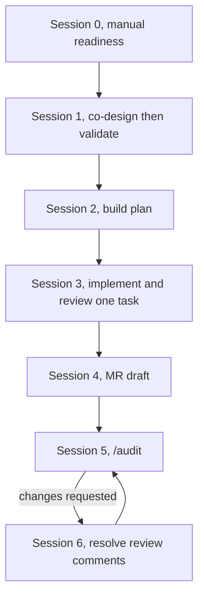

# Assigned story workflow

Use this guide to deliver a sprint story assigned to you with the `pod-builder` persona, from story-level co-design through code review, approval, and merge to `master`.

Pod Builder has **seven** skills and does **not** run `/orchestrate-design`. Work owned by other personas is not covered here: writing `epic-spec.md`, grooming the backlog, dual-persist architecture/masterplan, `sdd/components/`, ADRs, OpenAPI, and the design package (SA **or** LB).

**Prerequisite (upstream SA/LB):** Before Session 1, confirm SA/LB already produced `nwob-docs/sdd/epic-spec.md`, `epic-spec.md` (backlog index), dual `architecture.md` ↔ `sdd/masterplan.md` (and `sdd/components/` when in scope), and the design package.

The prompt templates below are a starting point, not a script. They contain the minimum needed to run each step. Add any extra detail the story requires.

This guide assumes the project is already initialized with the `pod-builder` persona bundle. If it is not, see [initialization.md](../initialization.md).



---

## Session 0: story readiness

Check that the workspace and the story are ready for design: index row in backlog index row in `epic-spec.md` and full anatomy in `{STORIES_DIR}/{STORY_ID}/story-spec.md`. Also confirm SA/LB upstream artifacts (epic + masterplan/architecture + design package).

Run the checklist yourself. You do not need the agent unless the story is missing from `epic-spec.md` / `story-spec.md`.

1. Open a new Cursor chat for this story. Use another new chat for Session 5 if a different developer audits.
2. Open `${STORY_CONTEXT.PROJECT_ROOT}` as the workspace root. Do not open a parent folder. Do not open only `repositories/${STORY_CONTEXT.SERVICE}/`.
3. Confirm these exist: `.nwob/manifest.json`, `.nwob/active-persona.json`, `AGENTS.md`, `.cursor/skills/`, `nwob-docs/sdd/epic-spec.md, dual architecture (`nwob-docs/architecture/architecture.md` and/or `nwob-docs/sdd/masterplan.md`), `repositories/${STORY_CONTEXT.SERVICE}/`, `.nwob/artifact-paths.json`, both files under `.nwob/templates/`, `references/rules/git-delivery-standards.md`, `references/rules/merge-request-patterns.md`, `references/rules/builder-quality-patterns.md`, `.cursor/rules/constitution-core.mdc`, and `.cursor/rules/constitution-custom.mdc` (if missing, sync NWOB skills from `nwob-agent-skills` or run `nwob doctor`).
4. Open `epic-spec.md` and find the backlog row for `${STORY_CONTEXT.STORY_ID}`. Open `${STORY_CONTEXT.STORIES_DIR}/${STORY_CONTEXT.STORY_ID}/story-spec.md` — it needs Type, Summary, Description, Given/When/Then, Dependencies, and Size.
5. Fill in STORY_CONTEXT below. Do not attach a file. Paste the YAML as plain text with your Session 1 message.
6. Before Session 3, set `TODO_ID` and `TASK_ID` for the todo you are running. Before Sessions 4, 5, and 6, set `MR_BRANCH` after you push the MR source branch.

STORY_CONTEXT (replace only the quoted `{...}` values):

```yaml
STORY_CONTEXT:
  PROJECT_ROOT: "{PROJECT_ROOT}"
  SERVICE: "{SERVICE}"
  STORIES_DIR: nwob-docs/sdd/stories
  STORY_ID: "{STORY_ID}"
  TODO_ID: ""
  TASK_ID: ""
  JIRA_PROJECT: PROJ
  JIRA_TICKET: "{JIRA_TICKET}"
  JIRA_BASE_URL: https://myntfintech.atlassian.net
  MR_BRANCH: ""
```

Agent prompt when the story is not in `epic-spec.md` (backlog index). Paste STORY_CONTEXT above this block.

```text
/persona solution-architect
/features

Write ${STORY_CONTEXT.STORY_ID} into nwob-docs/sdd/epic-spec.md backlog index and ${STORY_CONTEXT.STORIES_DIR}/${STORY_CONTEXT.STORY_ID}/story-spec.md (full Type, Summary, Description, Given/When/Then, Dependencies, Size) from nwob-references/epics/.

BOUNDS: Only nwob-docs/sdd/epic-spec.md, story-spec.md under stories/, and epic source reads. No repositories/${STORY_CONTEXT.SERVICE}/ code. No other sessions. (Lead Builder may run the same /features command — SA and LB are co-equal.)

EXIT_JSON: {"session":"0-fallback","story_id":"<STORY_ID>","gate":"COMPLETE"|"BLOCKED"}
HARD_STOP
```

If per-story `story-tasks.md` (order from epic-spec) or masterplan/architecture are missing, stop and ask SA **or** LB to run `/orchestrate-design` (and architecture commands as needed). Pod Builder must not author those artifacts.

---

## Session 1: co-design and validation

This session is agreeing how the story will be built before anyone writes application code.

**Session 1 = `co-design-solution` → `validate-design-package`.** Do **not** run `/orchestrate-design` (SA/LB owns that and the design package). Load validate as a separate skill-hat — producing the annex does not count as approving it.

`/co-design-solution` writes the annex, including a `story-tasks.md` ID on every subtask row, then writes matching full bodies into `{STORIES_DIR}/{STORY_ID}/story-tasks.md` using those same IDs. `/validate-design-package` is the **STOP** gate. If a row has no ID, run `/co-design-solution` again before validate. If the design package needs a refresh after new IDs, route that to SA **or** LB — do not run `/orchestrate-design` as Pod Builder.

- If this chat already has STORY_CONTEXT from Session 0, paste the prompt only.
- If it does not, paste the YAML from Session 0, then the prompt.
- After it finishes, open the annex and `story-tasks.md` and check that every subtask has an ID and that `story-tasks.md` used those same IDs.

Prompt:

```text
SESSION: 1
TARGET_STORY: ${STORY_CONTEXT.STORY_ID}

EXECUTION_SEQUENCE:
1. LOAD_SKILL: .cursor/skills/co-design-solution/SKILL.md
   Story plan: ${STORY_CONTEXT.STORIES_DIR}/${STORY_CONTEXT.STORY_ID}/story-spec.md technical annex
   Story tasks: ${STORY_CONTEXT.STORIES_DIR}/${STORY_CONTEXT.STORY_ID}/story-tasks.md
   Grep repositories/${STORY_CONTEXT.SERVICE}/ before module proposals.
   Do NOT author epic-spec, masterplan, architecture, sdd/components, ADRs, or OpenAPI.
2. LOAD_SKILL: .cursor/skills/validate-design-package/SKILL.md
   Independent story-level design-package sign-off (skill-hat; separate from step 1).

BOUNDS: Story annex and story-tasks only under ${STORY_CONTEXT.STORIES_DIR}/${STORY_CONTEXT.STORY_ID}/. No /orchestrate-design. No edits under repositories/${STORY_CONTEXT.SERVICE}/. No trigger-ai-build. No /audit.

EXIT_JSON: {"session":1,"story_id":"<STORY_ID>","gate":"APPROVED"|"REJECTED"}
HARD_STOP
```

---

## Session 2: build planning

This session is deciding the build plan and getting your OK before implementation starts.

`trigger-ai-build` will keep going into code unless you stop it. The prompt below is that stop. The live plan belongs under `~/.cursor/plans/`.

- Stay in the author chat.
- `STORY_ID` and `SERVICE` are already there, so paste the prompt only.
- Read the Locked research decisions in the Cursor plan under `~/.cursor/plans/`. Reply before anything is marked READY to implement.

Prompt:

```text
/trigger-ai-build

Planning for ${STORY_CONTEXT.STORY_ID} in repositories/${STORY_CONTEXT.SERVICE}/. Stop once the execution plan is written. Don't mark an Implementation todo READY until I say so in chat.
```

---

## Session 3: task implementation and review

This session is building the story one increment at a time, with a review after each increment.

- Each turn, paste the two fields below (they are new or they changed), then the prompt.
- After Rework, paste the prompt only.
- Stay on Session 3 until every `story-tasks.md` ID for this story is done.

Prompt:

```yaml
STORY_CONTEXT:
  TODO_ID: "{TODO_ID}"
  TASK_ID: "{TASK_ID}"
```

```text
/trigger-ai-build
/review-implementation

${STORY_CONTEXT.STORY_ID} in repositories/${STORY_CONTEXT.SERVICE}/. Only todo ${STORY_CONTEXT.TODO_ID} / ${STORY_CONTEXT.TASK_ID} this turn.
```

---

## Session 4: merge request preparation

This session is preparing the merge request so a reviewer can look at the finished work.

- Start it after every `story-tasks.md` ID for the story passed Session 3.
- Run it as its own paste, not inside `trigger-ai-build`.
- Same author chat. Jira is already in STORY_CONTEXT from Session 0 or Session 1, so paste the prompt only.
- After you push the source branch, Session 5 needs `MR_BRANCH` in its YAML. Session 6 reuses it from this chat.
- The agent should print a title, a full body, a source branch, and a base branch, then stop. You create the MR in GitLab from that draft.

Prompt:

```text
/raise-merge-request

${STORY_CONTEXT.STORY_ID} in repositories/${STORY_CONTEXT.SERVICE}/. Ticket is ${STORY_CONTEXT.JIRA_PROJECT}-${STORY_CONTEXT.JIRA_TICKET}.
```

---

## Session 5: independent code audit

This session is an independent look at the open merge request before it is treated as ready to merge. Another developer must run it. Never self-review.

- Have another developer run this in a different Cursor chat than Sessions 1–4.
- Paste the YAML below (this chat has none of these values yet), then the prompt. `MR_BRANCH` is the source branch already pushed.
- The review-implementation line is there so `/audit` does not treat this as a brownfield skip.
- If the verdict is Approved, approve and merge in GitLab when you are ready.
- If it is Request changes, the author runs Session 6 with pasted GitLab comments. Unfinished `story-tasks.md` IDs go back to Session 3.

Prompt:

```yaml
STORY_CONTEXT:
  SERVICE: "{SERVICE}"
  STORY_ID: "{STORY_ID}"
  MR_BRANCH: "{MR_BRANCH}"
```

```text
/audit

${STORY_CONTEXT.STORY_ID} on ${STORY_CONTEXT.MR_BRANCH} in repositories/${STORY_CONTEXT.SERVICE}/. Increments already passed review-implementation, so don't treat this as a brownfield skip.
```

---

## Session 6: review comment resolution

This session is responding to review feedback on the merge request.

- Run this in the Sessions 1–4 author chat.
- `MR_BRANCH` should already be in that chat from Session 4. Paste the prompt, then the GitLab comments.
- Unfinished `story-tasks.md` IDs go to Session 3.
- After the agent shows the reply and git commands, wait. Commit and push only if you say yes. Then a peer runs Session 5 again.

Prompt:

```text
/resolve-review-comments

${STORY_CONTEXT.STORY_ID} on ${STORY_CONTEXT.MR_BRANCH} in repositories/${STORY_CONTEXT.SERVICE}/. GitLab comments are pasted below.
```
