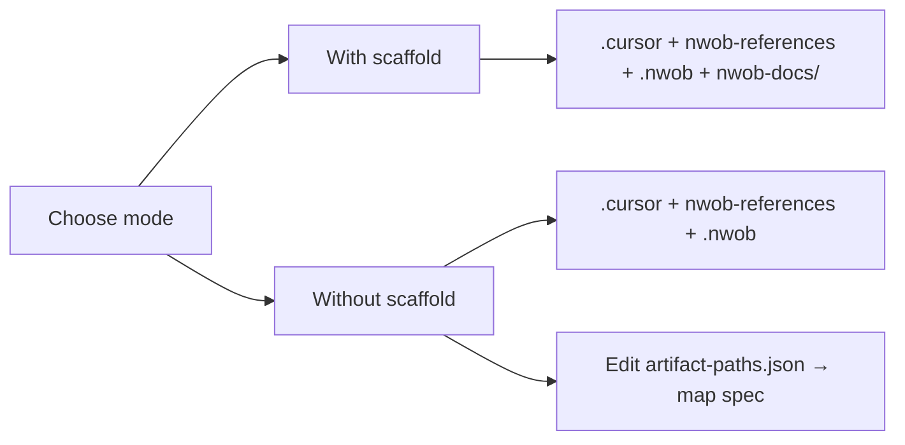
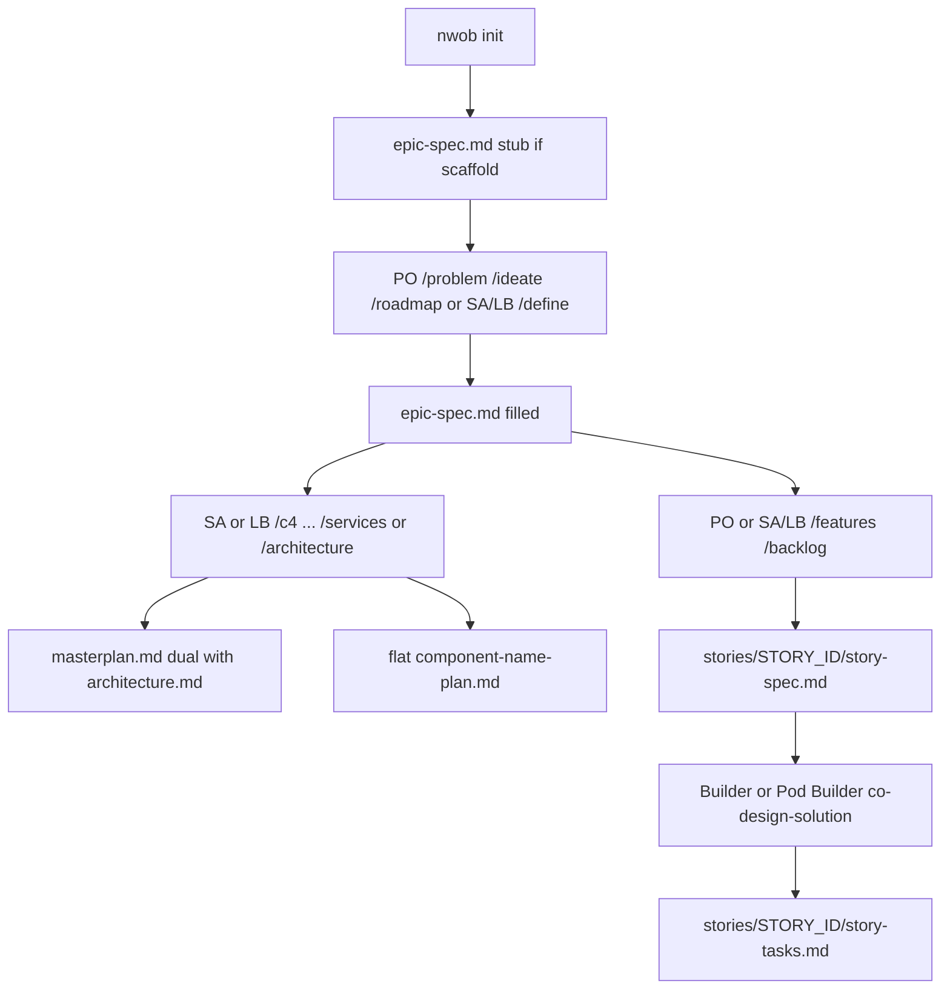

# NWOB Installation

How to initialize the NWOB CLI in a target project. For personas, doctor repairs, and troubleshooting, see [docs/initialization.md](docs/initialization.md).

## Prerequisites

- **Python 3.11+** (`requires-python >=3.11` in `pyproject.toml`)
- **Cursor** (or another supported integration; default is `cursor`)
- An **nwob-agent-skills** source: local clone path, or Git URL (`https://`, `ssh://`, `git@host:org/repo.git`)

## Two init modes

| Mode | How you get it | Creates `nwob-docs/`? | Best for |
|------|----------------|----------------------|----------|
| **With scaffold** | `nwob init` / `nwob-init.sh` default; or `NWOB_SCAFFOLD_DOCS=1` with `setup-nwob.sh` | Yes — dirs, `.gitkeep`s, and persona template stubs | Greenfield |
| **Without scaffold** | `--no-scaffold-docs`; **default** for `setup-nwob.sh` | No | Brownfield / docs already elsewhere |

Both modes install the same skills, rules, references, agents, and `.nwob/` state. The only difference is whether the `nwob-docs/` tree is created.



## Init entry points

Pick one. All three call the same installer.

### A — `setup-nwob.sh` (venv + install + init)

```bash
# Default: NO nwob-docs/ scaffold
source /path/to/nwob-agent-skills/scripts/setup-nwob.sh \
  <SKILLS_SOURCE> /path/to/your-project product-owner

# Greenfield: scaffold nwob-docs/
NWOB_SCAFFOLD_DOCS=1 source /path/to/nwob-agent-skills/scripts/setup-nwob.sh \
  <SKILLS_SOURCE> /path/to/your-project product-owner
```

Use `source`, not `./setup-nwob.sh`, so the venv stays active.

### B — `nwob-init.sh` (init only; CLI already available)

```bash
cd /path/to/your-project
/path/to/nwob-agent-skills/scripts/nwob-init.sh --here --persona product-owner
# Brownfield:
/path/to/nwob-agent-skills/scripts/nwob-init.sh --here --persona product-owner --no-scaffold-docs
```

### C — Python CLI

```bash
cd /path/to/nwob-agent-skills
python3 -m venv .venv && source .venv/bin/activate
pip install -e .

cd /path/to/your-project
nwob init --here --persona product-owner --integration cursor
# Brownfield:
nwob init --here --persona product-owner --integration cursor --no-scaffold-docs
```

| Flag | Meaning |
|------|---------|
| `--here` | Init in the current directory |
| `--persona` / `-p` | Bundle: `product-owner`, `solution-architect`, `lead-builder`, `builder`, `pod-builder`, `observer` |
| `--integration` / `-i` | Default `cursor` |
| `--force` | Overwrite managed skills/rules/commands (not living SDD content) |
| `--no-scaffold-docs` | Skip all `nwob-docs/` scaffolding |

---

## Mode A — With scaffold (greenfield)

### Steps

1. Choose a target project directory (empty or existing app code without an NWOB layout).
2. Run init **without** `--no-scaffold-docs`:

   ```bash
   nwob init --here --persona product-owner --integration cursor
   # or:
   NWOB_SCAFFOLD_DOCS=1 source /path/to/nwob-agent-skills/scripts/setup-nwob.sh \
     /path/to/nwob-agent-skills . product-owner
   ```

3. Confirm `.nwob/init-options.json` has `"scaffold_nwob_docs": true`.
4. Open Cursor in the project; active persona skills appear under `.cursor/skills/`.
5. Start SDD with `/problem` (fills `nwob-docs/sdd/epic-spec.md` if still a stub).

### Expected project folder after init

Example: **product-owner** with docs scaffold on. Always-created assets plus `nwob-docs/`:

```text
your-project/
├── setup-nwob.sh                 # Bootstrap helper (copied at init)
├── .gitignore                    # Managed NWOB ignore block
├── AGENTS.md                     # NWOB overlay (gitignored)
├── agents/
│   └── product-owner.md
├── nwob-references/              # Rules + samples (gitignored)
│   ├── rules/
│   └── samples/
├── nwob-docs/                    # CREATED in this mode
│   ├── sdd/
│   │   ├── .gitkeep
│   │   ├── stories/.gitkeep
│   │   └── epic-spec.md          # PO/SA/LB persona stub (backlog index + HL US/TS)
│   │   # masterplan.md + flat components/*-plan.md lazy-created by SA/LB (not blank-scaffolded)
│   ├── architecture/
│   │   ├── adr/.gitkeep
│   │   └── service-map.md        # Core scaffold file
│   ├── diagrams/sequences/.gitkeep
│   ├── meetings/.gitkeep
│   ├── observations/.gitkeep
│   ├── process/.gitkeep
│   └── presentations/
│       ├── .gitkeep
│       └── intake-record.md      # PO/SA/LB persona stub
├── .nwob/
│   ├── manifest.json
│   ├── init-options.json         # scaffold_nwob_docs: true
│   ├── active-persona.json
│   ├── artifact-paths.json       # defaults: spec + optional stories_dir
│   └── templates/
└── .cursor/
    ├── rules/
    │   ├── constitution-core.mdc
    │   ├── constitution-custom.mdc   # only .cursor file meant for git
    │   └── nwob-product-owner.mdc
    ├── skills/
    └── commands/
```

Other personas add different stubs under `nwob-docs/` (for example SA **or** LB add `architecture.md` / `network.md` / `sdd/masterplan.md`, `design-package.md`, and `audit-report.md`). Flat per-container plans at `nwob-docs/sdd/components/{component-name}-plan.md` are **lazy-created** by `/services` or SA/LB design skills — not blank-scaffolded at init. Legacy nested `sdd/components/{id}/`, `epic-plan.md`, `epic-tasks.md`, and `story-plan.md` are **read-only** brownfield fallbacks — init does not create them. Pod Builder does **not** author architecture, masterplan, component plans, or run `/orchestrate-design`. Scaffold files are **create-only** — existing content is never overwritten, even with `--force`.

---

## Mode B — Without scaffold (brownfield)

### Steps

1. Run init with docs scaffold off (or use default `setup-nwob.sh`):

   ```bash
   nwob init --here --persona product-owner --integration cursor --no-scaffold-docs
   # or:
   source /path/to/nwob-agent-skills/scripts/setup-nwob.sh \
     /path/to/nwob-agent-skills . product-owner
   ```

2. Confirm always-created assets: `.nwob/`, `.cursor/`, `nwob-references/`, `agents/`, `AGENTS.md`, `setup-nwob.sh`. Confirm **no** new `nwob-docs/` tree from init.
3. Edit `.nwob/artifact-paths.json` so at least `spec` points at your existing problem/spec doc (relative to the project root).
4. Ensure that mapped **spec file exists on disk**, or create it later with `/problem` at the resolved path.
5. Validate:

   ```bash
   nwob config paths --validate
   nwob doctor
   ```

### Minimum required when `--no-scaffold-docs` is used

Init itself always succeeds without any SDD markdown on disk. For mapping validation and starting SDD work:

| Requirement | Required? | Notes |
|-------------|-----------|-------|
| `.nwob/artifact-paths.json` | **Yes** | Written by init; keep a non-empty `spec` path |
| Mapped spec file (e.g. `epic-spec.md` or your brownfield path) | **Yes** to start SDD | Mapping key `spec` only |
| `stories_dir` | No | Optional; default `nwob-docs/sdd/stories/` when omitted |
| `nwob-docs/` tree | No | Not created in this mode |

Example mapping after brownfield edit (only `spec` required):

```json
{
  "schema_version": "1.0",
  "paths": {
    "spec": "docs/requirements/epic-spec.md"
  }
}
```

Optional `stories_dir` when per-story folders live outside the default layout:

```json
{
  "schema_version": "1.0",
  "paths": {
    "spec": "docs/requirements/epic-spec.md",
    "stories_dir": "docs/requirements/stories/"
  }
}
```

**Obsolete keys:** Remove `plan` and `tasks` from older mappings (formerly `epic-plan.md` / `epic-tasks.md`). `nwob config paths --validate` warns but does not fail when they appear — delete them and fold content into `epic-spec.md` and per-story `story-tasks.md`.

Agents proceed **in place** at mapped paths — no mandatory copy into `nwob-docs/`.

### Expected project folder after init

Same always-created tree as Mode A, **without** `nwob-docs/`:

```text
your-project/
├── setup-nwob.sh
├── .gitignore
├── AGENTS.md
├── agents/
│   └── product-owner.md
├── nwob-references/
│   ├── rules/
│   └── samples/
├── .nwob/
│   ├── manifest.json
│   ├── init-options.json         # scaffold_nwob_docs: false
│   ├── active-persona.json
│   ├── artifact-paths.json       # edit: map at least "spec"
│   └── templates/
├── .cursor/
│   ├── rules/
│   │   ├── constitution-core.mdc
│   │   ├── constitution-custom.mdc
│   │   └── nwob-product-owner.mdc
│   ├── skills/
│   └── commands/
└── docs/                         # YOUR existing docs (example)
    └── requirements/
        └── epic-spec.md          # map this as "spec"
```

If architecture, meetings, or presentations are needed later, skills create them under the fixed `nwob-docs/` defaults (those paths are not in the mapping).

---

## Verify

```bash
nwob doctor
nwob config paths --show
nwob config paths --validate
```

| Check | With scaffold | Without scaffold |
|-------|---------------|------------------|
| `nwob-docs/sdd/` | Expected by doctor | Not required |
| `.nwob/artifact-paths.json` | Present (defaults) | Present; map `spec` at minimum |
| Active persona skills | `.cursor/skills/` | Same |

## When SDD artifacts are generated

Init may create **stubs** or empty dirs; **skills** author living content. `nwob init`, `/persona`, and `/switch` **MUST NOT** rewrite existing SDD substance — only owning skills write these files. Full write ACL: [sdd-artifact-layout.md](references/rules/sdd-artifact-layout.md). End-to-end workflow: [AGENTS.md](AGENTS.md) / [README.md](README.md).



| Artifact | At init (scaffold) | When authored | Agent | Command / skill | How |
|----------|--------------------|---------------|-------|-----------------|-----|
| `nwob-docs/sdd/epic-spec.md` | Persona stub when scaffold on; else map `spec` in brownfield | Step 1–3 (DEFINE → features/backlog) | Product Owner **or** SA/LB (architect-led) | PO: `/problem` → `/ideate` → `/roadmap` → `/features` → `/backlog`; SA/LB: `/define` | Problem, roadmap, HL US/TS, and **chronological backlog index** at mapped `spec` path |
| `nwob-docs/sdd/masterplan.md` | **Not** blank-scaffolded (lazy) | Step 2 (conceptual) or step 8 (design-package) | Solution Architect **or** Lead Builder (co-equal). Pod Builder **MUST NOT** author | `/c4` … `/ops`, `/architecture`, `/orchestrate-design` | Dual-persist same body to `architecture/architecture.md` |
| `sdd/components/{component-name}-plan.md` | **Not** blank-scaffolded; lazy flat file | After containers exist (typically `/services` or design-package) | SA **or** LB. Pod Builder **MUST NOT** author | `/services`, `/ops`, `/orchestrate-design` | One plan file per container; legacy nested `sdd/components/{id}/` is read-only brownfield |
| `sdd/stories/{STORY_ID}/story-spec.md` | No per-story files; only `stories/.gitkeep` when scaffolded | Step 3 (`/features`) / backlog refine | PO primary; SA/LB via `/define` / `/features`; PB may co-author when blocking | `/features`, `/backlog` | Lazy-create `{stories_dir}/{STORY_ID}/`; product fields + technical annex (no separate `story-plan.md`) |
| `sdd/stories/{STORY_ID}/story-tasks.md` | None | Step 8 (design workshop), after stories exist | Builder / Pod Builder **primary**; SA/LB may co-author | `co-design-solution`; SA/LB `/orchestrate-design` / `co-design-solution` | Full task bodies per story |

**Retired (do not generate):** `epic-plan.md`, `epic-tasks.md`, `story-plan.md`. Brownfield copies may remain on disk for read-only migration.

## Next steps

- Personas, env vars, git policy: [docs/initialization.md](docs/initialization.md)
- Path mapping rules and write ACL: [references/rules/sdd-artifact-layout.md](references/rules/sdd-artifact-layout.md)
- Full workflow: [AGENTS.md](AGENTS.md) / [README.md](README.md)

**Note:** Workflow SDD Gate A requires `epic-spec.md` on disk (backlog index + HL US/TS). Init and path validation require only the `spec` mapping key. Build Gate C requires in-scope `story-spec.md` + `story-tasks.md`.
