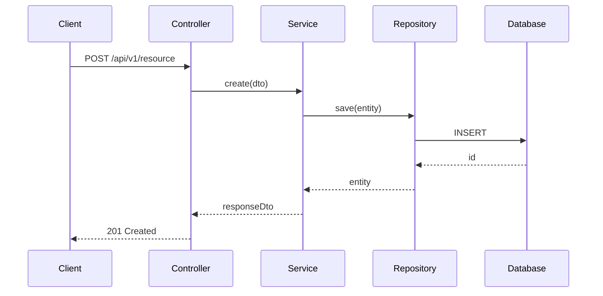
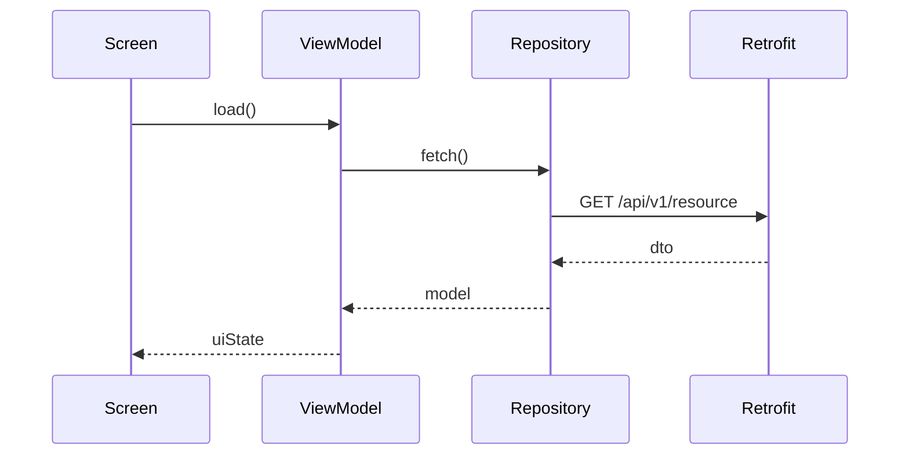
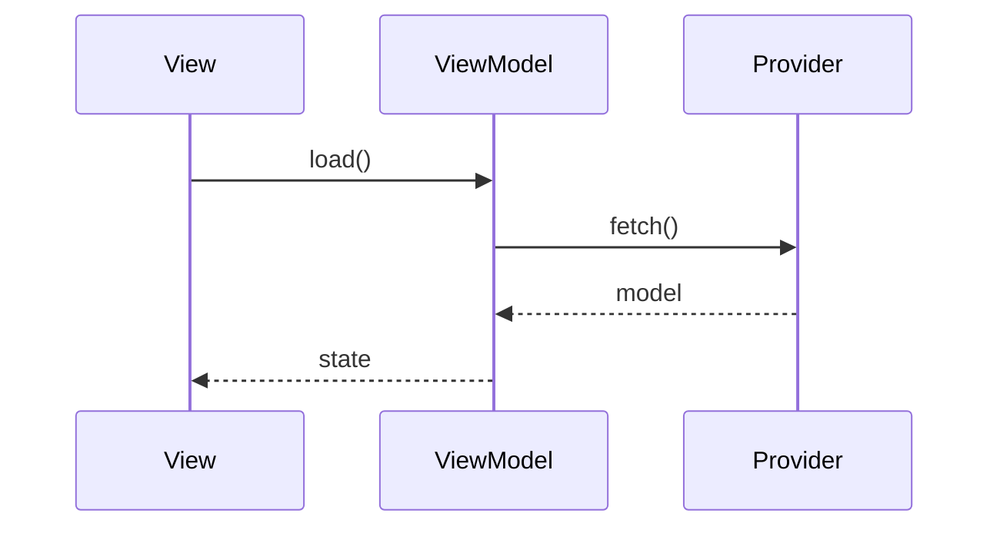

# Merge request patterns

Canonical **draft schema** for GitLab MR title, body, mermaid, and reply-draft shape. Lookup for Builder `raise-merge-request` and `resolve-review-comments`. The skills own the workflow.

**Law** (one branch per ticket, conventional commits, no agent commit in Sessions 2–4, Session 6 git only after user yes, human GitLab approve): [git-delivery-standards.md](git-delivery-standards.md). Do not duplicate that law here.

Constitution: the title uses `[<JIRA-PROJECT>-<JIRA-Ticket-Number>]` (project key from `constitution-custom.mdc`), not the `epic-spec.md` backlog index story id. The body includes Business Context and Technical Context under Summary.

The human opens, updates, and replies in GitLab. This file does not define GitLab CLI commands.

---

## Title

```text
[<JIRA-PROJECT>-<JIRA-Ticket-Number>] <Short Description of the Work Done>
```

`<JIRA-Ticket-Number>` is the numeric Jira id, not `{STORY_ID}`. The text after the prefix states the purpose of the whole branch. Prefer under 60 characters.

Example: `[PROJ-12345] Set up monorepo root POM and shared dependency management`

---

## Body schema

The NWOB frame is always present. Add reviewer-navigation sections on medium and large diffs. Skip them when the size tier says skip.

```markdown
## Jira Ticket
- https://<your-atlassian-host>/browse/<JIRA-PROJECT>-<JIRA-Ticket-Number>

---

## Summary

### Business Context
- Why this change, from epic-spec.md and Gherkin. Concrete. No filler.

### Technical Context
- How it was solved, from the diff, not from commit messages alone.
- Story `{STORY_ID}` and every `story-tasks.md` ID for this clone.
- What changed by layer, plus new deps, config, or infra on medium and large diffs.

## Start here
## Flow
## How to review
## Integration notes
## Test plan
## Additional Notes
```

A body without Business Context and Technical Context headings fails.

---

## Size tiers

**Small** (about 50 lines or fewer, 1 or 2 files, one concern): Summary only. Add Start here, Flow, or How to review only if the control flow is not obvious from the diff.

**Medium or large** (many files, new APIs, events, or config): add Start here, How to review, and Test plan. Add Flow when the request, event, or multi-service path is not obvious. Add Integration notes when external contracts change.

Additional Notes is optional on every tier: risks, debt, follow-up tickets, environment updates.

---

## What to read before you draft

Work in `repositories/{SERVICE}/`. Limit the diff to the Jira ticket. Source branch and base branch come from the locked execution plan under `~/.cursor/plans/`.

Commands against the base branch:

1. `git log <base>...HEAD --oneline`
2. `git diff <base>...HEAD --stat`
3. `git diff <base>...HEAD`
4. `git status`

Then read the changed files and the call chains they touch. Business Context comes from `epic-spec.md`, the annex, and Gherkin AC. Technical Context follows the clone's layers as they appear in the diff (Java: controllers, services, repositories; iOS: Views, ViewModels, providers; Android: Screens, ViewModels, repositories, Retrofit), then config and migrations.

Ignore generated files, lock files, build artifacts, coverage outputs, and vendor dependencies when you summarize. Mention them once if they appear in the diff.

---

## Mermaid Flow

Use `sequenceDiagram` for request, event, or multi-service control flow. **N/A** — skip diagrams for a rename, a single constant, a doc-only diff, or when the clone has no request/event path to show.

Fence with `mermaid` on its own line. Keep about 12 participants or fewer. Show the happy path. Show error or retry branches only when the reviewer must verify them. Name participants from the **clone platform**, not a Java default on mobile MRs.

**Java / Spring:** `Client`, `Controller`, `Service`, `Repository`, `Database`, `Kafka`.



**Android:** `Screen`, `ViewModel`, `Repository`, `Retrofit`.



**iOS:** `View`, `ViewModel`, `Provider`.



---

## Session 4 draft output

`raise-merge-request` prints:

1. Draft title
2. Draft body (full markdown)
3. Source branch name
4. Base branch name

Stop there. The human opens or updates the MR in GitLab. Do not commit, push, or call GitLab APIs.

If an open MR already exists for the branch, the human updates that MR. Do not draft a second MR for the same branch.

---

## Session 6 reply draft

`resolve-review-comments` prints a short reply the human can paste into GitLab. Use only pasted review comments, not a GitLab fetch.

```markdown
## Reply

- What changed
- Which comments are done
- What is deferred and why
```

Print the reply, then stop and ask. If the clone has uncommitted or unpushed fixes, include the `git commit` and `git push` commands you would run. Commit and push only after the user says yes. Do not post to GitLab.

Ignore bot and system notes unless they block merge.

---

## Multi-clone stories

One MR per clone. Each MR uses this specification. Technical Context lists `{STORY_ID}` and every `story-tasks.md` ID for that clone. Do not mix unrelated services in one MR.

---

## Troubleshooting

| Issue | Action |
| ----- | ------ |
| Wrong target branch | Re-read the locked execution plan. |
| Mermaid does not render in GitLab | Opening fence is ` ```mermaid ` on its own line. |
| Java participants on an iOS or Android MR | Use View/ViewModel/Provider (iOS) or Screen/ViewModel/Repository/Retrofit (Android). |
| Open MR already exists | Human updates that MR. Do not draft a second MR for the same branch. |
| No pasted review comments in chat | Ask the user to paste GitLab review text. Do not fetch. |

---

## Limits

| Wrong | Right |
| ----- | ----- |
| Title with story id only | `[<JIRA-PROJECT>-<n>] …`. Story id in Technical Context. |
| Body from commit messages only | Diff plus spec plus annex. |
| Second MR for the same branch | Human updates the existing MR. |
| Open or update the MR from this file | Print title, body, and branch names. The human uses GitLab. |
| Commit or push without the user saying yes | Session 6: print the reply and git commands, then wait. |
| Fetch or post GitLab comments from the agent | Use pasted review text. The human pastes the reply. |
| Aira-only body with no Business Context or Technical Context | NWOB Summary headings stay. |
