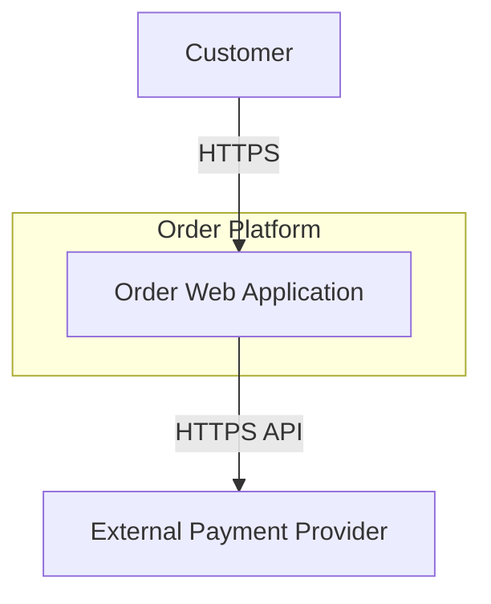
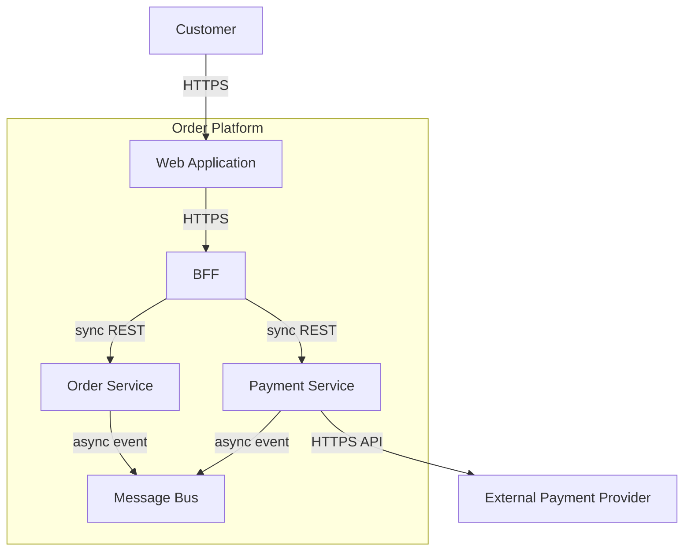

# Architecture Governance

## Overview

Generates technology-agnostic C4 Mermaid diagrams first, then produces lightweight ADRs, facilitates ARC reviews before BRC, and maintains design-to-delivery feedback loops. Applies organisational architecture gold standards and [constitution-core.mdc](../../../rules/constitution-core.mdc): **Lightweight ADRs**, **ARC Review**, and **Design-to-Delivery Feedback Loop**.

**Authors:** Solution Architect **or** Lead Builder (co-equal). Both may author ADR bodies. **Pod Builder MUST NOT** author architecture, masterplan, or ADRs.

**Dual-persist (mandatory on every write):** `nwob-docs/architecture/architecture.md` ↔ `nwob-docs/sdd/masterplan.md` (same body). Readers may use either twin.

**`/c4` is technology-agnostic:** logical containers and integration patterns only — no Kubernetes, Java, Kafka, EKS, AWS, or specific stores until `/platform` and `/services` after pattern ADR.

Skill boundaries: [references/rules/solution-architect-skill-boundaries.md](../../../references/rules/solution-architect-skill-boundaries.md). Commands: [solution-architect-command-standards.md](../../../references/rules/solution-architect-command-standards.md).

## Commands

| Command | Scope | Prerequisite | Output |
|---------|-------|--------------|--------|
| `/c4` | C4 Context + Container only (technology-agnostic) | SDD tier met (`epic-spec.md` minimum); Phase 0 complete | `architecture.md` ↔ `sdd/masterplan.md` (System Context + Container View) |
| `/pattern` | Architectural pattern-selection ADR (≥2 options) | C4 Context + Container in system SoT | `ADR-NNN-architectural-pattern-selection.md` (SA **or** LB) |
| `/adr` | Any material ADR | Material decision identified | `ADR-NNN-kebab-title.md` (SA **or** LB) |
| `/arc` | ARC intake and review package | Problem statement + ADRs + diagrams | ARC record under `architecture/` |
| `/architecture` | Full chain orchestrator (Steps 1–8) | Per command-standards | Complete `architecture/` tree + dual `masterplan.md` + `sdd/components/`; final pass confirms data sections populated |

**`/c4` scope:** Technology-agnostic first pass — users, external systems, logical containers. Do not name vendors, runtimes, orchestrators, or data stores.

**`/pattern` stop:** If C4 Context + Container missing from `architecture.md` / `masterplan.md`, stop and redirect to `/c4`.

## When to Use

- C4 architecture diagram generation (`/c4`)
- Conceptual MVP and trade-off analysis before technology commitment
- Pattern-selection ADR after C4 (`/pattern`)
- Recording any significant technology or design decision (`/adr`)
- Preparing or documenting an ARC session (`/arc`)
- SA–Tech Lead pairing or design-vs-implementation drift correction
- Governing compulsory vs advisory deprecation; ADR supersession

## Process

Resolve effective stack and data lifecycle per [AGENTS.md](../../../AGENTS.md#default-vs-override-constraints) before ARC checklist or ADR alignment. **Do not apply stack defaults in `/c4` output** — record them only after pattern ADR in downstream commands.

### C4 Model Diagramming with Mermaid (`/c4` — always first)

1. **Choose Level:** Context (L1) and Container (L2) required for `/c4`; Component or Code deferred to `/platform` or `/services`.
2. **Generate Mermaid** in fenced ` ```mermaid ` blocks — use `flowchart TB` with `subgraph` for boundaries.
3. **Define Boundaries:** Users, external systems, and application boundary only — no cloud regions, VPCs, clusters, or vendor zones.
4. **Label Relationships:** Protocol type, purpose, and data direction on every edge (e.g. `HTTPS`, `async event`, `sync query`).

**Mermaid syntax rules:**

- Node IDs: camelCase or PascalCase; no spaces in IDs.
- Avoid reserved words as IDs: `end`, `subgraph`, `graph`.
- Edge labels with special characters: wrap in quotes, e.g. `-->|"async event"|`.
- Keep diagrams under ~50 nodes for readability.

**L1 System Context example** (embed under **System Context** in `architecture.md`):



**L2 Container View example** (embed under **Container View** in `architecture.md`):



**Container naming (logical roles only):**

| Allowed | Not allowed in `/c4` |
| --- | --- |
| `WebApp`, `MobileApp`, `AdminPortal` | `React App`, `SvelteKit` |
| `APIGateway`, `BFF` | `Spring Boot BFF`, `Kong` |
| `OrderService`, `PaymentService` | `Java Service`, `EKS Pod` |
| `ExternalPaymentProvider` | `Stripe`, `AWS` |
| `MessageBus` (generic) | `Kafka`, `RabbitMQ`, `SQS` |
| `DataStore` (generic per context) | `PostgreSQL`, `Redis`, `DynamoDB` |

**Microservices principles at L2:**

1. **Bounded contexts** as containers — one primary responsibility per container.
2. **Loose coupling** — prefer async integration for cross-context state changes; label sync vs async on edges.
3. **Stateless instances** — document that runtime instances hold no durable state; externalize sessions and offsets (without naming stores).
4. **Independent deployability** — containers map to teams or contexts that can evolve separately.

Embed **two** fenced `mermaid` blocks under **System Context** and **Container View** in `nwob-docs/architecture/architecture.md`, and **dual-persist** the same body to `nwob-docs/sdd/masterplan.md`.

### Lean Architecture & Progressive Enhancement (`/c4`)

1. **Right-Size:** Prefer simplest topology meeting current requirements; note modular monolith vs distributed services as options — do not commit.
2. **Present MVP:** Simplest architecture meeting current functional and non-functional requirements.
3. **Document Future State:** Section **Advanced Options / Future State** with evolution triggers.
4. **Record Rationale:** Link to pattern-selection ADR after `/pattern` at `nwob-docs/architecture/adr/`.

**Output:** Minimum Viable Architecture (MVP); Advanced Options / Future State with triggers.

### Trade-off Analysis (`/c4`)

Compare at least two topology options across FinOps, security, reliability, and operability at **principle level** — no vendor or product names. Document RTO/RPO targets and availability strategy at trade-off level.

**Output:** Trade-offs & Considerations section or comparison table with recommendation.

### Architectural Pattern Selection ADR (required for `/pattern` and full engagements)

**Trigger:** Any full SA engagement (`/architecture`), or material greenfield/brownfield design after `/c4`.

**Timing:** After C4 Context + Container exist; **before** `/platform` and `/services` deep-dive.

**Canonical path:** `nwob-docs/architecture/adr/ADR-NNN-architectural-pattern-selection.md`

1. **Capture forces:** NFRs, team topology, scale, compliance, brownfield constraints from `epic-spec.md` and C4 diagrams.
2. **List ≥2 patterns** with fit assessment — must include non-default options even when recommendation is org defaults (EKS + EDA):
   - Modular monolith vs microservices vs serverless
   - EKS vs ECS/Lambda vs VM
   - Event-driven (Kafka) vs sync REST-only
3. **Record recommendation** — may be "accept organizational defaults (EKS + event-driven microservices)" with documented rationale.
4. **Set status** to Accepted when prompter confirms or engagement proceeds to `/platform`/`/services`.
5. **Link** from `architecture.md` / `masterplan.md` **Key Decisions** section.

**Minimum options table** (include in ADR):

| Pattern | Fit | Trade-offs | Rejected because |
| --- | --- | --- | --- |
| *(option A)* | | | |
| *(option B)* | | | |

### Lightweight ADRs (`/adr`)

Document **why**, not what — code shows what was built; ADRs capture context, constraints, and trade-offs.

1. **Identify Decision:** Lasting impact (technology, integration, data model, security boundary, migration strategy, architectural topology).
2. **Capture Context:** Problem, constraints, forces.
3. **List Alternatives:** At least two options and why each was accepted or rejected.
4. **Record Trade-offs:** Gains and sacrifices explicitly stated.
5. **Store canonically:** `nwob-docs/architecture/adr/ADR-NNN-kebab-title.md` per [sdd-artifact-layout.md](../../../references/rules/sdd-artifact-layout.md). Link from `architecture.md` / `masterplan.md` and service catalogue. SA **or** LB may author.

**When to write an ADR:** Framework or store choice, auth strategy, API architecture, infrastructure platform, deployment model, integration style, migration approach, or any decision expensive to reverse.

**When NOT to write an ADR:** Obvious choices restating code; throwaway prototypes.

**ADR lifecycle:**

| Status | Meaning |
| --- | --- |
| Proposed | Under review; not yet binding |
| Accepted | Active decision |
| Deprecated | Still in use but scheduled for removal |
| Superseded by ADR-XXX | Replaced; link to successor |

**Template:**

```markdown
# ADR-{NNN}: {Title}
**Status:** Proposed | Accepted | Deprecated | Superseded by ADR-XXX
**Date:** YYYY-MM-DD

## Context
## Architectural Patterns Considered

| Pattern | Fit | Trade-offs | Rejected because |
| --- | --- | --- | --- |

## Decision
## Alternatives Considered
## Trade-offs
## Constitution Alignment
## Consequences
```

**Constitution Alignment:** Document mandatory rules compliance and **effective** stack and data lifecycle (defaults or overrides).

### Deprecation Governance

1. **Decision framework:** Value remaining, active consumers, replacement readiness, migration cost.
2. **Advisory deprecation:** Warn consumers; catalogue `Status: Deprecated`.
3. **Compulsory deprecation:** ADR required; announced timeline; incremental migration.
4. **Material direction changes:** Escalate to ARC before BRC.

### Material vs Minor Changes

| Change | Action |
| --- | --- |
| **Material** — new service, store override, security boundary, breaking API | ADR + ARC before BRC |
| **Minor** — pattern library tweak, fitness threshold adjustment | Update pattern/changelog; no ARC unless drift detected |

### ARC Review (`/arc`)

Reviews occur **before BRC**; outcomes documented and accessible to all delivery teams.

1. **Pre-ARC Intake:** Problem statement, ADRs, diagrams, fitness-function plan, catalogue draft. **Do not** require `epic-spec.md`, `epic-spec.md` backlog index, or `story-tasks.md` / `story-tasks.md`.
2. **Constitution Checklist:** Verify mandatory rules; record **effective stack** and **effective data lifecycle**.
3. **Structure Review:** Context → design → alternatives → risks → operational readiness → decision.
4. **Document Outcome:** Approved / Approved with conditions / Deferred / Rejected.
5. **Publish:** ARC register linked from service catalogue.

### Design-to-Delivery Feedback Loop

1. **Establish Touchpoints:** Weekly or per-sprint SA–Tech Lead pairing; architecture office hours.
2. **Define Drift Signals:** Contract violations, fitness-function failures, unexpected dependencies, ops incidents.
3. **Compare Design vs. Reality:** ADRs, diagrams, catalogue against current code and metrics.
4. **Correct Early:** Update ADRs, patterns, or fitness functions; escalate to ARC for material changes.
5. **Close the Loop:** Feed lessons into pattern library or gold-standard updates.

### `/architecture` Orchestrator Final Pass

When invoked as the full SA/LB chain (`/c4` → `/pattern` → `/platform` → `/services` → `/contracts` → `/ops`), confirm **`architecture.md` ↔ `masterplan.md`** includes these sections before declaring done:

| Section | Owner step | Minimum content |
| --- | --- | --- |
| **Data Flow Diagram** | `/services` | Mermaid `flowchart` with same topology as Container View; payload edge labels only |
| **Data Models** | `/services` | `### Conceptual`, `### Logical`, `### Physical`; logical + physical **mandatory** `erDiagram` (fields; physical includes types) |
| **State Machine** | `/services` | Mermaid `stateDiagram-v2` for primary domain aggregate(s) |
| **DB Maintenance & Operation** | `/services` + `/ops` | Design-time + runtime subsections per distributed-systems and production-operations skills |

When persistence or lifecycle is genuinely N/A, document **N/A with rationale** in the affected subsections — do not omit section headings silently.

## Artifact Outputs

| Artifact | Canonical path |
| --- | --- |
| System architecture (C4, MVP, trade-offs) | `nwob-docs/architecture/architecture.md` ↔ `nwob-docs/sdd/masterplan.md` (dual-persist) |
| Pattern-selection ADR | `nwob-docs/architecture/adr/ADR-NNN-architectural-pattern-selection.md` |
| ADR | `nwob-docs/architecture/adr/ADR-NNN-kebab-title.md` |
| ARC record | Linked from catalogue; under `nwob-docs/architecture/` |

## Must NOT

- Author `story-tasks.md` or full task bodies from this skill (in-scope `story-tasks.md` (order from epic-spec backlog) is `/orchestrate-design`; epic-spec/plan via `/define` / `/features` / PO skills — not this skill)
- Skip dual-persist when writing `architecture.md` or `masterplan.md`
- Implement application security controls in code
- Name Kubernetes, Java, Spring, Kafka, PostgreSQL, Redis, EKS, AWS, ECS, or Lambda in `/c4` diagrams or narrative
- Use PlantUML (` ```plantuml `, `@startuml`) or non-Mermaid diagram fences in `/c4` output
- Add VPC, subnet, cluster, or IaC detail in `/c4` (deferred to `/platform`)
- Skip C4 before `/pattern`
- Skip pattern ADR before `/platform`/`/services` in full engagements (unless explicit user override)

## Constitution Compliance

**Mandatory:** ADRs must include **Constitution Alignment**. Pattern ADR required for full architecture engagements.

**Default-overridable:** Technology stack (Default technology stack in constitution-core) and data lifecycle (Default data lifecycle in constitution-core) recorded as effective constraints — applied in `/pattern` ADR and downstream commands, not in `/c4` diagrams.

## Rationalizations

| Excuse | Rebuttal |
|--------|----------|
| "We know it's EKS — skip `/c4`" | C4 Context + Container must exist before platform commitment; `/c4` is technology-agnostic first. |
| "Put Kafka and PostgreSQL on the diagram — we'll need them" | Technology commitment belongs in pattern ADR and `/platform`; `/c4` stays logical. |
| "We know it's EKS + Kafka — skip pattern ADR" | Pattern ADR documents alternatives even when accepting org defaults; required before deep-dive. |
| "We'll write the ADR after shipping" | Decisions without ADRs cannot pass ARC or survive team turnover. |
| "One architecture option is obviously best" | Trade-off analysis across FinOps, security, reliability, and operability is mandatory. |
| "Store ADRs in `docs/adr/`" | Canonical path is `nwob-docs/architecture/adr/ADR-NNN-kebab-title.md`. |
| "Only SA may write ADRs" | SA and LB are co-equal; either may author ADR bodies. |
| "Update architecture.md without masterplan.md" | Dual-persist both twins on every write. |

## Red Flags

- Technology names (K8s, Java, Kafka, AWS, EKS) in `/c4` diagrams or narrative.
- C4 diagrams missing boundary labels, relationship protocols, or renderable Mermaid blocks.
- Pattern ADR with fewer than two options considered.
- `/platform` or `/services` without accepted pattern ADR and no explicit override.
- ADR missing alternatives, trade-offs, or Constitution Alignment section.
- ARC skipped before BRC for material architecture changes.
- `architecture.md` written without dual `sdd/masterplan.md` (or the reverse).
- System SoT outputs written outside the dual-persist pair (`architecture.md` ↔ `masterplan.md`) or ADR paths outside `nwob-docs/architecture/adr/`.
- Full `/architecture` engagement missing Data Flow, Data Models (logical/physical diagrams), State Machine, or DB Maintenance sections without documented N/A rationale.

## Verification

- [ ] `/c4`: Mermaid `flowchart` blocks embedded under System Context and Container View; dual-persisted to `architecture.md` ↔ `masterplan.md`?
- [ ] `/c4`: No vendor, runtime, orchestrator, or store names in L1/L2?
- [ ] `/c4`: MVP, Future State, and trade-offs (≥2 options) documented?
- [ ] `/pattern`: ADR at `nwob-docs/architecture/adr/` with ≥2 pattern options and options table (SA **or** LB)?
- [ ] Pattern ADR linked from `architecture.md` / `masterplan.md`?
- [ ] `/adr`: alternatives, trade-offs, and Constitution Alignment present?
- [ ] ADR lifecycle status current (supersession links when applicable)?
- [ ] `/arc`: constitution checklist reviewed; outcome accessible to delivery teams?
- [ ] Regular SA–Tech Lead interaction with drift criteria defined?
- [ ] `/architecture`: Data Flow Diagram, Data Models (logical + physical `erDiagram`), State Machine, and DB Maintenance & Operation sections populated or N/A with rationale on both twins?
