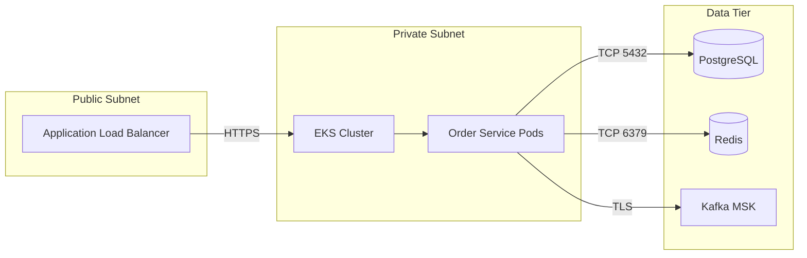
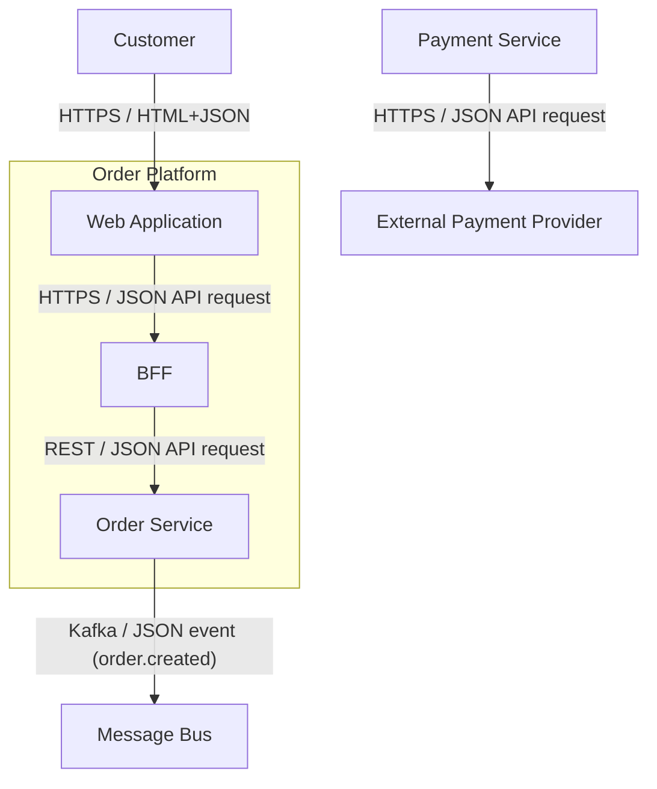
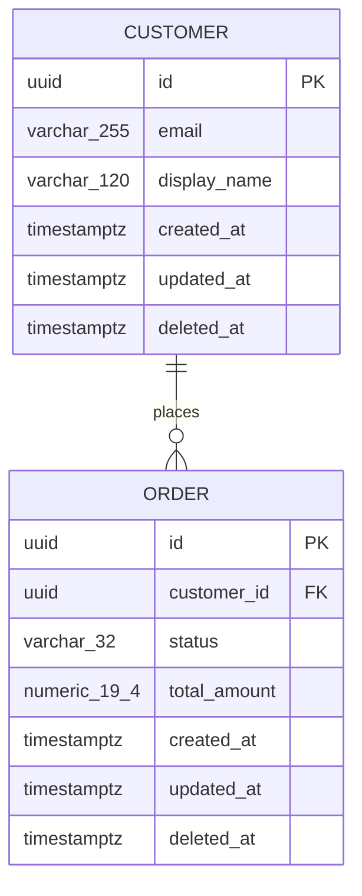
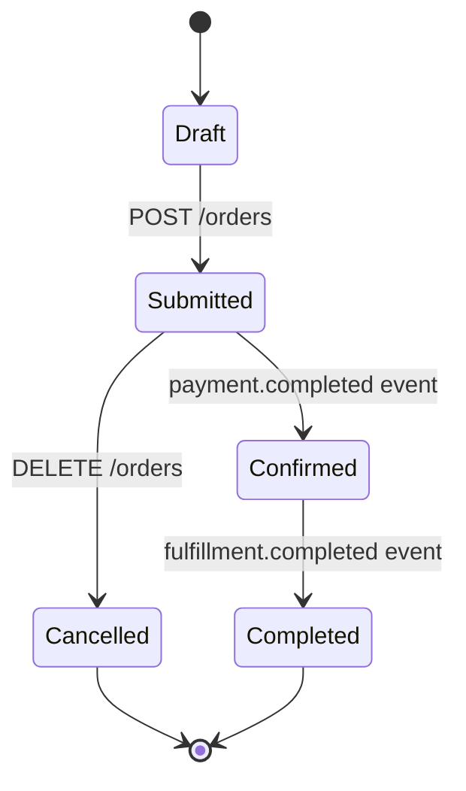
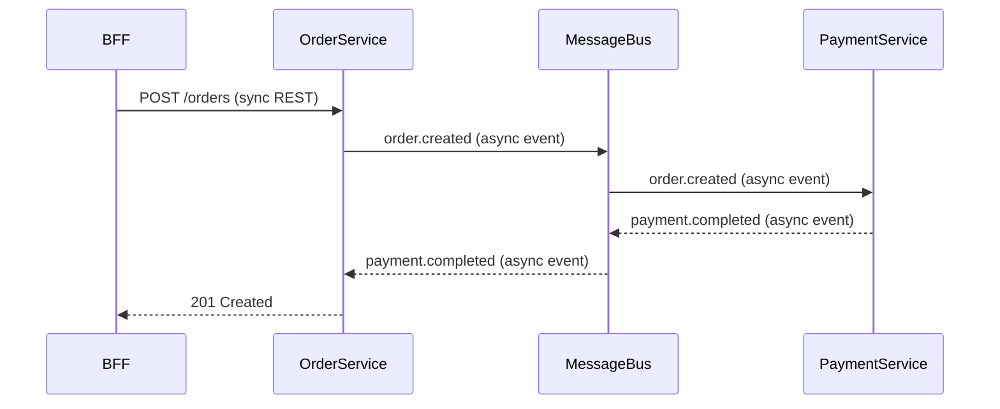

# Distributed Systems Architecture

## Overview

Designs cloud platform and service topology applying the **Design for perpetual partial failure** gold standard. **`/platform`** commits to infrastructure after accepted pattern ADR — **defaults** AWS/EKS; supports ECS, Lambda, VMs when specified. **`/services`** defaults to event-driven microservices with Kafka, PostgreSQL, Redis, Java, and soft-delete per constitution sections 2 and 5; evaluates modular monolith, sync-only integration, and alternative brokers when pattern ADR or **effective constraints** specify otherwise per [AGENTS.md](../../../AGENTS.md#default-vs-override-constraints).

**Authors:** Solution Architect **or** Lead Builder (co-equal). **Pod Builder MUST NOT** author system SoT or `sdd/components/**`.

**Dual-persist (mandatory on system SoT only):** `architecture.md` ↔ `sdd/masterplan.md` on every write. Per container: single flat file `nwob-docs/sdd/components/{component-name}-plan.md` (from [component-plan-template.md](../../../templates/sa/component-plan-template.md)) — **no** nested `sdd/components/{id}/` or `component-spec.md` twins. Legacy `architecture/components/` and nested component paths are read-only brownfield fallback.

Skill boundaries: [references/rules/solution-architect-skill-boundaries.md](../../../references/rules/solution-architect-skill-boundaries.md). Commands: [solution-architect-command-standards.md](../../../references/rules/solution-architect-command-standards.md).

## Commands

| Command | Scope | Prerequisite | Output |
|---------|-------|--------------|--------|
| `/platform` | Platform deep-dive, security, network, IaC | Pattern ADR **Accepted** or explicit user override | `architecture.md` ↔ `masterplan.md`, `network.md`, platform trade-offs |
| `/services` | Service boundaries, integration, data, resilience | Pattern ADR **Accepted** | System SoT (Data Flow, Data Models, State Machine, integration, data, resilience, design-time DB maintenance); flat per-container `sdd/components/{component-name}-plan.md` |
| `/architecture` | Steps 3 and 6 of full chain | Per command-standards | As above, within orchestrated flow |

**`/platform` stop:** If C4 Context + Container missing from `architecture.md` / `masterplan.md`, stop and redirect to `/c4`. If pattern ADR missing and no explicit override, stop and redirect to `/pattern`.

**`/services` stop:** If pattern ADR missing and no explicit override, stop and redirect to `/pattern`. If C4 missing, stop and redirect to `/c4`.

## When to Use

- Cloud or container platform selection (`/platform`)
- EKS, ECS, Lambda, or VM workload design
- Platform security architecture (IAM, network, secrets)
- Network and infra topology (`network.md`)
- Service topology and integration design (`/services`)
- Modular monolith or layered architecture (when pattern ADR specifies)
- Sync vs. async integration decisions
- BFF and API gateway placement
- Database, cache, or search technology selection
- Monolith decomposition, strangler-fig, or dual-write migration
- Event schema evolution and backward compatibility
- Circuit breakers, bulkheads, retries, graceful degradation

## Process

Resolve effective stack, platform, topology, and data lifecycle per pattern ADR and [AGENTS.md](../../../AGENTS.md#default-vs-override-constraints) before applying guidance.

### Platform Defaults, Not Constraints (`/platform`)

| Deployment model | Default | When to choose alternative |
| --- | --- | --- |
| Container orchestration | Amazon EKS | ECS/Fargate for simpler ops; Lambda for event-driven burst; VMs for legacy lift-and-shift |
| Cloud provider | AWS native | Multi-cloud or third-party when specified in sources |
| Application topology | Per pattern ADR | Modular monolith valid MVP; microservices when ADR accepts org EDA default |

Document non-default platform choices in pattern ADR or platform ADR; express topology in `network.md` with security/IaC principles adapted to the effective platform.

### AWS & Kubernetes Solution Design (`/platform` — when EKS is effective platform)

1. **Evaluate Workloads:** Map requirements to AWS container services (default: Amazon EKS).
2. **Select Supporting Services:** VPC, ALB, EBS/EFS/S3, Secrets Manager, IRSA.
3. **Secure Access:** IAM Roles for Service Accounts; least-privilege policies.
4. **Scale Design:** Node scaling (Karpenter), pod scaling (HPA/KEDA), multi-AZ.
5. **Embed in IaC:** Express topology in Terraform/CDK as the source of truth.

**Non-EKS platforms:** Document equivalent security, scaling, and IaC patterns for ECS, Lambda, or VM deployments in `network.md`.

**Output:** Platform services list, placement model, IaC module paths.

### Network Topology Diagramming (Mermaid — `/platform`)

Express infrastructure in `nwob-docs/architecture/network.md` using **`flowchart LR`** with `subgraph` for zones. Technology names **allowed** after accepted pattern ADR (EKS, VPC, ALB, etc.).

1. **Zones:** Public subnet (ingress), private subnet (workloads), data tier (stores), external SaaS.
2. **Edges:** Label protocols and direction; show security boundaries (SG, NACL, network policy).
3. **Embed** at least one fenced `mermaid` block in `network.md`.

**Example:**



### Security Architecture (Platform Tier — `/platform`)

Define boundaries and policies — application auth implementation is Builder scope.

1. **IAM/IRSA (K8s) or equivalent:** Least-privilege roles; no long-lived credentials in runtime.
2. **Network isolation:** Private subnets; security groups and network policies where applicable.
3. **Secrets:** AWS Secrets Manager or Parameter Store; no secrets in images or env files in repo.
4. **Edge protection:** WAF on ALB/API Gateway where public-facing; TLS termination at ingress.
5. **Runtime security:** Non-root containers, read-only root filesystem where feasible (K8s/ECS).

Document security trade-offs; material choices require ADR via `architecture-governance`.

### Stateless by Default (when K8s is effective platform — `/platform`)

Per Architectural principles in constitution-core, all application instances running in Kubernetes MUST be completely stateless.

1. **No Pod-Local State:** Persistent state in external stores per **effective stack** (default: PostgreSQL, Redis, Kafka).
2. **Session Management:** Sessions in external cache (default: Redis), not pod memory.
3. **Async State:** Event state and offsets via effective message broker (default: Kafka).
4. **Verification:** Confirm no pod-local persistent state before go-live.

When effective platform is Lambda or serverless, apply stateless principles via external stores and managed services.

### Topology Selection (before decomposition — `/services`)

Evaluate against accepted pattern ADR. Do not decompose into microservices unless bounded contexts, team topology, or NFRs justify it.

| Pattern | Fit when | Trade-off |
| --- | --- | --- |
| **Modular monolith** | Single team, unclear boundaries, MVP speed | Simpler ops; module boundaries via ArchUnit |
| **Microservices (default)** | Clear bounded contexts, independent scaling, EDA default | Higher operability cost; needs broker and contracts |
| **Serverless / functions** | Event-driven burst, low steady state | Cold start, vendor limits; good with Lambda + API Gateway |
| **Sync REST-only** | Simple CRUD, no cross-service state changes | Avoid for cross-service writes when EDA is effective default |

| Integration style | Default | Override example |
| --- | --- | --- |
| Cross-service state changes | Async events (Kafka) | Sync REST when ADR specifies |
| User-facing queries | Sync REST/gRPC | — |
| Batch / reporting | Scheduled jobs or event consumers | Per workload |

Document topology choice in pattern-selection ADR; reference here in `architecture.md`.

### Service Boundaries & Integration

0. **Read service-map:** Load `nwob-docs/architecture/service-map.md`; run `nwob doctor` if `repositories/` is missing. Align C4 container names with **Logical service** slugs.

1. **Identify Bounded Contexts:** Decompose only when justified; monolith modules when pattern ADR recommends modular monolith.
2. **Choose Communication:**
   - **Async (default):** Effective message broker (default: Kafka) for cross-service state changes.
   - **Sync:** REST/gRPC for user-facing queries needing immediate consistency.
   - **BFF:** Backend-for-Frontend aggregates parallel calls; thin orchestration only — business logic in domain services.
3. **Apply Patterns:** CQRS, Event Sourcing, Outbox Pattern when distributed transactions apply.
4. **Define Event Contracts:** AsyncAPI/event schemas; explicit versioning (see Schema Evolution).
5. **Idempotency:** Producers idempotent; consumers handle duplicates, DLQs, reliable offset commits.

**Output:** Service boundaries, communication map (sync/async), event flow (topics, schemas, ordering). Update `service-map.md` rows (repository path, sequence diagram link, `sdd/components/` path, status). Dual-persist system SoT updates to `architecture.md` ↔ `masterplan.md`.

### Per-container component plans (`/services`)

After **Container View** exists and logical service boundaries are set, for **each** in-scope C4 container / logical service:

1. **Resolve name:** kebab-case `{component-name}` matching the Container View node and `service-map.md` logical service name.
2. **Lazy-create** flat file `nwob-docs/sdd/components/{component-name}-plan.md` from [templates/sa/component-plan-template.md](../../../templates/sa/component-plan-template.md).
3. **Fill component-scoped sections** using the same H2/H3 set as `architecture.md` / `masterplan.md` (System Context through Data Lifecycle). Scope = this container’s collaborators, internal modules (C4 L3), owned data, and integrations only.
4. **Require** the Parent architecture link to the system SoT (`architecture.md` / `masterplan.md`) and a completed consistency checklist in the file header.
5. **MUST NOT** contradict system boundaries, Effective Technology Stack, or NFRs in the system SoT. System-wide topology and cross-cutting data models stay in `architecture.md` / `masterplan.md`; deepen here.
6. **Link** the flat plan path from the **Component plan** column in `service-map.md`.
7. **MUST NOT** create nested `sdd/components/{id}/` folders, `component-spec.md`, or new files under legacy `nwob-docs/architecture/components/` (read-only brownfield fallback for readers only).

SA **or** LB may author component plans via `/services`, `/ops`, `/architecture`, or `/orchestrate-design`. **Pod Builder MUST NOT** author component plans.

### Data Flow Diagram (Mermaid — `/services`)

Populate **`## Data Flow Diagram`** in `architecture.md` / `masterplan.md` immediately after **Container View**.

1. **Reuse Container View topology:** same node IDs, subgraphs, and component names as the **Container View** Mermaid block.
2. **Relabel edges only** with integration payload semantics — do not add, remove, or rename nodes.
3. **Label format:** `{transport} / {payload}` — e.g. `HTTPS / JSON API request`, `REST / JSON API response`, `Kafka / JSON event (order.created)`.
4. Derive labels from **Integration Points** and `/contracts` payloads where available; fall back to the `/services` communication map during conceptual runs.
5. **Embed** one fenced `mermaid flowchart TB` block under `## Data Flow Diagram`.

**Example** (same graph as Container View, relabeled edges):



### Data Models (Conceptual, Logical & Physical — `/services`)

Populate **`## Data Models`** with three mandatory subsections: `### Conceptual`, `### Logical`, `### Physical`.

| Tier | Required output | Diagram rule |
| --- | --- | --- |
| **Conceptual** | Domain entities, relationships, bounded-context ownership | Mermaid `erDiagram` **or** prose + table (diagram preferred when ≥2 entities) |
| **Logical** | Attributes, PK/FK, cardinality, normalization; map entities to C4 containers / service-map slugs | **Mandatory** Mermaid `erDiagram` listing **every field** on each entity (field names only — no store-specific types) |
| **Physical** | Effective store mapping (default PostgreSQL tables/schemas, indexes, partitioning); Flyway migration ownership; align with effective data lifecycle (`created_at`, `updated_at`, `deleted_at`) | **Mandatory** Mermaid `erDiagram` listing **every field with its physical data type** (e.g. `uuid`, `varchar_255`, `timestamptz`, `jsonb`) |

**Diagram requirements:**

- **Logical diagram:** entity blocks enumerate all fields; mark PK/FK (e.g. `id PK`, `customer_id FK`); relationships labeled with cardinality.
- **Physical diagram:** same entities/relationships as logical tier; each field line includes the **effective-store data type**; table/schema names may appear in entity titles (e.g. `order_service.orders`).
- When only one entity exists, still render logical and physical `erDiagram` blocks.
- When persistence is genuinely N/A (stateless compute-only scope), document **N/A with rationale** in both subsections — do not omit subsections silently.
- Mermaid `erDiagram` attribute syntax does not allow spaces in type tokens — use underscores in diagrams (e.g. `varchar_255`) and spell canonical SQL types in adjacent prose or a field glossary table when precision matters.

**Logical example** (fields, no types):

```mermaid
erDiagram
  CUSTOMER ||--o{ ORDER : places
  CUSTOMER {
    id PK
    email
    display_name
    created_at
    updated_at
    deleted_at
  }
  ORDER {
    id PK
    customer_id FK
    status
    total_amount
    created_at
    updated_at
    deleted_at
  }
```

**Physical example** (fields + data types):



### State Machine (Mermaid — `/services`)

Populate **`## State Machine`** in `architecture.md` / `masterplan.md`.

1. **Identify aggregates:** Primary domain aggregate(s) from `epic-spec.md` backlog index stories (e.g. Order, Payment, Application).
2. **Document lifecycle:** States, transitions, triggers (API, event, scheduler), and terminal states.
3. **Render** with Mermaid `stateDiagram-v2` — one diagram per aggregate, or combined when tightly coupled.
4. **Cross-reference** Gherkin AC in `epic-spec.md` backlog index where state changes are story-owned.

**Example:**



### DB Maintenance & Operation (design-time — `/services`)

Populate design-time subsections under **`## DB Maintenance & Operation`** in `architecture.md` / `masterplan.md`. Runtime subsections (**Backup & Recovery**, **Performance Maintenance**, **Monitoring & Runbooks**) are completed by `/ops`.

| Subsection | Content |
| --- | --- |
| **Schema & Migrations** | Flyway ownership, migration naming, rollback policy, index strategy |
| **Data Retention & DLM** | Soft-delete purge cadence, retention windows; link to **Data Lifecycle** section |

Do not duplicate **Data Lifecycle** policy prose — link and extend with operational cadence only.

### Data, Caching & Persistence

Apply the **effective stack** (default: **PostgreSQL + Kafka + Redis**):

| Need | Default Technology | Override example |
| --- | --- | --- |
| Relational data, ACID, complex joins | PostgreSQL (Liquibase; proper indexing; no N+1) | MongoDB, DynamoDB when specified |
| Event-driven communication | Kafka (MSK on AWS) | RabbitMQ, SQS/SNS when specified |
| Ephemeral cache, sessions, distributed locks | Redis — not a source of truth | Memcached, Caffeine when specified |

**Performance architecture (not code-level fixes):**

- Mandate pagination for list endpoints; no unbounded fetches.
- Prevent N+1 at design: `JOIN FETCH`, `@EntityGraph`, or batch loading patterns in ADR.
- Redis caching strategy: what to cache, TTL, invalidation on mutation — document in `architecture.md`.

1. Define read/write paths including cache TTL and invalidation.
2. Document store choice in an ADR with workload rationale (especially when overriding defaults).
3. Note backup, scaling, and cost implications.

### Schema Evolution & Event Versioning

1. **Backward compatibility:** New event fields optional; consumers ignore unknown fields.
2. **Version in schema:** `eventVersion` in envelope; document breaking changes in ADR.
3. **Dual publishing:** During migration, publish both old and new event shapes until consumers migrate.
4. **Contract tests:** Consumer-driven or schema-registry validation in CI (thresholds in `architecture-delivery-enablement`).

### Migration Patterns

At architecture level only — implementation is Builder scope.

| Pattern | Use when |
| --- | --- |
| **Strangler fig** | Incrementally replace monolith routes with new services |
| **Adapter** | Bridge old and new APIs during transition |
| **Dual-write** | Write to old and new stores; reconcile until cutover |
| **Feature-flag cutover** | Traffic shift after validation in non-prod |

Document migration ADR via `architecture-governance`; compulsory deprecation requires consumer migration plan.

### Data Lifecycle

Apply the **effective data lifecycle** (default per Default data lifecycle in constitution-core: soft-delete + DLM):

**Default (soft-delete):**

1. **Audit Timestamps:** Every database entity MUST include `created_at`, `updated_at`, and `deleted_at`.
2. **Application Behavior:** Any API `DELETE` must only populate `deleted_at`. Application layer lacks permissions for `DELETE FROM`.
3. **DLM:** Permanent deletion via scheduled infrastructure process (K8s CronJob or database cron) per retention policies.

**When sources specify hard-delete or alternate lifecycle:** Follow effective policy; document in ADR.

### Language & Runtime

- **Default:** Java — Records, Switch Expressions, Virtual Threads where applicable.
- **Override:** Use language specified in effective stack.

### Design for Perpetual Partial Failure

1. **Map Failure Domains:** Dependencies (DB, cache, broker, APIs) and blast radius.
2. **Apply Patterns:** Circuit breakers, bulkheads, timeouts, exponential-backoff retries, fallbacks, idempotency.
3. **Define Degradation:** What degrades vs. halts; user-visible behaviour per failure scenario.
4. **Plan Recovery:** Health checks, auto-healing, runbook triggers.
5. **Validate:** Chaos engineering, game days, dependency kill tests in non-prod.

**Output:** Failure assumptions, resilience pattern per integration, degradation matrix, validation plan.

### Sequence Diagramming (Mermaid — `/services`)

Document critical flows per service at `nwob-docs/diagrams/sequences/{service-name}.md` using **`sequenceDiagram`**.

1. **Participants:** Logical service/container names from C4 Container View.
2. **Flows:** Happy path + error/timeout path for cross-service calls.
3. **Labels:** Sync vs async; include correlation ID propagation on HTTP/event edges.
4. **Embed** one or more fenced `mermaid` blocks per file.

**Example:**



## Artifact Outputs

| Artifact | Canonical path |
| --- | --- |
| Service map | `nwob-docs/architecture/service-map.md` |
| System architecture (platform, services, integration, data flow, data models, state machine) | `nwob-docs/architecture/architecture.md` ↔ `nwob-docs/sdd/masterplan.md` |
| Component plan (per container, flat) | `nwob-docs/sdd/components/{component-name}-plan.md` |
| Network / infra topology (Mermaid) | `nwob-docs/architecture/network.md` |
| Platform ADRs | `nwob-docs/architecture/adr/ADR-NNN-kebab-title.md` via governance |
| Event schemas / AsyncAPI | `repositories/{service-name}/src/main/resources/asyncapi/`; linked from service-map |
| Store/migration ADRs | `nwob-docs/architecture/adr/ADR-NNN-kebab-title.md` via governance |
| Sequence diagrams (Mermaid) | `nwob-docs/diagrams/sequences/{service-name}.md` |

## Must NOT

- Author `story-tasks.md` or full task bodies from this skill (Builder `co-design-solution`)
- Skip dual-persist on system SoT writes (`architecture.md` ↔ `masterplan.md`)
- Write new files under legacy `nwob-docs/architecture/components/`
- Define CI pipeline YAML
- Run `/platform` without C4 Context + Container or accepted pattern ADR (unless explicit override)
- Implement application-level auth (JWT filters, route handlers)
- Decompose into microservices without pattern ADR or source justification
- Use PlantUML or non-Mermaid diagram fences in platform/sequence outputs
- Profile and fix code-level performance (set architectural mandates only)

## Constitution Compliance

**Mandatory:** When K8s is the effective platform, all workload instances must be stateless per Architectural principles in constitution-core. Perpetual partial failure design, idempotent producers, DLQ handling, reliable offset commits (when event-driven).

**Default-overridable (constitution sections 2 and 5):** Stack and data lifecycle per [AGENTS.md](../../../AGENTS.md#default-vs-override-constraints).

## Rationalizations

| Excuse | Rebuttal |
|--------|----------|
| "We'll add statelessness later when we scale" | Pod-local state blocks horizontal scaling and violates Architectural principles in constitution-core from day one. |
| "REST is simpler than the broker for this integration" | Default is async for cross-service state changes; sync when ADR or sources specify. |
| "We must microservice everything" | Modular monolith is valid when pattern ADR recommends it. |
| "We can add idempotency after launch" | Duplicate events are inevitable; design idempotency from the start. |
| "Big-bang cutover is faster" | Strangler and dual-write reduce blast radius; document cutover ADR. |
| "Write components under architecture/components/" | Write flat `{component-name}-plan.md` under `nwob-docs/sdd/components/`. |
| "Update architecture.md without masterplan.md" | Dual-persist both twins on every write. |
| "Pod Builder will fill component plans" | Only SA **or** LB author flat `sdd/components/*-plan.md`. |

## Red Flags

- `/platform` run without C4 Context + Container in `architecture.md` / `masterplan.md`.
- Sessions or persistent state stored in pod memory or local filesystem (K8s).
- Microservices chosen without pattern ADR or bounded-context justification.
- Cross-service state changes via sync REST when effective stack specifies event-driven.
- Data stores chosen without ADR when overriding defaults.
- No degradation path defined for single dependency failure.
- Data Flow Diagram topology differs from Container View (nodes added/removed/renamed).
- Logical data model missing mandatory `erDiagram` or fields not enumerated per entity.
- Physical data model missing mandatory `erDiagram` or fields missing per-field data types.
- State Machine missing for primary domain aggregate with lifecycle in `epic-spec.md` backlog index.
- In-scope container missing flat `sdd/components/{component-name}-plan.md`, or component plan contradicts system SoT.
- New component files written under legacy `architecture/components/`.
- System SoT updated without dual-persist.

## Verification

- [ ] `/platform`: Pattern ADR accepted or explicit override documented?
- [ ] Effective platform resolved (default EKS or ADR override)?
- [ ] Workloads stateless when K8s is effective platform?
- [ ] `network.md` includes renderable Mermaid topology diagram for effective platform?
- [ ] Sequence diagrams at `nwob-docs/diagrams/sequences/` use Mermaid `sequenceDiagram`?
- [ ] Infrastructure expressed as IaC artefacts where applicable?
- [ ] Topology matches pattern ADR (monolith vs microservices vs serverless)?
- [ ] Effective stack and data lifecycle resolved from sources (or defaults applied)?
- [ ] Service boundaries align with team ownership; BFF/gateway placement documented?
- [ ] Event schemas versioned when event-driven; producers idempotent; consumers handle DLQs?
- [ ] Pagination and N+1 prevention mandated at architecture level?
- [ ] Migration pattern documented in ADR when brownfield or decomposition?
- [ ] `## Data Flow Diagram` present with same topology as Container View and payload edge labels?
- [ ] `## Data Models` present with `### Conceptual`, `### Logical`, `### Physical` subsections?
- [ ] Logical `erDiagram` enumerates every field per entity (no store types)?
- [ ] Physical `erDiagram` enumerates every field with physical data type per field?
- [ ] `## State Machine` present with Mermaid `stateDiagram-v2` for primary aggregate(s)?
- [ ] `## DB Maintenance & Operation` design-time subsections (Schema & Migrations, Data Retention & DLM) populated?
- [ ] Outputs dual-persisted to `architecture.md` ↔ `sdd/masterplan.md`?
- [ ] One flat component plan per in-scope container under `nwob-docs/sdd/components/{component-name}-plan.md`, linked from `service-map.md`?
- [ ] Each component plan links parent system SoT, uses the same section set, and does not contradict system architecture?
- [ ] No new writes under legacy `architecture/components/`?
- [ ] Graceful degradation defined and failure simulation planned?
