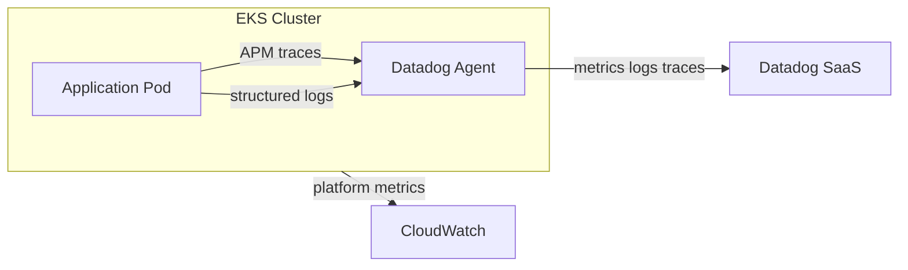

# Production Operations

## Overview

Designs build-and-run ownership, SLAs/SLOs, Datadog observability, and production readiness for the **effective platform** from pattern ADR (EKS, ECS, Lambda, VM, or monolith). Applies the **Build & Run Architecture** gold standard and [constitution-core.mdc](../../../rules/constitution-core.mdc). **Defaults** to Datadog on EKS; adapts observability deployment for ECS, Lambda, and VM when ADR specifies. OpenTelemetry optional when explicitly requested.

**Authors:** Solution Architect **or** Lead Builder (co-equal). Dual-persist system SoT and owning component twins when updating runtime DB subsections. **Pod Builder MUST NOT** author these artifacts.

Skill boundaries: [references/rules/solution-architect-skill-boundaries.md](../../../references/rules/solution-architect-skill-boundaries.md). Commands: [solution-architect-command-standards.md](../../../references/rules/solution-architect-command-standards.md).

## Commands

| Command | Scope | Prerequisite | Output |
|---------|-------|--------------|--------|
| `/ops` | SLOs, observability, production readiness, runtime DB maintenance | `/services` minimum; `/contracts` preferred | SLOs, observability topology, readiness checklist, DB ops in `architecture.md` ↔ `masterplan.md` / `network.md` / owning `sdd/components/` twins |
| `/architecture` | Step 8 of full chain | Per command-standards | As above, within orchestrated flow |

**`/ops` stop:** If `/services` outputs missing from `architecture.md` / `masterplan.md`, stop and redirect to `/services`.

## When to Use

- Production readiness or go-live review
- On-call, runbook, and escalation design
- SLAs, SLOs, and error budgets
- Performance budgets and SLO guardrails (architecture level)
- Metrics, logs, tracing, and alerting for microservices

## Process

Resolve effective observability stack per [AGENTS.md](../../../AGENTS.md#default-vs-override-constraints): default Datadog; OTel when explicitly requested or specified in sources.

### Build & Run Architecture

Delivery teams own and monitor solutions in production—not a separate ops silo.

1. **Operational Ownership:** On-call rotation, runbooks, escalation paths owned by delivery team.
2. **SLAs/SLOs:** Availability, latency, error budget, RTO/RPO aligned with business impact.
3. **Design for Operability:** Health endpoints, graceful shutdown, externalized config, feature flags, safe rollbacks.
4. **Production Readiness Review:** Capacity, monitoring, runbooks, incident response, catalogue entry before go-live.

**Output:** Ownership model, SLAs/SLOs, operational artefacts, production readiness checklist.

### DB Maintenance & Operation (runtime — `/ops`)

Complete runtime subsections under **`## DB Maintenance & Operation`** in `architecture.md` ↔ `masterplan.md`. Design-time subsections (**Schema & Migrations**, **Data Retention & DLM**) are owned by `/services` — do not duplicate; extend with operational detail only.

| Subsection | Content |
| --- | --- |
| **Backup & Recovery** | Automated backup schedule, PITR capability, restore procedure, RPO/RTO targets aligned with SLAs |
| **Performance Maintenance** | Connection pooling policy, read-replica strategy (when applicable), vacuum/analyze or equivalent maintenance windows |
| **Monitoring & Runbooks** | DB-specific alerts (connection saturation, replication lag, disk growth); runbook links tied to SLOs |

When effective store is managed (e.g. RDS PostgreSQL), document platform-native backup and maintenance features. Link runbooks from service catalogue.

When a component owns a local store, also complete the same runtime subsections in that component’s flat plan under `nwob-docs/sdd/components/{component-name}-plan.md`. Keep a system-level summary in `architecture.md` / `masterplan.md`; put component-scoped RPO/RTO, pooling, and runbook links in the component plan. Do not write new files under legacy nested component paths.

### SLO Methodology & Performance Budgets

Architecture-level performance guardrails — code profiling is Builder scope.

1. **Measure:** Define SLIs (availability, P95 latency, error rate) per critical user journey.
2. **Set SLOs:** Target thresholds aligned with business impact; define error budget policy.
3. **Guard:** Latency and error-rate fitness functions in CI (thresholds in `architecture-delivery-enablement`).
4. **Budget:** Document acceptable P95 latency and error rate per service in `architecture.md` or catalogue.

Do not specify frontend Core Web Vitals or React profiling — those belong to Builder during implementation.

### Observability & Monitoring

Adapt deployment to **effective platform** from pattern ADR:

| Platform | Default observability |
| --- | --- |
| EKS (default) | Datadog agents on nodes; APM, logs, traces |
| ECS/Fargate | Datadog sidecar or Fargate integration |
| Lambda | Datadog Lambda extension; CloudWatch for platform metrics |
| VM/EC2 | Datadog agent on host |

1. **Default Stack — Datadog:** Unified metrics, APM, logs, and distributed tracing when no override specified.
2. **OpenTelemetry:** Implement OTel **when explicitly requested or specified in effective stack**. Document as alternative/complement to Datadog.
3. **AWS Infrastructure Layer:** CloudWatch and X-Ray for platform telemetry where Datadog does not cover AWS-native metrics.
4. **Instrument Services:** Structured logs, RED/USE metrics, distributed tracing across async boundaries.
5. **Tie to SLOs:** Dashboards and alerts driven by error budgets—not vanity metrics.
6. **Propagate Trace Context:** Correlation IDs and trace IDs end-to-end; `trace_id` in RFC 7807 error payloads (Datadog trace by default; OTel span when OTel is in effective stack).
7. **Automate Regression Checks:** CI fitness functions for latency and error-rate thresholds.

**Output:** Stack per layer, critical signals per service, SLO-based alert rules with runbook links. Document observability topology in `nwob-docs/architecture/network.md` where relevant.

### Observability Topology Diagramming (Mermaid — `/ops`)

When observability deployment is non-trivial, add a **`flowchart LR`** Mermaid block to `network.md` showing telemetry path: workload → agent/collector → backend (Datadog default; OTel when specified).

**Example (EKS + Datadog default):**



### Runbook Template

Each service runbook linked from catalogue must include:

```markdown
# Runbook: {Service Name}

## Alert: {Alert name}
**Severity:** P1 | P2 | P3
**SLO impact:** {Which SLO is burning}

### Symptoms
### Diagnosis steps
### Mitigation
### Escalation path
### Rollback procedure
```

### Production Readiness Checklist

```
- [ ] On-call rotation and escalation defined
- [ ] SLAs/SLOs and error budgets documented and measurable
- [ ] Datadog agents/exporters configured for effective platform (EKS default)
- [ ] Dashboards and SLO-based alerts configured (Datadog-derived by default)
- [ ] Runbooks linked from service catalogue (using template above)
- [ ] Health checks (/health, /ready, /live) and graceful shutdown implemented
- [ ] Rollback and feature-flag strategy tested
- [ ] Resilience patterns validated in ops context (not only dev)
- [ ] Tracing spans cross service and async boundaries
- [ ] Correlation IDs / trace IDs propagated end-to-end
- [ ] trace_id present in RFC 7807 error payloads
- [ ] Load/capacity baseline established for critical paths
- [ ] DR drill or failover test completed (when RTO/RPO mandated)
- [ ] Security scan and dependency audit gates passed (Builder CI)
- [ ] OTel instrumentation verified (only when OTel explicitly adopted)
```

## Artifact Outputs

| Artifact | Canonical path |
| --- | --- |
| SLO/error budget definitions | `architecture.md` ↔ `masterplan.md` or catalogue |
| DB Maintenance & Operation (runtime) | `nwob-docs/architecture/architecture.md` ↔ `nwob-docs/sdd/masterplan.md` |
| Component DB ops (when component owns a store) | `nwob-docs/sdd/components/{component-name}-plan.md` ↔ `{component-name}-plan.md` |
| Observability / network topology (Mermaid) | `nwob-docs/architecture/network.md` |
| Runbook outlines | Linked from catalogue; co-located per service repo |

## Must NOT

- Perform code-level performance profiling or fixes
- Author incident postmortems (delivery/ops team)
- Author `story-tasks.md` or full task bodies from this skill; skip dual-persist on SoT/component writes
- Write new files under legacy `nwob-docs/architecture/components/`
- Invoke reference `shipping-and-launch` or `performance-optimization` directly for implementation — borrow go-live and SLO patterns only

## Constitution Compliance

**Mandatory:** `trace_id` in error payloads; SLO alerts tied to observability signals; build-and-run ownership; trace context propagation end-to-end.

**Default-overridable (Default technology stack in constitution-core):** Datadog is the default observability stack; OTel when specified in effective stack per [AGENTS.md](../../../AGENTS.md#default-vs-override-constraints).

## Rationalizations

| Excuse | Rebuttal |
|--------|----------|
| "Ops team will handle production after go-live" | Build-and-run requires delivery team ownership; separate ops silo violates gold standard. |
| "We'll add observability after launch" | Production without SLO-based alerting is blind; observability is a go-live gate. |
| "OpenTelemetry is the modern default" | Datadog is the default when unspecified; OTel when effective stack or user specifies it. |
| "I'll profile and fix the slow query here" | SA sets SLO/budget; Builder profiles and fixes at code level. |

## Red Flags

- No on-call rotation or runbooks defined before production go-live.
- Dashboards show vanity metrics not tied to SLOs or error budgets.
- OTel adopted by default without explicit request.
- `trace_id` missing from RFC 7807 error payloads.
- Go-live without error budget or rollback strategy.
- DB Backup & Recovery or Monitoring & Runbooks subsections missing when persistence is in scope.

## Verification

- [ ] Effective platform from pattern ADR reflected in observability deployment?
- [ ] Delivery team owns build *and* run?
- [ ] SLAs/SLOs and error budgets defined; runbooks exist before production?
- [ ] Effective observability stack resolved; Datadog configured when default, OTel when specified?
- [ ] Observability topology documented with Mermaid in `network.md` when deployment is non-trivial?
- [ ] Runbooks follow template and link from catalogue?
- [ ] Tracing and correlation IDs span distributed and async paths?
- [ ] Go-live checklist complete including capacity and rollback?
- [ ] OTel only present when explicitly requested?
- [ ] `## DB Maintenance & Operation` runtime subsections populated (Backup & Recovery, Performance Maintenance, Monitoring & Runbooks) when persistence is in scope on `architecture.md` ↔ `masterplan.md`?
- [ ] Owning `sdd/components/` twin runtime DB subsections updated when a component owns a local store?
- [ ] DB backup/RPO/RTO documented and aligned with SLAs?
