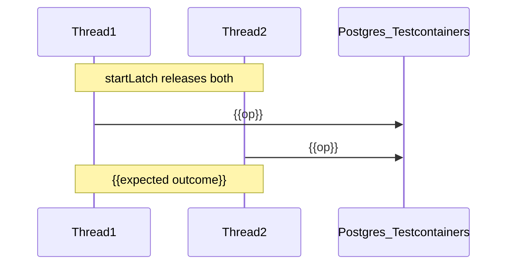

<!--
This is the execution plan template used for a Builder trigger-ai-build session, one per story.
It is a Cursor Plan Mode overlay, not an SDD artifact and not a replacement for story-tasks.md.
The canonical build order continues to live in story-tasks.md. Generate this plan only after Builder
validate-design-package has passed. Once the plan exists, Builder trigger-ai-build implements each
todo in turn, Builder review-implementation approves the corresponding story-tasks.md ID, and Builder /audit
reviews the resulting MR once every todo is done.

Before creating a plan from this template, confirm that four things already exist: `{stories_dir}/{{STORY_ID}}/story-spec.md`
(product Gherkin + technical annex sections), the relevant `{stories_dir}/{{STORY_ID}}/story-tasks.md` rows, resolved
`epic-spec.md` (backlog index), and a validate-design-package sign-off. Do not require `story-spec.md` (retired). If any
of these are missing, stop here rather than moving into Plan Mode. Once they are confirmed, copy the template into
~/.cursor/plans/ so its YAML todos stay live.
Do not persist a copy under nwob-docs/; execution plans are Cursor cache only. From there, replace
every {{PLACEHOLDER}} with real content, since no angle-bracket prose should remain in the final plan,
and delete any section marked OPTIONAL that does not apply to this story while keeping every mandatory
section even when it ends up short. Lock the research decisions together with the user before writing
the Implementation todos, and structure the work so that one todo corresponds to exactly one Lead
Builder trigger-ai-build turn followed by one Builder review-implementation pass; todos should never
be batched together unless the user explicitly asks for it, and even when two or three story-tasks.md items
are grouped into a single todo, each one still needs its own verdict. Apply `.cursor/rules/constitution-custom.mdc`
when that file is present (branch regex, package naming, injection style).

Placeholders written as {{LIKE_THIS}} are required and must be replaced with concrete text. Sections or
blocks marked [OPTIONAL] may be deleted entirely if they do not apply to this story. Anything labeled
"Example:" is illustrative only and should be rewritten to match your own story rather than copied as-is.
-->

# {{STORY_ID}} ({{JIRA_KEY}}) — {{FULL_LANE_TITLE}}

This plan is carried out under three NWOB skills working together: Builder `trigger-ai-build` produces this plan and drives each todo, Lead Builder `review-implementation` approves every completed todo, and Lead Builder `audit-and-approve-code` (`/audit`) reviews the resulting MR once all todos are done.

The work happens entirely inside [`{{service-repo}}`]({{service-repo}}), which should be cloned under `repositories/{{service-repo}}/` before any todo begins.

Branch names follow `.cursor/rules/constitution-custom.mdc` when that file is present; otherwise use `feat/<sprint>/{{JIRA_KEY}}-{{slug}}`, with the sprint written as `{{YYMM}}`. Of the candidates below, `feat/{{YYMM}}/{{JIRA_KEY}}-{{recommended-slug}}` is recommended because {{why_recommended}}; `feat/{{YYMM}}/{{JIRA_KEY}}-{{alt-slug-1}}` is the better choice when {{when_to_use_alt_1}}; and `feat/{{YYMM}}/{{JIRA_KEY}}-{{alt-slug-2}}` applies when {{when_to_use_alt_2}}.

- `feat/{{YYMM}}/{{JIRA_KEY}}-{{recommended-slug}}` — **recommended**; {{why_recommended}}
- `feat/{{YYMM}}/{{JIRA_KEY}}-{{alt-slug-1}}` — {{when_to_use_alt_1}}
- `feat/{{YYMM}}/{{JIRA_KEY}}-{{alt-slug-2}}` — {{when_to_use_alt_2}}

<!-- Once a single branch name is locked in, collapse this section into one line, for example:
**Branch:** `feat/{{YYMM}}/{{JIRA_KEY}}-{{recommended-slug}}` (branched from current `master`) -->

The branch is based on `{{base-branch}}`, which already includes {{what_already_merged}}, and {{independence_note}}.
<!-- Example: based on `master`, which already includes 013a/b, 022a/b, and INTa; independent of any unmerged sibling branches. -->

Three documents make up the canonical build inputs, read in this order: `{stories_dir}/{{STORY_ID}}/story-spec.md`
(product Gherkin + technical annex; indexed from `epic-spec.md`), `{stories_dir}/{{STORY_ID}}/story-tasks.md`
(official task IDs and bodies), and `nwob-docs/sdd/epic-spec.md` when confirming cross-story order.

1. `{stories_dir}/{{STORY_ID}}/story-spec.md` — product fields + technical annex (default `nwob-docs/sdd/stories/`)
2. `{stories_dir}/{{STORY_ID}}/story-tasks.md` — full task bodies and official IDs this plan must cite
3. `nwob-docs/sdd/epic-spec.md` — chronological backlog index (optional for single-story plans)

<!-- Any local Jira dump is supporting material only and never outranks these three sources. -->

Where a similar story has already been built, link its Cursor plan here as a pattern reference, so that this story mirrors the same IT base, tagging, and todo style: [{{sibling-plan-1}}](~/.cursor/plans/{{plan-file-1}}.plan.md), [{{sibling-plan-2}}](~/.cursor/plans/{{plan-file-2}}.plan.md)

Before any implementation begins, Lead Builder `validate-design-package` must show a design sign-off of **{{passed / date / waiver}}**; if this field is still empty, implementation should not start.

This story explicitly excludes {{item_a}}, {{item_b}}, and {{item_c}}, along with any new production behavior — defects discovered along the way should be filed under {{owning_story_ids}} rather than fixed here — and it excludes cross-repo end-to-end testing unless this story is the one that owns it. Naming the sibling stories that must not be touched here keeps that boundary explicit. By contrast, this story does include {{deliverable_1}}, {{deliverable_2}}, and {{deliverable_3}}, the additive tags `{{Tag-A}}` and `{{Tag-B}}`, and the README lane documentation, and this in-scope statement should stay tight enough that the difference between tests-only work and feature work is obvious at a glance.

---

## Agent execution rules (mandatory — always follow)

The rules in this section apply to every todo in this plan without exception, and they override any default agent behavior, since together they are what implements Builder `trigger-ai-build` alongside Lead Builder `review-implementation`.

### Per-todo agent workflow

After finishing each todo, the agent must work through the following steps in order and go no further. First, it implements exactly that todo through Builder `trigger-ai-build` for the `story-tasks.md` ID cited in that todo, without letting the work creep into the next one. Next, it briefly explains what changed and why. It then runs the verify commands from that todo's Verify block, which must match the Verify field recorded in `story-tasks.md`, and reports whether they passed or failed. After that, it provides a suggested commit message that the user can copy and paste directly, following the Git rules described below. It then updates this plan's todo checklist by setting the completed todo's status to `completed` in the YAML frontmatter, doing this before it stops rather than after. Finally, it stops and waits for Lead Builder `review-implementation` to sign off on that `story-tasks.md` ID — when the same person is dual-hatting both roles, their approval satisfies this gate — before it starts the next todo.

The agent must not begin Todo N+1 while Todo N is still marked `pending`, and it must not batch multiple todos into a single turn unless the user explicitly asks for that. Even when two or three `story-tasks.md` items are grouped into one todo, each of those items still needs its own verdict. Lead Builder `/audit` should not run until every todo for this story is finished, Session 4 `raise-merge-request` has drafted MR copy, and the human has opened the MR on `MR_BRANCH`.

### Git rules (user-only commits and pushes)

The agent never runs `git commit`, `git push`, `git add` for staging commits, or any other command that creates or publishes git history; that responsibility stays with the user throughout. Creating a branch with `git checkout -b …` and making local file edits are both fine while implementing a todo, since the user still owns every commit and push that follows. Each todo therefore ends with a suggested commit message, leaving the decision of whether and when to commit entirely up to the user.

Conventional commit format and branch/MR **law**: [git-delivery-standards.md](../../references/rules/git-delivery-standards.md). Draft MR title and body: [merge-request-patterns.md](../../references/rules/merge-request-patterns.md). Branch regex: `constitution-custom.mdc`.

### Todo checklist maintenance

This plan's YAML frontmatter `todos:` block is the source of truth for how far the session has progressed, while `{stories_dir}/{{STORY_ID}}/story-tasks.md` remains the source of truth for what needs to be built and in what order for this story (`epic-spec.md` backlog index for cross-story order only). Once a todo's work and verify commands are complete, its status should move from `pending` to `completed` in the frontmatter during that same turn, before the agent stops for approval, so that completed work is never left showing as pending. A todo should not be marked `completed` until its verify commands have actually been run and their results reported. If a todo ends up cancelled or descoped instead, set its status to `cancelled` and explain why in the plan body, and if the underlying task itself changes, keep `story-tasks.md` in sync through Builder `co-design-solution`.

The table below mirrors the frontmatter todos and should be kept in sync as work moves from pending to completed:

**Current checklist** (update frontmatter as todos complete):

| ID | Todo | `story-tasks.md` | Status |
|----|------|------------|--------|
| `todo-00-{{slug}}` | {{TITLE}} | {{T-NNN}} | pending |
| `todo-01-{{slug}}` | {{TITLE}} | {{T-NNN}} | pending |
| `todo-02-{{slug}}` | {{TITLE}} | {{T-NNN}} | pending |

### Constraints [OPTIONAL — include for review-fix / high-risk plans]

The additional constraints below apply on top of everything already stated, and are worth spelling out explicitly on review-fix or otherwise high-risk plans:

| Constraint | Rule |
|------------|------|
| **Git** | The agent must not commit or push; only the user commits and pushes. |
| **Web search** | The agent must not run web searches; if an external reference is needed, it should instead give the user a self-contained prompt to run (see the Gemini prompts section below). |
| **Production code** | {{None / allowed only for listed files}} |
| **README edits** | Edits should be append-only, unless a rename forces a line to be updated. |
| **Personas** | Do not author retired SDD files (`epic-plan.md`, `epic-tasks.md`, `story-plan.md`), and do not skip `review-implementation` just because the same person also ran `trigger-ai-build`. |

---

## Locked research decisions (user-confirmed)

> This table should be filled in together with the user before any Implementation todos begin, drawing from the story implementation annex wherever a decision has already been made there. Every row that goes in here becomes a binding decision, so once the build is underway, none of them should be reopened without an explicit waiver.

| Decision | Value | Rationale |
|----------|-------|-----------|
| IT base / harness | **{{ChosenBase}}**, not {{RejectedBase}} | {{why — e.g. rejected base mocks Redis / Kafka publisher}} |
| Class naming | `*IntegrationTest` (not `*IT`) | `codecoverage` profile excludes only `**/*IntegrationTest.java`; CI runs `mvn verify -Pcodecoverage` |
| Tags | **{{Additive dual-tag / Story tags only}}** — `{{Tag-A}}` / `{{Tag-B}}` {{on top of existing / alone}} | Satisfies story CI lane without breaking sibling `-Dgroups` filters |
| Branch base | `{{master / other}}` | {{independence from unmerged siblings}} |
| Kafka / broker | **{{Mock only / Real Testcontainers / N/A}}** | {{sibling story owns the other mode}} |
| Production code | **None** unless an IT reveals a defect | Story type {{C — tests only / B — feature}}; defects file under {{OWNING_STORY}} |
| Contracts win | OpenAPI / QA contracts beat story-sequence drift | List known drift below if any |
| {{Extra decision}} | {{Value}} | {{Rationale}} |

Any known drift between the contracts and the story sequence that should simply be ignored can be listed here [OPTIONAL]:

- {{e.g. Sequence says PUT /publish; OpenAPI wins → POST …/publish}}
- {{e.g. QA path `/routing-overrides` is a typo; real path is `/api/v1/overrides`}}

---

## Baseline (do not reimplement)

The artifacts below should be reused rather than reimplemented, since extending an existing artifact is preferable to creating a parallel duplicate, and this table should match the Reusable table already recorded in the implementation annex.

| Artifact | Path | This story's usage |
|----------|------|--------------------|
| {{IT base}} | [`{{Path}}.java`]({{repo}}/{{path}}) | Extend; reuse helpers `{{a}}` / `{{b}}` / `{{c}}` |
| {{Existing IT}} | [`{{Path}}.java`]({{repo}}/{{path}}) | {{Extend / Retag only / Cross-link}} |
| {{Fixtures / auth}} | [`{{Path}}.java`]({{repo}}/{{path}}) | {{How used}} |
| {{SUT entrypoints}} | [`{{Controller/Service}}.java`]({{repo}}/{{path}}) | Drive via HTTP / jobs — {{no behavior change / listed changes only}} |
| Contracts | `contracts/qa-test-scenarios.md`, `contracts/example-payloads/**` | Oracles + QA ids in method names / Javadoc |
| OpenAPI | `repositories/{{service-repo}}/src/main/resources/swagger/` | SA `/contracts` — do not invent shapes |

Before starting Todo 1, run the following checks to confirm the branch and baseline files are in the expected state:

```shell
cd repositories/{{service-repo}}
git checkout {{base-branch}} && git pull
git checkout -b feat/{{YYMM}}/{{JIRA_KEY}}-{{recommended-slug}}
test -f {{path/to/required-baseline-file}}
test ! -f {{path/to/file-this-story-will-create}}
test -f ../../nwob-docs/sdd/stories/{{STORY_ID}}/story-spec.md
# story-tasks.md must list {{T-NNN}}… for this story
mvn -q test -Dtest='{{ExistingClassA}},{{ExistingClassB}}'
# Or: mvn -q test -Dgroups={{Existing-Group}}
```

---

## Scope line (this story vs siblings)

The diagram below draws the boundary between what has already landed, what this story delivers, and what remains with sibling stories:

```mermaid
flowchart LR
    subgraph landed [Landed SUT and seed ITs]
        sut[{{Landed production capability}}]
        seed[{{Existing seed ITs / bases}}]
    end

    subgraph thisStory [{{STORY_ID}} deliverables]
        d1[{{Deliverable 1}}]
        d2[{{Deliverable 2}}]
        d3[{{Deliverable 3}}]
        docs[README lane]
    end

    subgraph deferred [Other stories]
        sib1[{{Sibling story A}}]
        sib2[{{Sibling story B}}]
    end

    seed --> d1
    d1 --> d2
    d2 --> d3
    d3 --> docs
    docs -.-> sib1
    sut --> d1
```

### Ownership matrix

The ownership matrix then makes that same boundary explicit at the level of individual QA items, acceptance criteria, and tasks:

| QA / AC / task | Owner | This story's action |
|----------------|-------|---------------------|
| {{QA-ID-1}} | **{{STORY_ID}}** / `story-tasks.md` {{T-NNN}} | {{New class / extend / assert at HTTP boundary}} |
| {{QA-ID-2}} | **Done ({{prior}})** | Retag / cross-link only — do not re-own |
| {{QA-ID-3}} | **{{Sibling}}** | Out of scope |
| Tags + README | **{{STORY_ID}}** | Additive tags + run docs |

Wherever the story sequence and the contracts disagree, the contracts take precedence; summarized here, that means: {{one-line summary of binding contract interpretations}}.

---

## Research decisions (implementation)

> The notes under this heading are the design decisions the agent must follow while writing code, and more subsections can be added as needed. None of them should contradict `nwob-docs/architecture/`; if a conflict turns up, stop here and route it to the Solution Architect through `/adr` via Lead Builder `orchestrate-design` rather than resolving it unilaterally.

### {{Subsection 1 — e.g. Where MockMvc / helpers live}}

{{Decision and concrete steps.}}

The following helpers may also need to be added to support this decision [OPTIONAL]:

| Helper | Purpose |
|--------|---------|
| `{{createX(request)}}` | `POST /api/v1/{{resource}}` as {{role}} |
| `{{assertNoYAfter(action)}}` | Absence oracle — seek-to-end, run action, assert no new offsets |

### {{Subsection 2 — e.g. Tagging policy}}

```java
@Tag("{{Tag-A}}")
@Tag("{{Tag-B}}")
// keep existing when additive:
@Tag("{{Existing-Tag}}")
```

Story tags should be applied to concrete IT classes rather than only to an abstract base class, since tagging the base would inadvertently pull unrelated subclasses into this lane.

### {{Subsection 3 — e.g. Journey / narrative flow}} [OPTIONAL]

```
{{STEP_1}}
  → {{STEP_2}}
  → {{STEP_3}}
  → {{ASSERTION}}
```

### {{Subsection 4 — e.g. Mocking / Kafka / fault-injection policy}}

| Concern | Policy |
|---------|--------|
| Publisher | {{`@MockitoBean` / real producer / unreachable bootstrap}} |
| Happy path | {{verify / poll topic / HTTP+DB state}} |
| Absence | {{`verify(never())` / seek-to-end absence helper}} |
| Hard rule | {{e.g. No Kafka Testcontainers in this lane}} |

### Duplication policy

A case should be re-asserted here only when {{real DB / real broker / cross-topic stitch / HTTP→history gap}} adds proof that a sibling suite does not already provide; pure request-shape validation belongs in the MVC slice tests instead, with a Javadoc cross-reference pointing back to it from here.

### Production defect policy

If an integration test fails against the contracts, fix it directly only when the cause is clearly a one-line or test-blocking bug already owned by {{OWNING_STORIES}}; otherwise, file the defect under the owning story and keep this lane green by using the correct oracle instead. In general, this branch should avoid expanding production scope beyond what it already owns.

---

## Architecture

The diagram below must align with `nwob-docs/architecture/architecture.md` (dual: `nwob-docs/sdd/masterplan.md`), `service-map.md`, and in-scope `nwob-docs/sdd/components/` twins, since it represents only this story's slice of the architecture rather than a second, competing source of truth.

```mermaid
flowchart TB
    subgraph lane [{{Lane name}}]
        itA[{{PrimaryIT}}]
        itB[{{SecondaryIT}}]
    end

    support[{{ITSupportOrBase}}]
    pg[(Postgres Testcontainers)]
    redis[(Redis Testcontainers)]
    kafka[(Kafka Testcontainers)]

    itA --> support
    itB --> support
    support --> mvc[MockMvc plus filters]
    mvc --> ctrl[{{Controller}}]
    ctrl --> svc[{{Service}}]
    svc --> pg
    svc --> producer[{{EventProducer}}]
    producer --> topic["{{topic.name}}"]
    support -->|"poll / absence asserts"| topic
```

Where the request path matters and stays aligned with the contracts, it can be sketched out as an optional producer/request-path diagram [OPTIONAL]:

```
{{HTTP_CALL_1}}  → {{status / side effect}}
{{HTTP_CALL_2}}  → {{Kafka / DB assertion}}
```

For concurrency or multi-actor flows, an optional sequence diagram can capture the ordering more precisely [OPTIONAL]:



---

## Testing standards (mandatory)

Every test in this story must align with the constitution's requirement of full coverage and Testcontainers usage where applicable, and with how Builder `trigger-ai-build` expects tests to be produced. The table below spells out what that means in practice:

| Rule | Application |
|------|-------------|
| **AAA** | Every test: `// Arrange`, `// Act`, `// Assert` |
| **Naming** | `tc<NNN>_<methodOrFlow>_given<Condition>_should<Behavior>`; block range **tc{{start}}+** (siblings own other ranges) |
| **State-based first** | HTTP status, `error_code`, persisted row/log state, consumed Avro/headers — {{Mockito only for … / no Mockito verify on producer}} |
| **Mocks at boundaries only** | {{None in this lane / listed mocks only}} |
| **Tags** | `{{Tag-A}}` / `{{Tag-B}}` as locked above |
| **Isolation** | Unique codes/targets per test; drain topics in `@BeforeEach` if needed; consecutive runs pass |
| **Coverage gate** | Class names end in `*IntegrationTest` so `mvn verify -Pcodecoverage` skips them |
| **Continuous verify** | Run affected classes before stopping each todo |
| **TDD** | RED → GREEN → REFACTOR when behavior changes |

### Test case map

The test case map then ties each individual test back to its `story-tasks.md` ID and to the corresponding `story-spec.md` Gherkin or QA id, so that traceability holds all the way from a single assertion up to the story's acceptance criteria:

| tc | Class | QA | `story-tasks.md` | Key assertions |
|----|-------|-----|------------|----------------|
| tc{{NNN}} | `{{ClassName}}` | {{QA-ID}} | {{T-NNN}} | {{HTTP / DB / Kafka assertion in one line}} |
| tc{{NNN}} | same | {{QA-ID}} | {{T-NNN}} | {{…}} |
| tc{{NNN}} | `{{OtherClass}}` | {{QA-ID}} | {{T-NNN}} | {{…}} |

<!-- For reference, two real rows from a past story looked like this (rewrite entirely for your own
story): tc341 in OverrideCrudIntegrationTest covered OVR-H01 / KFK-H03 under T-020, asserting a 201
ACTIVE response, a CREATED log entry, and an OVERRIDE_ACTIVATED event on the topic; tc342 in the same
class covered OVR-H02 / KFK-V04 under T-021, asserting a 201 PENDING response with no Kafka event
raised at all. -->

---

## Target file layout

The files this story touches should map onto the layout below, with each entry noting the todo and `story-tasks.md` item responsible for it:

```
repositories/{{service-repo}}/
├── src/test/java/{{package}}/
│   ├── {{support/}}/
│   │   └── {{ITSupport}}.java                 # Todo N / story-tasks.md T-NNN — extend / NEW
│   ├── {{kafka|api|scheduler}}/
│   │   ├── {{ExistingIT}}.java                # Todo N — rename / retag / extend
│   │   └── {{NewIT}}.java                     # Todo N — NEW
│   └── support/
│       └── {{RestTestSecurity}}.java          # Todo N — overloads only if needed
├── src/main/java/{{package}}/                 # {{none expected / listed docs only}}
│   └── {{optional-doc.md}}                    # Todo N — NEW doc if any
└── README.md                                  # Final todo — append-only lane docs
```

No unexpected `src/main/java` `*.java` changes should appear here unless the Locked decisions section explicitly allows them.

---

## Implementation todos (sequential — one todo per turn)

> Every item here should mirror an entry in the YAML `todos:` frontmatter, in the same order and using the same ids, and each todo should name the `story-tasks.md` {{T-NNN}} it corresponds to.

### Todo 0 — {{TITLE}} [OPTIONAL — use for Sonar cleanup / prerequisite hygiene]

**`story-tasks.md`:** {{T-NNN or n/a — hygiene only}}

**Context:** {{why this must land before feature work}}

| File | Line(s) | Rule / issue | Fix |
|------|---------|--------------|-----|
| [`{{File}}.java`]({{path}}) | {{n}} | {{rule}} | {{exact fix}} |

**Work:** This todo should {{bullet}}. While doing so, avoid refactoring any neighbouring tests, and do not touch `src/main/java` unless the table above lists it explicitly.

**Verify:**

```shell
cd repositories/{{service-repo}}
mvn -q test -Dtest='{{ClassA}},{{ClassB}}'
mvn -q verify -Pcodecoverage
```

**Suggested commit message (user commits):** `{{type}}: {{imperative summary}}`

**On completion:** Set `todo-00-{{slug}}` to `completed` in the plan frontmatter, and then stop so that Lead Builder `review-implementation` (or the user, when dual-hatting) can review the change.

---

### Todo 1 — {{TITLE}}

**`story-tasks.md`:** {{T-NNN}}

**Work:** This todo should {{concrete bullet 1 — name classes, methods, tags}}, while making sure it avoids {{concrete bullet 2 — what NOT to do}}. Every new test should carry AAA comments, and the agent should load only the annex, the `story-spec.md` Gherkin, and the files listed on {{T-NNN}} rather than flooding its context with the whole repository.

**Verify:**

```shell
mvn -q test -Dtest={{ClassUnderTodo}}
# and/or:
mvn -q -DskipTests test-compile
```

**Suggested commit message (user commits):** `{{type}}: {{imperative summary}}`

**On completion:** Set `todo-01-{{slug}}` to `completed` in the plan frontmatter, request Lead Builder `review-implementation` for {{T-NNN}}, and then stop and wait for that approval before continuing.

---

### Todo 2 — {{TITLE}}

**`story-tasks.md`:** {{T-NNN}}

**Work:** {{Describe what this todo delivers, in the same flowing style used above.}}

**Verify:**

```shell
mvn -q test -Dtest={{ClassUnderTodo}}
```

**Suggested commit message (user commits):** `{{type}}: {{imperative summary}}`

**On completion:** Set `todo-02-{{slug}}` to `completed` in the plan frontmatter, request Lead Builder `review-implementation` for {{T-NNN}}, and then stop and wait for that approval before continuing.

---

### Todo N — README lane docs, suite verify, scope guard

**`story-tasks.md`:** {{T-NNN or docs-only}}

**Editing rule (README):** Edits should be append-only, and existing lines should be changed only when an earlier rename makes that unavoidable.

**Work:** This todo documents the lane in the README, covering the class inventory, the tags in use, the commands needed to run it, any container or context notes, and the `*IntegrationTest` naming rule, and it cross-links to sibling oracles that are owned elsewhere rather than duplicating their documentation. It then finishes with a scope-leak check confirming there is no {{forbidden-ownership}} and no unexpected `src/main/java` `*.java` change.

**Verify:**

```shell
mvn -q test -Dgroups={{Tag-A}}
mvn -q test -Dgroups={{Tag-B}}
mvn -q verify -Pcodecoverage
git diff --name-only {{base-branch}} -- src/main/java | grep '\.java$' && echo 'FAIL: production Java change' || echo 'OK'
rg -n '{{scope-leak-pattern}}' src/test/java/{{package}} && echo 'REVIEW: scope leak' || echo 'OK'
```

**Suggested commit message (user commits):** `docs: document the {{STORY_ID}} {{lane}} lane`

**On completion:** Set `todo-N-{{slug}}` to `completed` in the plan frontmatter and stop for approval. Once this is the last todo for the story, Builder `raise-merge-request` drafts MR title, body, and branch names (Session 4); the human opens the MR in GitLab; a peer developer runs Lead Builder `/audit` on `MR_BRANCH`.

---

## Final acceptance checklist

This checklist maps back to the `story-spec.md` Gherkin and to this story's `story-tasks.md` items, with each increment proven by Lead Builder `review-implementation` along the way and the MR as a whole proven by `/audit`.

| AC | Proof |
|----|-------|
| {{AC 1 title}} | {{tc / command / artifact / story-tasks.md ID}} |
| {{AC 2 title}} | {{…}} |
| {{AC 3 title}} | {{…}} |
| Tagging / docs / runtime | `-Dgroups={{Tag-A}}` / `{{Tag-B}}` green; README run + troubleshooting |
| CI safety | Every IT ends in `*IntegrationTest`; `mvn verify -Pcodecoverage` skips the lane |
| Scope | No {{sibling}} ownership; no {{forbidden harness}} |
| Repeatability | Consecutive lane runs pass {{N}}/{{N}} [OPTIONAL: record in MR test plan] |
| Production | {{No `src/main/java` Java changes / only listed files}} |
| SDD | All `story-tasks.md` IDs for {{STORY_ID}} complete; annex unchanged in spirit; no `story-spec.md` rewrite |

Once every row above is satisfied, the following test plan can be pasted directly into the MR description [OPTIONAL]:

```markdown
## Test plan
- [x] `mvn -q test -Dgroups={{Tag-A}}` — **{{N}}/{{N}} consecutive passes** (YYYY-MM-DD, local)
- [x] `mvn -q test -Dtest={{PrimaryIT}}`
- [x] `mvn -q verify -Pcodecoverage` — unit gate unchanged
- [x] Builder review-implementation for story-tasks.md {{T-NNN}}…{{T-NNN}}
- [ ] Builder /audit on MR
```

---

## Downstream readiness

Completing this story unblocks the following downstream consumers:

| Story / consumer | Unblocked capability |
|------------------|----------------------|
| [{{Next story}}](../../nwob-docs/sdd/stories/{{ID}}/story-spec.md) | {{what they can now rely on}} |
| {{Ops / demos}} | {{runnable local path}} |
| {{Deferred follow-on}} | {{explicitly still blocked / deferred}} |

---

## Dependency note

Before this plan starts, the following prerequisites should already be satisfied: {{list merged stories / bases on branch}}, and Lead Builder `validate-design-package` should already have passed.

This story is best described as {{test consolidation / feature / docs+IT}}, and its approach is to {{extend existing classes rather than duplicating oracles}} rather than build something parallel; in every case, it remains an overlay only on the `story-tasks.md` rows that belong to **{{STORY_ID}}**, never a substitute for them.

The following items are explicitly deferred rather than covered here:

| Item | Owner |
|------|-------|
| {{Deferred capability}} | {{STORY_ID or ticket}} |
| {{Cross-repo E2E}} | {{E2E-STORY}} |
| Any defect found while testing | File under {{OWNING_STORY}} — do not silently expand this story into production work |

Where the product key was split across sibling stories, the split looks like this, with the current story marked for clarity:

- {{STORY_A}} — {{one-line lane}}
- {{STORY_B}} — {{one-line lane}}
- **{{THIS_STORY}}** — {{one-line lane}} (this plan)
- {{STORY_C}} — {{one-line lane}}

The authoritative contracts for this story live in `contracts/qa-test-scenarios.md` (specifically {{relevant sections}}), along with OpenAPI, AsyncAPI, or Avro definitions where applicable.

Finally, the Jira ticket is [{{JIRA_KEY}}](https://{{jira-host}}/browse/{{JIRA_KEY}}), tracked under product key **{{STORY_ID}}**. {{rescoped-from note if any}}.

---

## Finding-style deep dives [OPTIONAL — review-fix / contested AC only]

> This section applies when a follow-up plan is closing specific review findings, with one subsection per finding, each still citing its `story-tasks.md` ID; Lead Builder `review-implementation` remains the gate for that ID, or `/audit` if the MR is already open.

### Finding {{N}} — {{title}} ({{QA-ID}})

**Problem**

{{What is missing today and why AC fails.}}

**Implementation**

The target file is [`{{Class}}.java`]({{path}}), the new method is named `tc{{NNN}}_{{given_when_should}}`, and it traces to `story-tasks.md` {{T-NNN}}. Sketch it out with Arrange, Act, and Assert sections, either as bullets or as short code, along these lines:

```java
@Test
void tc{{NNN}}_{{name}}() throws Exception {
    // Arrange
    // ...
    // Act
    // ...
    // Assert
    // ...
}
```

**Verify**

```shell
mvn -q test -Dtest={{Class}}#tc{{NNN}}_{{name}}
```

---

## Gemini Pro prompts [OPTIONAL — when web search is forbidden]

When the agent is not permitted to run web searches and implementation runs into something unknown, give the user a self-contained prompt like the one below to run externally, then paste the answer back:

> **Context:** {{JDK / Spring Boot / test base class / containers}}. Implementing {{QA-ID}} (`story-tasks.md` {{T-NNN}}): {{one-sentence goal}}.
>
> **Question:** {{specific question}}
>
> **Constraints:** Answer from JDK/Spring docs knowledge. Prefer patterns already used in [`{{ExistingClass}}`]({{path}}).

---

## Commit guidance [OPTIONAL]

| Todo | Suggested message |
|------|-------------------|
| `todo-01-{{slug}}` | `test: {{summary}}` |
| `todo-02-{{slug}}` | `refactor: {{summary}}` |
| `todo-N-readme` | `docs: {{summary}}` |
| verify-only todos | *(no commit)* |

Related code todos may be squashed together at commit time even though the agent still implements and stops on a per-todo basis, running `trigger-ai-build` and `review-implementation` separately for each one. A squashed commit might look like this:

```
test({{area}}): {{summary}}

Closes {{finding / AC list}}. story-tasks.md {{T-NNN}}.
```
