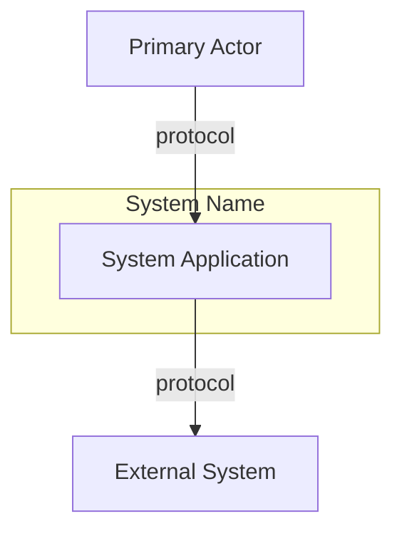
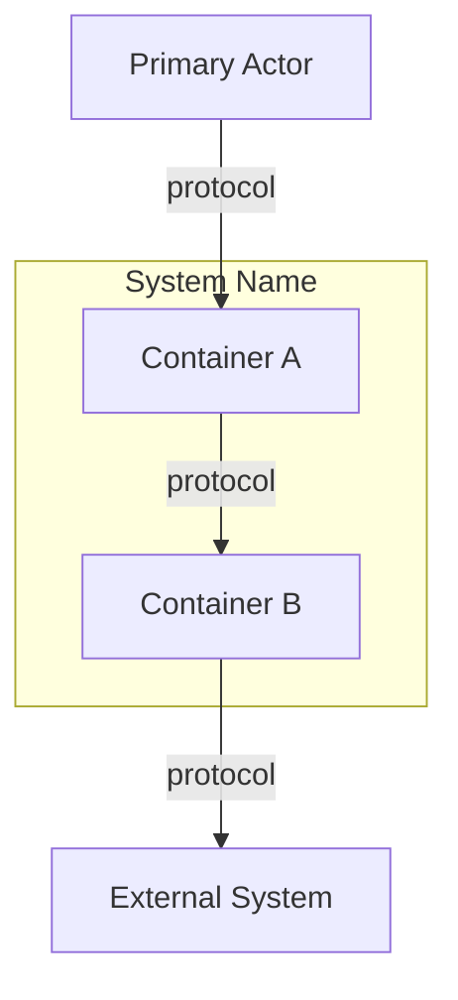
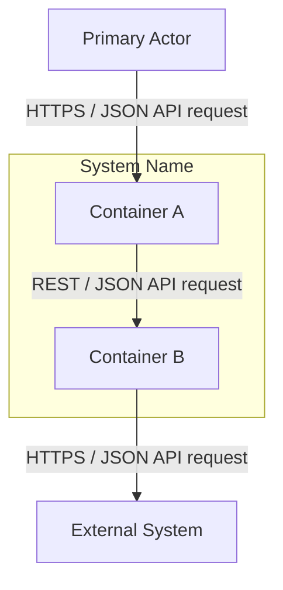
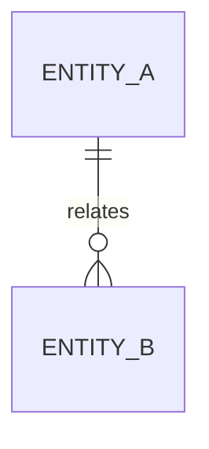
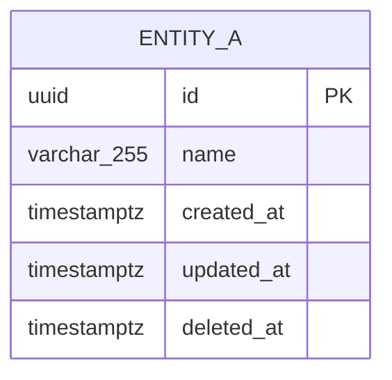
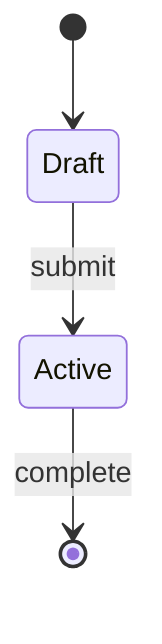

# Architecture Overview

> **SA/LB artifact** — Source of truth for system design (dual twin: `nwob-docs/sdd/masterplan.md` — same body). Align with `nwob-docs/sdd/epic-spec.md` (backlog index + HL US/TS).
> Constitution: `.cursor/rules/constitution-core.mdc`
>
> **Authors:** Solution Architect **or** Lead Builder — `/c4` … `/ops`, `/architecture`, `/orchestrate-design`. Dual-persist this file ↔ `nwob-docs/sdd/masterplan.md` on every write. Pod Builder must not author.
>
> **Populate order:** `/c4` fills System Context + Container View first; `/services` fills Data Flow, Data Models, State Machine, and design-time DB maintenance; `/ops` completes DB Maintenance & Operation runtime subsections.
> Per-container deepenings: flat `nwob-docs/sdd/components/{component-name}-plan.md` (lazy-created; no nested folders).

## System Context

<!-- C4 Level 1 — users, external systems, boundaries. Required before /pattern. Mermaid per architecture-governance SKILL. -->



## Container View

<!-- C4 Level 2 — logical containers. Technology-agnostic on first pass; refine in /platform and /services.
     Per-container detail: nwob-docs/sdd/components/{component-name}-plan.md (same section set as system SoT; complements this file).
     Authors: SA or LB via /services, /orchestrate-design. -->



## Data Flow Diagram

<!-- /services — same topology as Container View; relabel edges with payload semantics only (e.g. HTTPS / JSON API request, order.created / JSON event). -->



## Data Models

<!-- /services — three mandatory subsections. Logical and Physical require Mermaid erDiagram blocks. -->

### Conceptual

<!-- Domain entities, relationships, bounded-context ownership. erDiagram preferred when >=2 entities. -->



### Logical

<!-- Mandatory erDiagram — every field on each entity; PK/FK marked; no store-specific types. -->

```mermaid
erDiagram
  ENTITY_A {
    id PK
    name
    created_at
    updated_at
    deleted_at
  }
```

### Physical

<!-- Mandatory erDiagram — same entities as logical; every field includes physical data type (e.g. uuid, varchar_255, timestamptz). -->



## State Machine

<!-- /services — primary domain aggregate lifecycle. Mermaid stateDiagram-v2 per aggregate. -->



## Key Decisions

<!-- Link to ADRs in `nwob-docs/architecture/adr/` -->

## Integration Points

<!-- APIs, events, sync vs async with justification. Logical → physical mapping: nwob-docs/architecture/service-map.md -->

## Non-Functional Requirements

<!-- Availability, scalability, security, observability -->

## Effective Technology Stack

<!-- Resolve from user prompt, SDD artifacts, ADRs; default per Default technology stack in constitution-core when unspecified -->

## DB Maintenance & Operation

<!-- /services: Schema & Migrations, Data Retention & DLM. /ops: Backup & Recovery, Performance Maintenance, Monitoring & Runbooks. -->

### Schema & Migrations

<!-- Flyway ownership, rollback policy, index strategy (/services) -->

### Data Retention & DLM

<!-- Soft-delete purge cadence; links to Data Lifecycle (/services) -->

### Backup & Recovery

<!-- Backup/restore, PITR, RPO/RTO (/ops) -->

### Performance Maintenance

<!-- Connection pooling, read replicas, vacuum/maintenance windows (/ops) -->

### Monitoring & Runbooks

<!-- DB monitoring alerts, runbook links tied to SLOs (/ops) -->

## Data Lifecycle

<!-- Effective policy per Default data lifecycle in constitution-core or overrides -->
