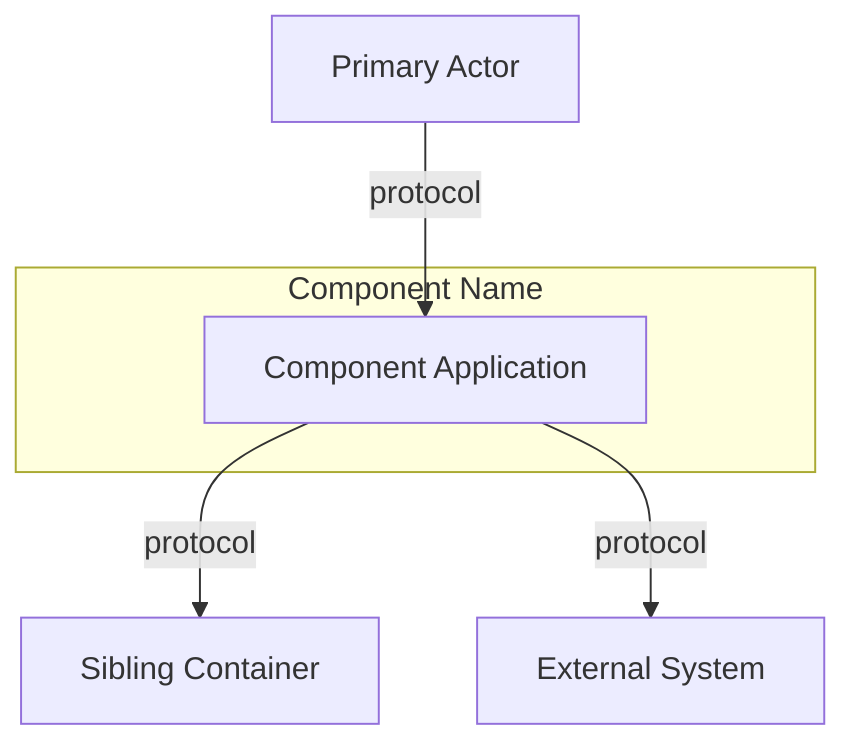
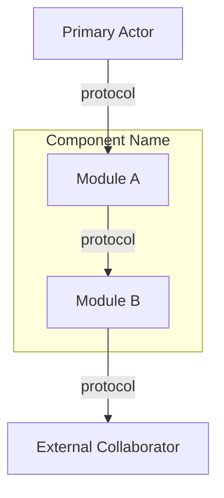
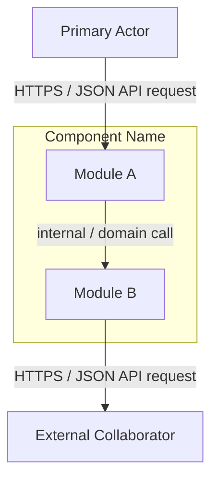
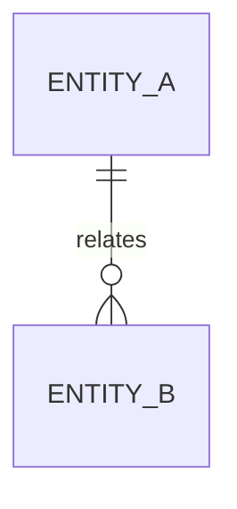
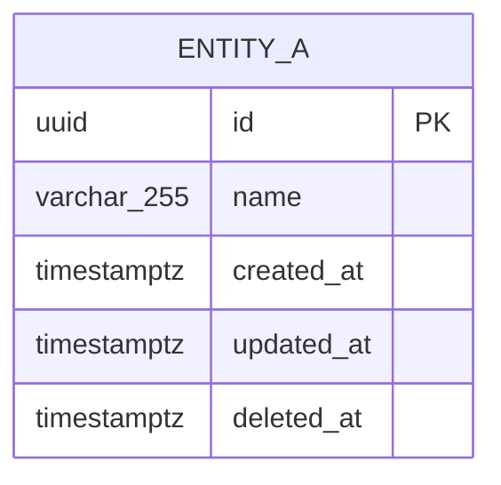
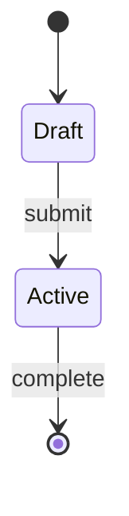

# Component Plan — {Component Name}

> **SA/LB artifact (per container)** — Deepens one C4 container / logical service.
> Path: `nwob-docs/sdd/components/{component-name}-plan.md` (flat; no per-component folder).
> Complements system SoT at `nwob-docs/architecture/architecture.md` / `nwob-docs/sdd/masterplan.md`; **MUST NOT** contradict system boundaries, stack, or NFRs.
> Derived from `epic-spec.md`. Constitution: `.cursor/rules/constitution-core.mdc`
>
> **Parent architecture:** [`nwob-docs/architecture/architecture.md`](../../architecture/architecture.md) (dual: [`nwob-docs/sdd/masterplan.md`](../masterplan.md))
> **Component name:** `{component-name}` (kebab-case; matches Container View / `service-map.md` logical service)
>
> **Authors:** SA **or** Lead Builder — `/services` (design-time); `/ops` (runtime DB Maintenance when this component owns a store); `/orchestrate-design`. Pod Builder must not write this path.
>
> **Populate order:** `/services` (or SA/LB `/orchestrate-design`) fills design-time sections; `/ops` completes DB Maintenance & Operation runtime subsections when applicable.
>
> **Consistency checklist (before done):**
> - [ ] Linked parent `architecture.md` / `masterplan.md` above
> - [ ] File path is flat `sdd/components/{component-name}-plan.md` (no nested folder, no `component-spec.md` twin)
> - [ ] Component name matches Container View / service-map row
> - [ ] No conflicting stack, boundaries, or NFRs vs `architecture.md` / `masterplan.md`
> - [ ] System-wide topology remains in `architecture.md` / `masterplan.md`; this file is component-scoped only

## System Context

<!-- Component-scoped immediate collaborators. System L1 stays in architecture.md. Mermaid flowchart preferred. -->



## Container View

<!-- Internal modules of THIS container (C4 L3). System L2 Container View stays in architecture.md. -->



## Data Flow Diagram

<!-- /services — same topology as Container View; relabel edges with payload semantics. -->



## Data Models

### Conceptual



### Logical

```mermaid
erDiagram
  ENTITY_A {
    id PK
    name
    created_at
    updated_at
    deleted_at
  }
```

### Physical



## State Machine



## Key Decisions

<!-- Link to ADRs in `nwob-docs/architecture/adr/` that apply to this component. -->

## Integration Points

<!-- APIs, events, sync vs async for THIS component. Logical → physical mapping: nwob-docs/architecture/service-map.md -->

## Non-Functional Requirements

<!-- Component-scoped budgets; align with architecture.md NFRs. -->

## Effective Technology Stack

<!-- Component-effective stack from architecture.md, ADRs, SDD; constitution defaults when unspecified. -->

## DB Maintenance & Operation

### Schema & Migrations

<!-- Flyway ownership, rollback policy, index strategy (/services) -->

### Data Retention & DLM

<!-- Soft-delete purge cadence (/services) -->

### Backup & Recovery

<!-- Backup/restore, PITR, RPO/RTO (/ops) -->

### Performance Maintenance

<!-- Connection pooling, read replicas, vacuum/maintenance windows (/ops) -->

### Monitoring & Runbooks

<!-- DB monitoring alerts, runbook links (/ops) -->

## Data Lifecycle

<!-- Effective policy for this component's stores; must not contradict architecture.md -->
