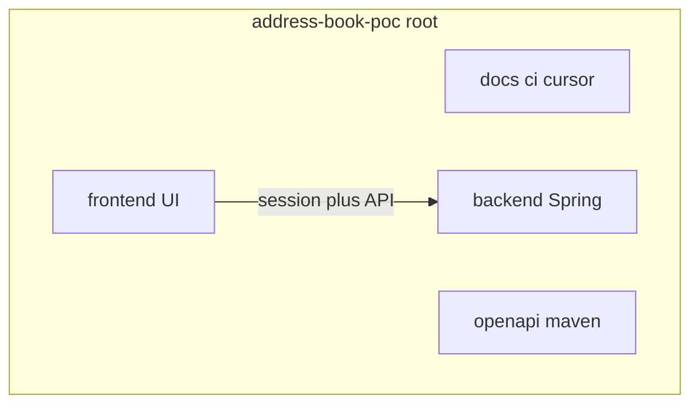

# Test the workflow on an address-book POC (3 milestones, backend/ + frontend/)

Prove the agents-v0 lifecycle on a CRUD address book with a web UI. **Repo root** holds delivery kit assets (`docs/`, `ci/`, `.cursor/`). **Application code** lives in [`backend/`](backend/) (Spring) and [`frontend/`](frontend/) (Svelte or React). The agents-v0 kit repo itself is unchanged.

## Target repo layout



**After kit install (before P0 Build):**

```text
address-book-poc/
├── AGENTS.md
├── .cursor/
├── ci/
├── docs/                 # project-profile, milestones, …
├── maven/                # kit snippets → merge into backend/pom.xml
├── openapi/
├── backend/              # Spring Initializr (only app code here)
│   ├── pom.xml
│   ├── mvnw
│   └── src/
├── .gitlab-ci.yml        # adjust build to backend/ (see below)
└── README.md
```

**After P2:** same tree with `frontend/` populated and Flyway under `backend/src/main/resources/db/migration/`.

- **Repo:** `/Users/marlondurana/REPO/address-book-poc`
- **Backend:** `backend/` — Java 17, Spring Boot 3.x, Web, Validation, Security, Data JPA, H2 file, Flyway, Actuator
- **Frontend:** `frontend/` — SvelteKit or React; scaffolded in P0 Build after Intake records the choice
- **Auth / contacts / milestones:** unchanged from the prior plan (P0 shell, P1 API, P2 UI; no BFF, no push/MR)

If you already have Spring at **repo root** (flat Initializr), move `pom.xml`, `mvnw`, `mvnw.cmd`, `.mvn/`, `src/`, and `HELP.md` into `backend/` before `bootstrap-greenfield.sh`, then re-run `./mvnw -B test` from `backend/`.

---

## 1. Install and validate the kit

Follow [docs/greenfield-onboarding.md](docs/greenfield-onboarding.md). **Order:** git root → Spring in `backend/` → bootstrap at **repo root** → profile + CI fix.

**Scaffold backend** (Initializr `baseDir=backend`):

```bash
mkdir -p /Users/marlondurana/REPO/address-book-poc
cd /Users/marlondurana/REPO/address-book-poc
git init -b main
curl -fsSL "https://start.spring.io/starter.zip?type=maven-project&language=java&javaVersion=17&baseDir=backend&groupId=com.example&artifactId=address-book&name=address-book&packageName=com.example.addressbook&dependencies=web,validation,security,data-jpa,h2,flyway,actuator" -o /tmp/address-book-backend.zip
unzip -q /tmp/address-book-backend.zip -d .
cd backend && ./mvnw -B test && cd ..
```

**Install kit** (from agents-v0):

```bash
./scripts/bootstrap-greenfield.sh --tool cursor /Users/marlondurana/REPO/address-book-poc
./scripts/validate-kit.sh --target /Users/marlondurana/REPO/address-book-poc
```

**`docs/project-profile.md`** (required for agents):

| Field | Value |
|-------|--------|
| Layout | Spring service: `backend/`; UI: `frontend/` (created P0 Build); OpenAPI: `openapi/api-v1.yaml`; delivery: repo root |
| Backend verify | `cd backend && ./mvnw -B clean verify -P!ci-security` (after P0 wires plugins; until then `cd backend && ./mvnw -B test`) |
| Frontend verify | TBD until `frontend/` exists; then e.g. `cd frontend && npm run verify` or `npm test` |
| Local run | `cd backend && ./mvnw spring-boot:run` plus `cd frontend && npm run dev` |
| Database | H2 file under `backend/` (document path in profile after P1) |

**CI alignment:** seeded [templates/.gitlab-ci.yml](templates/.gitlab-ci.yml) expects root `pom.xml`. For this layout, during prep (or P0 Build) update the POC’s `.gitlab-ci.yml` `build` job so it runs Maven from `backend/` (e.g. `cd backend` before `./mvnw`, and `rules:exists` on `backend/pom.xml`). Same idea for [templates/.github/workflows/build-and-security.yml](templates/.github/workflows/build-and-security.yml) if you use GitHub. Record this in `docs/project-profile.md` Layout and optionally a one-line ADR (“monorepo: delivery at root, Maven in backend”).

**Maven quality starters:** merge kit `maven/quality-plugins.xml` (and related files) into **`backend/pom.xml`**, not a root POM. ArchUnit / test paths stay under `backend/src/`.

**Manifests:** narrow P0–P2 to one story each (same artifacts as before: `p0-a-platform-shell`, `p1-a-contact-api`, `p2-a-address-book-ui`).

**Install passes when:**

- `validate-kit.sh --target` exits 0
- `cd backend && ./mvnw -B test` is green
- `docs/project-profile.md` documents `backend/` and `frontend/` layout and backend verify command
- CI file updated so a future pipeline can build `backend/` (local POC may still skip remote CI)
- P0–P2 manifests each have one concrete story path
- Initial commit only after you authorize it

---

## 2. Replies used at every gate

Work in the POC chat. The agent appends a `Delivery approvals` row only after you send these. Approver is you unless you substitute another name.

UI answer, only when P0 Intake asks:

```text
Svelte
```

```text
React
```

Phase approval:

```text
Approved — proceed to the next phase.
Approver: <your name>
```

Commit, when Build or Verify left `commit:` blank and verify is green:

```text
Commit this phase evidence. Use a message that explains why this milestone slice exists. Set commit: to that full sha in the reports you just wrote. Do not push.
```

Milestone go/no-go, after that milestone’s release checks exit 0:

```text
Approved — milestone go.
Approver: <your name>
```

Status, any time:

```text
/status

Report the change tier, which milestone and story are in progress, which approval rows exist, whether the evidence files exist, and the single next command. Do not start that phase.
```

---

## 3. Milestone 1 prompts — P0 platform shell

### Intake

```text
/intake

Feature artifact: docs/requirements/p0-a-platform-shell.md
Tier: Major (new service and new greenfield UI).
Milestone: P0 — Platform Skeleton
Story: P0-A

As a developer, I want to run this address-book app locally and sign in to an empty home shell, so that I can confirm the stack and session work before contact data exists.

Repo layout: Spring code only under backend/. UI only under frontend/ (scaffolded in Build). Delivery kit, docs, ci, and openapi stay at repo root. Record this in docs/project-profile.md Layout.

In scope:
- Quality plugins bound to verify in backend/pom.xml (JaCoCo, Checkstyle, SpotBugs, ArchUnit). OWASP Dependency-Check on the CI security profile only.
- GET /api/v1/health is public and returns only {"status":"UP"}.
- One local user from APP_USER and APP_PASSWORD. HttpOnly session cookie. A sign-in screen and an empty home screen after login. No contact data yet.
- Ask "Svelte or React?" once, then stop and wait for my answer before writing UX requirements that depend on it. Record the answer in this artifact and in docs/project-profile.md. Do not ask again in later milestones.

UX after my answer: WCAG 2.1 AA, desktop Chrome and a 375px-wide viewport, design system = semantic HTML only, testable criteria for sign-in success, sign-in error, and empty home.

NFRs: no secrets in the repo; health JSON has no internals.
Regulations: none beyond keeping future contact data unlogged; no contact fields exist yet.
Security-review triggers: new session login, new public health route, new UI.

Out of scope: contacts, contact API, contact screens, BFF, OAuth, Docker, push, merge request.

Confirm the P0 manifest lists only this story. Write the requirements artifact. Resolve every open question with me. Stop at the Intake gate.
```

### Design — system pack

```text
/design

Prerequisite: docs/requirements/p0-a-platform-shell.md has an Approved Intake row. If it does not, stop.

Do only the Major-tier system-design pack for the whole address-book program, then stop.

Produce short versions of:
- docs/design/system/context-map.md — backend/ service, frontend/ browser UI, H2 in backend/. No BFF, no broker, no cache. P1 will add contacts. P2 will add contact screens in frontend/.
- docs/design/system/nfr-slo.md — local-only.
- docs/design/system/threat-model.md — session cookie, public health, future contact data.
- docs/network.md — local only: backend API port and frontend dev server port.
- One ADR under docs/adr/ for monorepo layout (backend/ + frontend/), H2 file, session login, semantic HTML only, and domain events = N/A.

Stop. Do not write the P0 feature contract or UX spec yet.
```

### Design — shell contract and UX

```text
/design

System-design artifacts are approved. Continue P0-A feature design. Use the recorded Svelte or React decision. Do not ask again.

- OpenAPI at openapi/api-v1.yaml for GET /api/v1/health and the local login session. No contact paths yet.
- One RFC 7807 error envelope.
- No domain events. Point at the ADR.
- Mermaid sequence: sign in, then land on the empty home shell.
- docs/design/p0-a-platform-shell/ux-spec.md — sign-in and empty home only, with loading, error, and success states, WCAG 2.1 AA, desktop and 375px, semantic HTML only.
- Static HTML mockups under docs/design/p0-a-platform-shell/mockups/, one file per screen state. No API calls.
- A component-default row for every interactive control (name, screen, mockup, OpenAPI operation or —, default behavior, override). Shared controls are defined once.

Stop at the Design gate. Do not write application code. Do not ask for approval while a mockup lacks a component row or a row lacks its mockup.
```

### Build

Scaffold the UI after Design is approved (repo root):

- **Svelte:** `npx sv create frontend`, then set frontend verify and dev commands in `docs/project-profile.md`.
- **React:** Vite + React in `frontend/`, same profile update.

```text
/build

Prerequisite: Approved Design row for P0-A names the OpenAPI, ADR, diagram, docs/design/p0-a-platform-shell/ux-spec.md, and the mockups that spec links. If any are missing, stop.

Baseline first: run every command in docs/project-profile.md before edits (cd backend …; cd frontend … once frontend/ exists). If red, stop.

Implement only the platform shell:
- Merge kit maven/ quality starters into backend/pom.xml. OWASP on the CI security profile. Local backend verify: cd backend && ./mvnw -B clean verify -P!ci-security.
- Health route, session login, correlation id, traceparent, error body without stack traces — all Java under backend/src/.
- frontend/ shell for the recorded framework: sign-in and empty home matching the UX spec component defaults and the linked mockups. API calls use only the OpenAPI operations named on those rows. No contact UI. No BFF module. No Java or UI at repo root outside backend/ and frontend/. Leave the Design mockups static.
- Patch .gitlab-ci.yml (and GitHub workflow if present) so CI builds backend/ when root has no pom.xml.
- Tests under backend/: health, successful login, rejected anonymous access to a non-health route.
- Backend and frontend verify both green per project-profile.

Do not commit until I say so. Write docs/build/p0-a-platform-shell/build-report.md with citations and leave commit: blank. Stop at the Build gate.
```

### Verify

```text
/verify

Prerequisite: Approved Build row and docs/build/p0-a-platform-shell/build-report.md with a commit: sha. If missing, stop.

Run test-engineer, security-reviewer, then code-reviewer for P0-A:
- Backend coverage at least 80% and frontend at least 70% on this change, or stop and report the gap.
- axe-core on sign-in and empty home in frontend/. UX report at docs/verify/p0-a-platform-shell/ux-report.md.
- test-report.md, vapt-checklist.md (F1–F7; N/A only with a reason), review-notes.md under docs/verify/p0-a-platform-shell/.
- Same commit: on every report. If you add tests, ask me to commit them before stamping.

Critical findings go back to Build. Otherwise stop at the Verify gate.
```

### Release readiness and milestone go

```text
/release

Prerequisite: Approved Verify row for P0-A and the test, VAPT, UX, and review reports, with no open Critical findings. If missing, stop.

Update README with: cd backend && ./mvnw spring-boot:run and cd frontend && npm run dev.
Fill the merge-request template with Feature-Artifact: docs/requirements/p0-a-platform-shell.md and the VAPT sign-off.

Run:
- sh ci/check-approvals.sh docs/requirements/p0-a-platform-shell.md
- sh ci/check-evidence.sh docs/requirements/p0-a-platform-shell.md build
- sh ci/check-evidence.sh docs/requirements/p0-a-platform-shell.md verify

Do not commit, push, or open a merge request. Record the release row only after I approve readiness. Stop and report.
```

After that approval is recorded:

```text
Record the P0 milestone go/no-go.

Set the milestone row in docs/milestones/p0-platform-skeleton.md only after I send milestone approval.
Run:
- sh ci/check-milestone.sh docs/milestones/p0-platform-skeleton.md release
- sh ci/check-approvals.sh docs/milestones/p0-platform-skeleton.md milestone

Do not start P1. Do not push.
```

---

## 4. Milestone 2 prompts — P1 contact API

Start only after the P0 milestone row is Approved.

### Intake

```text
/intake

Feature artifact: docs/requirements/p1-a-contact-api.md
Tier: Standard
Milestone: P1 — Contracts and Data Models
Story: P1-A

Prerequisite: P0 milestone row is Approved. If it is not, stop.

As a signed-in user, I want to create, list, view, update, and delete contacts through the API, so that my address book persists across restarts.

Contact fields: display name (required), email, phone, street, city. Email, when present, must be valid. Persist with the existing H2 file and a Flyway migration under backend/src/main/resources/db/migration/. Data survives a restart.
All /api/v1/contacts routes require the P0 session. Do not log email or phone.
Implementation stays in backend/ only. Update openapi/api-v1.yaml to match.
UI: no new screens in frontend/. UX requirements are N/A because this story does not change the shell. Record that reason.
Security-review triggers: new authenticated CRUD of personal data.
Domain events: N/A, already decided in the P0 ADR.

Out of scope: contact screens, a second user, import/export, BFF, messaging, push, merge request.

Write the requirements artifact with AC IDs. Stop at the Intake gate.
```

### Design

```text
/design

Prerequisite: Approved Intake row on docs/requirements/p1-a-contact-api.md. If missing, stop.

P1 is Standard. Do not repeat the system-design pack.

- Extend openapi/api-v1.yaml with /api/v1/contacts list, create, get, update, delete.
- Idempotency-Key on create. Keep the single RFC 7807 envelope.
- Flyway table described in an ADR (contact columns, required display name).
- Mermaid sequence: signed-in client creates a contact and then lists it.
- UX spec N/A, with the Intake reason. Do not add frontend/ screens.

Stop at the Design gate. Do not write code.
```

### Build

```text
/build

Prerequisite: Approved Design row names the contact OpenAPI, the migration ADR, and the sequence diagram. If missing, stop.

Baseline first, using docs/project-profile.md (backend and frontend verify). If red, stop.

Implement only the contact API in backend/ on top of the P0 shell:
- Flyway migration, layered packages (api → service → repository), DTOs, validation, @PreAuthorize on mutations, session required on every contact route.
- Tests under backend/: create, list, get, update, delete, validation failure, unauthenticated rejection, restart-persistence for the H2 file.
- Do not change frontend/ except if a compile break forces a no-behavior fix. No contact screens.
- Backend and frontend verify both green.

Do not commit until I say so. Write docs/build/p1-a-contact-api/build-report.md with commit: blank. Stop at the Build gate.
```

### Verify

```text
/verify

Prerequisite: Approved Build row and docs/build/p1-a-contact-api/build-report.md with a commit: sha. If missing, stop.

Verify P1-A:
- Backend coverage at least 80% on this change, or stop and report the gap.
- UX report N/A with the reason that no frontend/ screen changed. Skip axe-core for new routes because there are none.
- test-report.md, vapt-checklist.md, review-notes.md under docs/verify/p1-a-contact-api/.
- Same commit: on every report.

Critical findings go back to Build. Otherwise stop at the Verify gate.
```

### Release readiness and milestone go

```text
/release

Prerequisite: Approved Verify row for P1-A, no open Critical findings. If missing, stop.

Update README with example contact API calls against the running backend/.
Fill the merge-request template with Feature-Artifact: docs/requirements/p1-a-contact-api.md and the VAPT sign-off.

Run:
- sh ci/check-approvals.sh docs/requirements/p1-a-contact-api.md
- sh ci/check-evidence.sh docs/requirements/p1-a-contact-api.md build
- sh ci/check-evidence.sh docs/requirements/p1-a-contact-api.md verify

Do not commit, push, or open a merge request. Stop and report readiness.
```

After the release row is Approved:

```text
Record the P1 milestone go/no-go in docs/milestones/p1-contracts-and-data-models.md only after I send milestone approval.
Run:
- sh ci/check-milestone.sh docs/milestones/p1-contracts-and-data-models.md release
- sh ci/check-approvals.sh docs/milestones/p1-contracts-and-data-models.md milestone

Do not start P2. Do not push.
```

---

## 5. Milestone 3 prompts — P2 address book UI

Start only after the P1 milestone row is Approved.

### Intake

```text
/intake

Feature artifact: docs/requirements/p2-a-address-book-ui.md
Tier: Standard
Milestone: P2 — MVP / Core Features
Story: P2-A

Prerequisite: P1 milestone row is Approved. If it is not, stop.

As a signed-in user, I want to add, list, view, edit, and delete contacts in the browser, so that I can manage my address book without calling the API directly.
Use the P1 API in backend/ as-is. Use the Svelte or React decision recorded in P0. Do not ask again.
All UI work stays in frontend/. No API contract changes unless you stop and ask.

UX: WCAG 2.1 AA, desktop Chrome and 375px, semantic HTML only.
Testable UX criteria for list, create, view, edit, delete, empty list, loading, and error.
After delete, the list no longer shows that contact. After refresh, remaining contacts are still there.

Security-review triggers: UI now exposes personal data and mutating actions.
Out of scope: API redesign, BFF, import/export, photos, push, merge request.

Write the requirements artifact. Stop at the Intake gate.
```

### Design

```text
/design

Prerequisite: Approved Intake row on docs/requirements/p2-a-address-book-ui.md. If missing, stop.

Standard tier. Do not repeat system design. Do not change the P1 contact contract. If a screen cannot be built on that contract, stop and tell me.

- docs/design/p2-a-address-book-ui/ux-spec.md — flows for list, create, view, edit, delete; per-screen loading, empty, error, and success; keyboard path; WCAG 2.1 AA; desktop and 375px; semantic HTML only.
- Static HTML mockups under docs/design/p2-a-address-book-ui/mockups/, one file per screen state. No API calls.
- A component-default row for every interactive control (name, screen, mockup, OpenAPI operation from the P1 contract or —, default behavior, override). Do not invent endpoints. Shared controls are defined once.
- Mermaid flowchart for create-then-see-on-list, and for delete-then-absent-from-list.
- ADR only if a UI-only decision needs one. Otherwise record ADR N/A with a reason.

Stop at the Design gate. Do not write code. Do not ask for approval while a mockup lacks a component row or a row lacks its mockup.
```

### Build

```text
/build

Prerequisite: Approved Design row names docs/design/p2-a-address-book-ui/ux-spec.md and the mockups that spec links. If missing, stop.

Baseline first using docs/project-profile.md. If red, stop.

Implement contact screens only in frontend/ on the existing backend/ API and session:
- List, create form, detail, edit form, delete confirmation.
- Empty, loading, and error states from the UX spec, matching the linked HTML mockups. Honor each component default, including an override when the spec records one.
- API base URL from frontend config (proxy or env). Call only the OpenAPI operation named on each component row. Session cookie from P0 login. No BFF. No new backend endpoints. Leave the Design mockups static.
- Frontend tests for the UX acceptance criteria. Backend test only if a P1 API defect blocks the UI; fix in backend/ in this story and cite it.
- Backend and frontend verify both green.

Do not commit until I say so. Write docs/build/p2-a-address-book-ui/build-report.md with commit: blank. Stop at the Build gate.
```

### Verify

```text
/verify

Prerequisite: Approved Build row and docs/build/p2-a-address-book-ui/build-report.md with a commit: sha. If missing, stop.

Verify P2-A:
- Frontend coverage at least 70% on this change, or stop and report the gap.
- axe-core on list, form, and detail in frontend/. Cover every UX acceptance criterion.
- docs/verify/p2-a-address-book-ui/ux-report.md, test-report.md, vapt-checklist.md, review-notes.md.
- Same commit: on every report.

Critical findings go back to Build. Otherwise stop at the Verify gate.
```

### Release readiness and milestone go

```text
/release

Prerequisite: Approved Verify row for P2-A, no open Critical findings. If missing, stop.

Update README so a newcomer can run backend + frontend and manage a contact in the browser.
Fill the merge-request template with Feature-Artifact: docs/requirements/p2-a-address-book-ui.md and the VAPT sign-off.

Run:
- sh ci/check-approvals.sh docs/requirements/p2-a-address-book-ui.md
- sh ci/check-evidence.sh docs/requirements/p2-a-address-book-ui.md build
- sh ci/check-evidence.sh docs/requirements/p2-a-address-book-ui.md verify

Do not commit, push, or open a merge request. Stop and report readiness.
```

After the release row is Approved:

```text
Record the P2 milestone go/no-go in docs/milestones/p2-mvp-core-features.md only after I send milestone approval.
Run:
- sh ci/check-milestone.sh docs/milestones/p2-mvp-core-features.md release
- sh ci/check-approvals.sh docs/milestones/p2-mvp-core-features.md milestone

Do not start P3. Do not push.
```

---

## 6. Expected directory checkpoints

| Stage | You should see |
|-------|----------------|
| After scaffold | `backend/pom.xml`, `backend/src/`; no `frontend/` yet |
| After bootstrap | `+ docs/`, `ci/`, `.cursor/`, `maven/`, `openapi/` at root; still no `frontend/` |
| After P0 | `+ frontend/`; quality wired in `backend/pom.xml` |
| After P1 | `+ backend/.../db/migration/`; contact packages in `backend/` |
| After P2 | Contact routes/components in `frontend/` |

---

## 7. Pass / fail

**Passes when:**

- `validate-kit.sh --target` passed before P0 Intake.
- P0, P1, and P2 each stopped at every phase; each Approved row was written only after your reply.
- One UI framework recorded in P0 and used in P2.
- Layout: no Spring `src/` at repo root; code only under `backend/` and `frontend/`.
- P0: sign-in and empty home. P1: API contact survives restart. P2: browser sign-in, create, list, view, edit, delete, empty state.
- Backend and frontend verify green on each story’s evidence commit (`cd backend` / `cd frontend` per project-profile).
- `check-milestone.sh` and `check-approvals.sh` exit 0 for P0, P1, P2 milestone rows.
- No secrets, no remote, no merge request.

**Fails when:** a later milestone starts before the previous milestone row is Approved; a gate is skipped; approval is inferred; verify is red; a Critical finding remains; a report lacks `commit:`; Java or UI land outside `backend/` / `frontend/`; or P2 cannot complete the address-book path.

---

## 8. What you will be asked

- OK to create or reshape `address-book-poc` with `backend/` layout
- OK to commit and to patch `.gitlab-ci.yml` for `backend/`
- `Svelte` or `React` in P0 Intake
- Gate and milestone approvals as in section 2
