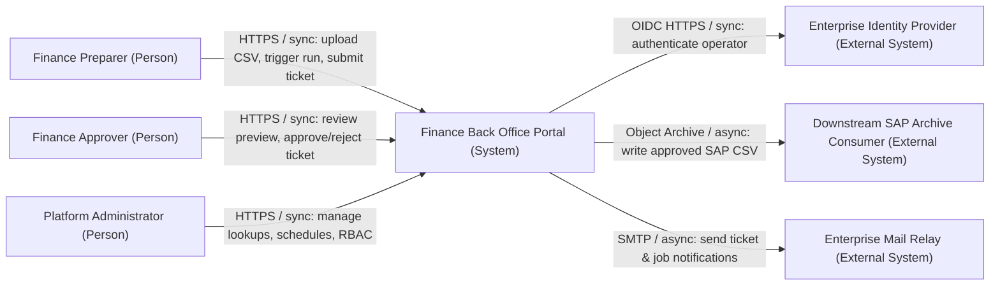
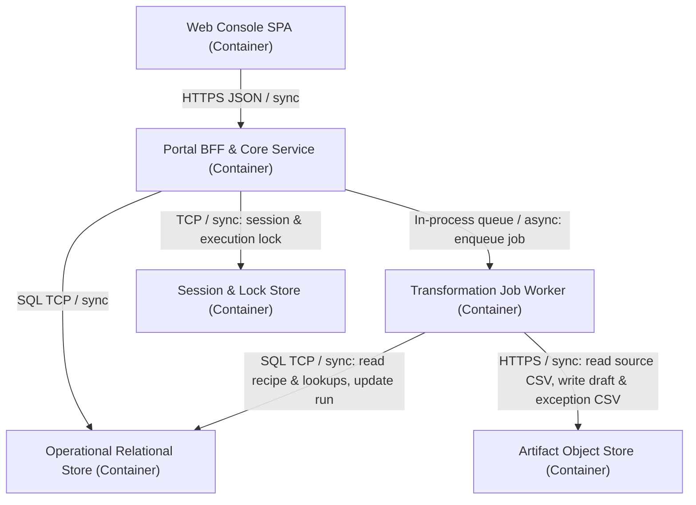
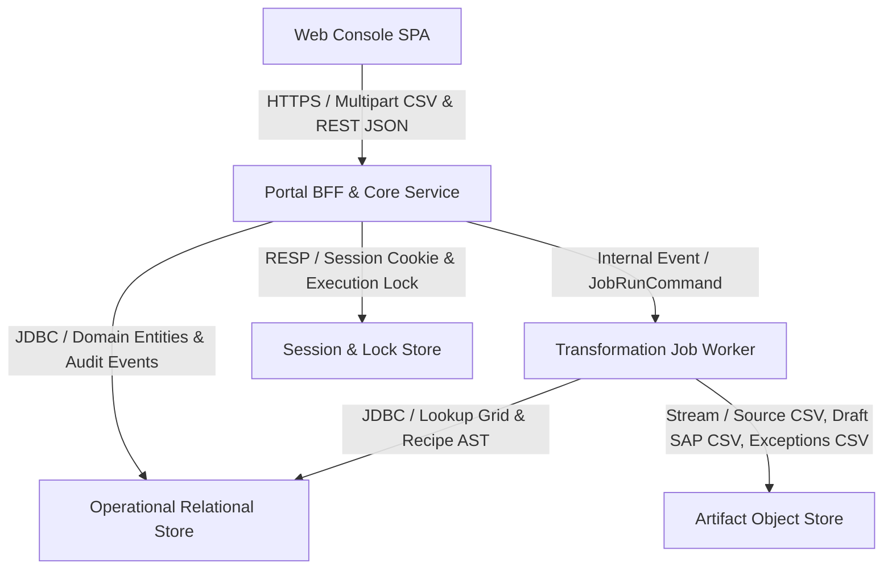
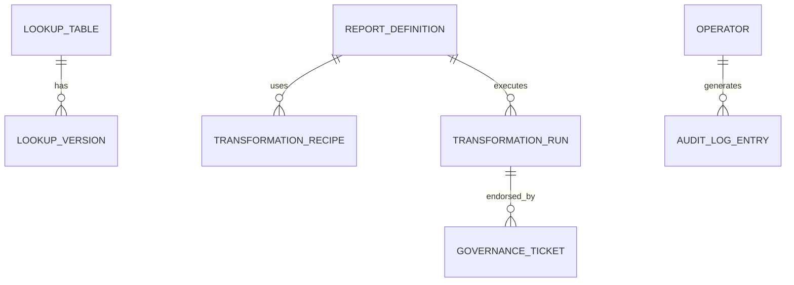
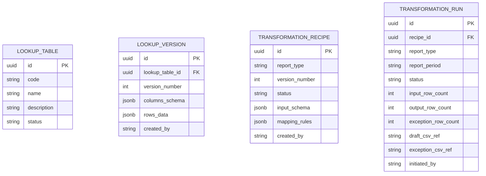
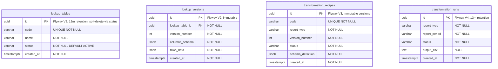
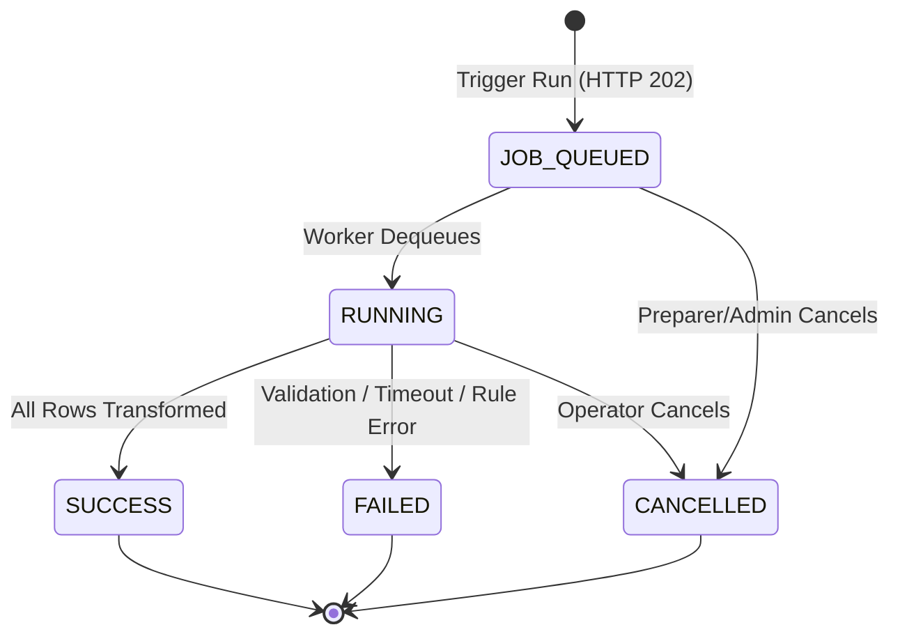

# Program Architecture: Finance Back Office Portal

## C4 Context

## C4 Container

## Data flow

## Data models

### Conceptual

### Logical

### Physical

## State machine

## Failure domains and degradation

| Dependency | What degrades | What halts | Validation |
|------------|---------------|------------|------------|
| Session / Lock Store | Active user sessions fail closed (HTTP 401) | New authenticated API calls and ticket cutovers | Integration test simulating store unavailability |
| Relational Database | All read/write endpoints return RFC 7807 `503` | Run submissions, lookup edits, ticket approvals | HikariCP readiness health check & Testcontainers |
| Artifact Object Store | CSV preview and download endpoints return `503` | Transformation worker file archival | Storage health indicator |

## MVP and future state

- **MVP State**: Single modular monolith (`app/backend` + `app/frontend`) handling `UPLOAD_ONLY` CSV ingestion, versioned lookup tables, transformation recipes, and the 5 seeded Funding Cost Summary SAP commission CSV exports.
- **Future State Trigger**: Extract `Transformation Job Worker` into an independent worker deployment if concurrent batch files exceed 50 MB or scheduled S3 polling (`S3_POLL`) introduces sustained CPU contention on the BFF tier.

## Delivery approvals

| Phase | Artifacts | Approver | Decision | Date |
|-------|-----------|----------|----------|------|
| architecture | docs/agents-v0/architecture.md, docs/agents-v0/network.md, docs/agents-v0/adr/0001-modular-monolith-architecture.md, docs/agents-v0/design/system/context-map.md, docs/agents-v0/design/system/nfr-slo.md, docs/agents-v0/design/system/threat-model.md, docs/agents-v0/design/system/ops-readiness.md, docs/agents-v0/design/system/arc-record.md, docs/agents-v0/design/system/architecture-review.md | mdurana | Approved | 2026-10-28 |
