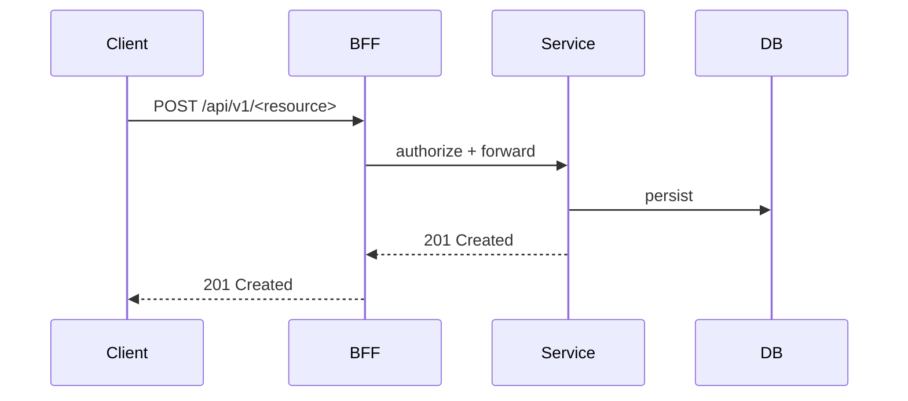

# Sequence: <service>

> Non-trivial flow for <service>. Follow Mermaid conventions (`architecture-and-diagrams.mdc`).

## <Flow name>

## Notes

- Idempotency key on non-idempotent creates (`api-and-events.mdc`).
- Correlation ID propagated end-to-end.
