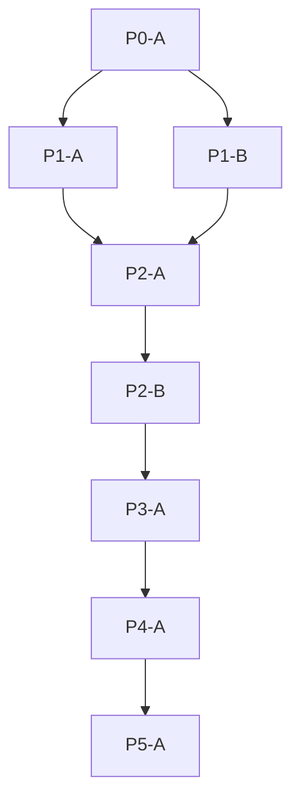

# Program Plan

| Milestone | Stories | What they cover |
|-----------|---------|-----------------|
| P0 | P0-A | Known-good Java/React platform skeleton, quality gates, and local container baseline |
| P1 | P1-A, P1-B | Versioned reference lookup tables and declarative transformation recipe schemas |
| P2 | P2-A, P2-B | MVP Funding Cost Summary transformation run, SAP CSV export, and maker-checker posting tickets |
| P3 | P3-A | Scheduled S3_POLL ingestion and runtime execution lock governance |
| P4 | P4-A | NFR/SLO latency, batch throughput, and fail-closed session hardening |
| P5 | P5-A | Production runbooks, alerting, and database operational readiness |

