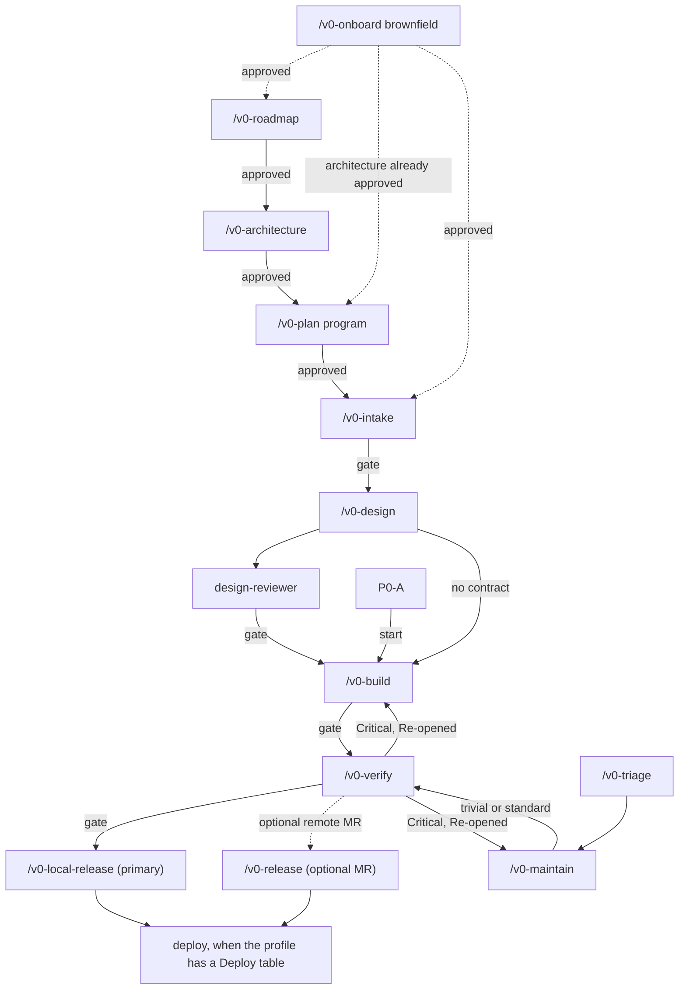

# Kit reference

Engineer's map of the `agents-v0` delivery kit: the workflow, the records, and how quality and human gates are enforced. Approvers use [user-guide.md](user-guide.md). This file describes the kit as installed; each phase command (`core/common/commands/`) and skill (`core/common/skills/*/SKILL.md`) is the procedure, and this page shows how the pieces fit together.

The kit is **local-first and IDE-portable** (Cursor, Claude Code, Antigravity, Windsurf, and VS Code Copilot). `scripts/install.sh` installs `AGENTS.md`, commands, skills, agents, and rules into the workspace. Phase quality is enforced by **phase skills, isolated reviewer subagents, and the bound stack pack's native build/test command** rather than brittle Markdown regex scripts.

## Workflow



A standard story follows the solid path: **Intake → Design → Build → Verify → Local Release** (or optional `/v0-release` when publishing a remote merge request). A new multi-story program runs **Roadmap → Architecture → Plan** before entering the story path.

`/v0-deliver` runs one story end-to-end by following each phase command and stopping at every human gate that applies. It does not run `/v0-export` or `/v0-deck`.
- **P0-A (platform skeleton):** Skips Intake and Design. Build copies the milestone story and `AC-1` through `AC-4`, writes the minimal `N/A` design, and runs through Verify to a single human approval gate at Release (`/v0-local-release` or `/v0-release`).
- **Contract-free stories (`Contract: None`):** A story with no OpenAPI draft, no AsyncAPI or `events/` contract, no UX spec, no new public route other than `/health`, `/ready`, or `/live`, and `Material: no` records `N/A: no /api/v1 operation` and `N/A: no event contract` in `design.md` and continues directly into Build without a separate Design approval stop.

| Edge | What it means |
|------|----------------|
| Onboard, dotted | An existing repo is documented as-is before feature work. A greenfield repo skips this. |
| Roadmap | A new program of more than one story. Pass the discovery file path to `/v0-roadmap`. Single tickets, existing milestones, Maintain, and Triage skip this. |
| Architecture | Runs after Roadmap and before story work. Produces C4 through operations and the ARC pack, reviewed by `design-reviewer`. The pattern ADR records `Pack: <id>` (`java`, `dotnet`, `node`, `python`, `go`, plus optional `ui`). Approving Architecture runs `.agents-v0/scripts/activate-stack-pack.sh`, populating `docs/agents-v0/project-profile.md` and activating the stack pack's rules and skills. |
| Plan | Turns the approved roadmap and architecture pack into milestones (`docs/agents-v0/milestones/plan.md` and `<milestone>.md`) with ordered stories (`Surface` and `Size` on each story). Single-story work skips Plan. |
| Design review | `design-reviewer` writes `review.md` whenever the story includes an OpenAPI draft, AsyncAPI or `events/` contract, UX spec, public route (other than `/health`, `/ready`, `/live`), or `Material: yes`. Design cannot advance until `review.md` has zero open Critical findings and the cited ADR is `Accepted`. |
| P0-A start | `bootstrap-greenfield.sh --scaffold-app` extracts the Java example archive when `Pack: java`, or follows the bound pack's scaffold skill. Skips Intake and Design; stops once for human approval at Release. |
| Local release (primary) | Runs after Verify is approved, or for P0-A when `verifyPassed` is `true` at the single Release gate, or for a maintenance note with `tier: emergency` when `maintain` is approved and the note records a rollback plan and `Follow-up verify due`. Re-verifies the working tree with the stack pack's native verify command, merges the feature branch into the target branch locally (`git merge --no-ff`) upon explicit user confirmation, and marks the story `released` in `<feature>.state.json`. |
| Remote release (optional) | Used when the team ships via remote GitLab merge requests instead of local merge. Renders the MR body and opens the MR upon user confirmation. |
| Verify back to Build / Maintain | Any `Critical` finding from `test-engineer`, `security-reviewer`, or `code-reviewer` on an unreleased story or note sets `activeStatus: "in_progress"` and `activePhase: "build"` (or `"maintain"`) in the state file and increments `reopenCount` (capped at 3 bounces before mandatory user escalation). A released `tier: "emergency"` note does not reopen: owed Verify blocks `verify` and the fix starts as a new maintenance id. |
| Triage | Docs-only or 1-for-1 patch version bump confirmed by the user; uses abbreviated Verify (native build/test + CVE check, skipping reviewer subagents). |

`/v0-status` is read-only: it inspects the active `state.json` file(s) and names the exact command to run next.

## Commands

| Command | When | Record |
|---------|------|--------|
| `/v0-onboard` | Existing brownfield repo, once | `docs/agents-v0/onboarding/report.md`, `docs/agents-v0/onboarding/state.json` |
| `/v0-roadmap` | New multi-story program | `docs/agents-v0/roadmap/<program>.md`, `docs/agents-v0/program.state.json` |
| `/v0-architecture` | After roadmap, before stories | `docs/agents-v0/architecture.md`, `docs/agents-v0/design/system/arc-record.md` |
| `/v0-plan` | Multi-story backlog planning | `docs/agents-v0/milestones/plan.md`, `docs/agents-v0/milestones/<milestone>.md` |
| `/v0-intake` | One story's Gherkin `AC-*` and NFRs | `docs/agents-v0/requirements/<feature>.md`, `<feature>.state.json` |
| `/v0-design` | Contracts, ADR, and UX before code | `docs/agents-v0/design/<feature>/` |
| `/v0-build` | Red-to-green implementation per unit | `docs/agents-v0/build/<feature>/plan.md`, `build-report.md` |
| `/v0-verify` | Native test/coverage run + security & code review | `docs/agents-v0/verify/<feature>/quality-gate.md`, `vapt-checklist.md`, `code-review.md` |
| `/v0-local-release` | Merge verified feature branch locally | Updates `<feature>.state.json` (`lastApprovedPhase: "release"`) + local merge commit |
| `/v0-release` | Optional remote MR workflow | Merge request ready for human merge |
| `/v0-maintain` | Bugfix, CVE, upgrade, refactor, doc sync | `docs/agents-v0/maintain/<id>/note.md`, `docs/agents-v0/maintain/<id>/state.json` |
| `/v0-triage` | User-confirmed trivial doc/version fix | `docs/agents-v0/maintain/<id>/note.md` (`tier: "trivial"` in `state.json`) |
| `/v0-deliver` | Orchestrates one story across phases, stopping at each gate | Updates `<feature>.state.json` and `<feature>.phase-result.md` |
| `/v0-export` | On-demand Jira CSV export | `docs/agents-v0/backlog/tickets.csv` |
| `/v0-deck` | On-demand executive briefing deck | `docs/agents-v0/presentations/<name>.md` |
| `/v0-status` | Inspect current phase and next action | Read-only status summary |

## State and Approvals (`state.json`)

Workflow state, artifact pointers, and human approvals live in structured JSON state files managed by `.agents-v0/scripts/sync-feature-state.sh`:

| Work Stream | State File | Phases Tracked |
|-------------|------------|----------------|
| Feature story | `docs/agents-v0/requirements/<feature>.state.json` | `intake`, `design`, `build`, `verify`, `release` |
| Maintenance / Triage | `docs/agents-v0/maintain/<id>/state.json` | `maintain`, `verify`, `release` |
| Brownfield Onboard | `docs/agents-v0/onboarding/state.json` | `onboard` |
| Program (Roadmap / Arch / Plan) | `docs/agents-v0/program.state.json` | `roadmap`, `architecture`, `plan` |

### Canonical `<feature>.state.json` Structure

```json
{
  "feature": "order-cancellation",
  "tier": "standard",
  "lastApprovedPhase": "build",
  "approvedPhases": ["intake", "design", "build"],
  "phaseDates": {
    "intake": "2026-10-19",
    "design": "2026-10-20",
    "build": "2026-10-21"
  },
  "activePhase": "verify",
  "activeStatus": "awaiting_approval",
  "blockedReason": "",
  "verifyPassed": true,
  "reopenCount": 0,
  "helperBriefHashes": [],
  "artifact": "docs/agents-v0/requirements/order-cancellation.md",
  "baseCommit": "a1b2c3d4e5f6...",
  "updatedAt": "2026-10-21T08:30:00Z",
  "artifacts": {
    "primary": "docs/agents-v0/requirements/order-cancellation.md",
    "design": "docs/agents-v0/design/order-cancellation/design.md",
    "openapi": "docs/agents-v0/design/order-cancellation/openapi.yaml",
    "buildPlan": "docs/agents-v0/build/order-cancellation/plan.md",
    "buildReport": "docs/agents-v0/build/order-cancellation/build-report.md",
    "verify": [
      "docs/agents-v0/verify/order-cancellation/quality-gate.md",
      "docs/agents-v0/verify/order-cancellation/vapt-checklist.md",
      "docs/agents-v0/verify/order-cancellation/code-review.md"
    ]
  }
}
```

- **How gates work:** At the end of a phase, the agent writes `<feature>.phase-result.md`, runs `sh .agents-v0/scripts/sync-feature-state.sh --active-phase <phase> --status awaiting_approval <artifact>`, and stops its turn.
- **How approval works:** Nothing advances until the user explicitly approves in chat (or records an `Approved` row). Upon user approval, the orchestrator runs `sh .agents-v0/scripts/sync-feature-state.sh --approve <phase> <artifact>`, which appends the phase to `approvedPhases`, updates `lastApprovedPhase`, clears `activePhase`, and indexes all created phase artifacts on disk.
- **Resuming work:** Re-entering any `/v0-*` command reads `<feature>.state.json` (`artifacts` map and `baseCommit`) and continues from existing files on disk without recreating approved artifacts.
- **Parallel feature isolation:** After Intake is approved, `/v0-intake` runs `.agents-v0/scripts/feature-worktree.sh <feature>` once the user confirms (not P0-A). A standard or emergency maintenance note runs `.agents-v0/scripts/feature-worktree.sh --maintain <id>` on branch `maintain/<id>`. A trivial note stays on the integration branch. Two active features in one checkout stop if they touch overlapping files.

## Design

`/v0-design` produces contract-first specifications guided by the `contract-first-design` and `ux-design` skills:

| File | Contents |
|------|----------|
| `docs/agents-v0/design/<feature>/openapi.yaml` | Written when the story adds or modifies an HTTP operation. OpenAPI 3.0+, unique `operationId`, security scheme, `Idempotency-Key` on mutating POSTs, standard error envelope. |
| `docs/agents-v0/design/<feature>/asyncapi.yaml` & `events/` | Written when the story publishes or consumes events. Event schema changes remain backward-compatible and additive. |
| `docs/agents-v0/design/<feature>/design.md` | Traces every `AC-*` from Intake, data model, per-operation authorization matrix, failure modes, observability, and rollout. |
| `docs/agents-v0/adr/<NN>-<slug>.md` | Architectural Decision Record comparing at least two options (`Status: Proposed` → `Accepted` on Design approval). |
| `docs/agents-v0/design/<feature>/ux-spec.md` & `mockups/` | Written for UI stories. Interactive elements carry `data-component` attributes; mockups are self-contained HTML/CSS. |
| `docs/agents-v0/design/<feature>/review.md` | Written by `design-reviewer`. Must have zero open `Critical` findings before Design approval. |

If Build or Verify discovers that an approved contract must change, the agent stops, updates the design artifact, re-runs `design-reviewer`, and asks the user to re-approve Design before continuing.

## Architecture Pack

`/v0-architecture` writes the system-level baseline under `docs/agents-v0/` using the `program-architecture` skill and validates it with `design-reviewer`:

| File | Contents |
|------|----------|
| `docs/agents-v0/architecture.md` | C4 Context and Container diagrams, transport-labelled data flows, conceptual/logical/physical `erDiagram` models, state machine, failure domains, MVP vs. target state. |
| `docs/agents-v0/network.md` | Network zones, protocol-labelled edges, and trust/security boundaries. |
| `docs/agents-v0/adr/<NN>-<slug>.md` | Pattern ADR selecting `Pack: <id>` and comparing candidate architectures across cost, security, reliability, and operability. |
| `docs/agents-v0/design/system/context-map.md` & `components/<service>.md` | Bounded contexts, service roots, contracts, sequence diagrams, and per-service component plans. |
| `docs/agents-v0/design/system/nfr-slo.md` & `threat-model.md` | Availability/latency SLOs, RPO/RTO targets, and STRIDE threat model. |
| `docs/agents-v0/design/system/ops-readiness.md` | Runbook template, error-budget policy, database operations, and production readiness checklist. |
| `docs/agents-v0/design/system/arc-record.md` | Architecture Review Committee recommendation and structural fitness functions. |
| `docs/agents-v0/design/system/architecture-review.md` | `design-reviewer` evaluation of the complete architecture pack. |

## Build and Verify

### Build (`/v0-build`)
1. Starts from a clean, green baseline and writes `docs/agents-v0/build/<feature>/plan.md` mapping every `AC-*` from Intake to concrete implementation units, target files, test cases, and risk level (`standard` vs. `critical`).
2. Executes units in dependency order using the bound pack's implementation skills (`implement-service`, `implement-bff`, `implement-frontend`) and strict red-to-green TDD.
3. **Failure budgets:** Each unit attempt is logged in `docs/agents-v0/build/<feature>/build-report.md`.
   - If the same test fails twice consecutively, Build stops and routes a helper brief to `debug-investigator` (`.agents-v0/scripts/check-failure-brief.sh`) before a third attempt.
   - A third consecutive failure on the same test, or exceeding 8 total failed attempts across the phase (`.agents-v0/scripts/check-attempt-budget.sh`), stops Build and escalates to the user.

### Verify (`/v0-verify`)
Verify combines **deterministic native stack execution** with **role-separated subagent reviews**:
1. **`test-engineer` (`quality-gate` skill):**
   - Resolves the project layout (`.agents-v0/scripts/resolve-layout.sh`) and the bound pack's native verify command (`.agents-v0/scripts/run-backend-verify.sh` only prints the `pack.json` command, e.g., `dotnet test`, `./mvnw -B clean verify -Pci-security`, `npm test`, `pytest`, or `go test ./...`). The caller executes the printed command.
   - Verifies that every `AC-*` in `requirements/<feature>.md` has a corresponding passing test, checks diff coverage against `docs/agents-v0/quality-gates.md` (default $\ge 80\%$ on changed lines), and records results in `docs/agents-v0/verify/<feature>/quality-gate.md`.
2. **`security-reviewer` (`vapt-review` skill) & `code-reviewer` (`pr-review` skill):**
   - Inspect `git diff <baseCommit>...HEAD`, `requirements/<feature>.md`, and `design/<feature>/` against `security-baseline`, `vapt-webapp`, `vapt-pr-review`, `code-review`, and the active stack pack rules.
   - Write `docs/agents-v0/verify/<feature>/vapt-checklist.md` and `docs/agents-v0/verify/<feature>/code-review.md`.
   - Any `Critical` finding (including unauthenticated endpoints, broken access control, injection, hardcoded secrets, or missing negative security tests) marks `"verifyPassed": false` and routes an unreleased story or note back to Build/Maintain (`--reopen build`, or `--reopen maintain` when the note is not released). A released `tier: "emergency"` note blocks `verify` (`--active-phase verify --status blocked`) and starts a new `/v0-maintain` id. It does not `--reopen maintain`.
   - When all three reports pass with zero `Critical` findings, `<feature>.state.json` records `"verifyPassed": true` and pauses for human approval.

## Local Release (`/v0-local-release`) and Remote Release (`/v0-release`)

- **`/v0-local-release` (Primary workflow):**
  1. Verifies `"verifyPassed": true`. A feature story, including one that already approved Verify, also has `"verify"` in `approvedPhases`. P0-A enters with `verifyPassed: true` while `verify` may still be absent. An emergency maintenance note enters when `maintain` is approved and the note records a rollback plan and `Follow-up verify due`; `verify` stays unapproved until the owed `/v0-verify`.
  2. Ensures a clean git working tree and runs the stack pack's native verify command one final time.
  3. Prompts the user to confirm merging the feature branch into the integration branch (`git merge --no-ff <feature-branch>`), updates `<feature>.state.json` via `sync-feature-state.sh --approve release`, and optionally tags the release or updates `CHANGELOG.md` via `.agents-v0/scripts/release-notes.sh`.
- **`/v0-release` (Optional remote MR workflow):**
  - Renders the merge-request summary via `.agents-v0/scripts/render-mr-body.sh` and opens/updates the GitLab MR (`glab mr create`) upon user authorization. `glab mr merge` and `glab mr approve` remain permanently blocked by `pre-shell.sh`.

## Onboarding and Maintenance

- **Brownfield Onboarding (`/v0-onboard`):**
  - Runs `.agents-v0/scripts/audit-brownfield-baseline.sh`, `.agents-v0/scripts/generate-repo-map.sh`, `.agents-v0/scripts/collect-dependency-graphs.sh`, and `.agents-v0/scripts/discover-codebase.sh` (using `.agents-v0/scripts/endpoint_scan.py` and `.agents-v0/scripts/packlib.py`) to record the test/coverage baseline (`docs/agents-v0/discovery/baseline.md`) and inventory endpoints, entities, migrations, messaging, and config keys under `docs/agents-v0/discovery/`.
  - Auto-detects the stack pack via `.agents-v0/scripts/activate-stack-pack.sh --detect` when `Pack` is unset.
  - `codebase-documenter` writes `docs/agents-v0/onboarding/report.md`, per-module docs (`docs/agents-v0/onboarding/modules/<module>.md`), as-is system docs (`architecture.md`, `network.md`, `design/system/context-map.md`, `adr/0000-inherited-decisions.md`), and user-selected flow sequence diagrams (`docs/agents-v0/diagrams/sequences/<service>.md`) citing `path/File:line` (validated by `.agents-v0/scripts/check-onboarding-docs.sh`).
- **Maintenance (`/v0-maintain` & `/v0-triage`):**
  - Tracked in `docs/agents-v0/maintain/<id>/note.md` and `docs/agents-v0/maintain/<id>/state.json` (`tier`: `trivial`, `standard`, or `emergency`).
  - Bug fixes require a failing reproduction test before the fix; dependency upgrades record before/after dependency graphs. Trivial and standard changes flow into `/v0-verify` and `/v0-local-release`. An emergency note releases first when it records a rollback plan and `Follow-up verify due`; full `/v0-verify` is owed by that date. A `Critical` finding on that owed Verify blocks `verify` and starts a new maintenance id.

## Agents, Skills, Rules, and Cross-IDE Portability

| Layer | Location | How It Loads Across IDEs |
|-------|----------|--------------------------|
| **Always-On Conduct & Lifecycle** | Root `AGENTS.md` + `core/common/rules/{workflow-orchestration,project-delivery-core,ai-agent-conduct}.mdc` | Loaded automatically by Cursor (`.cursor/rules/`), Antigravity (`AGENTS.md`), Claude Code (`CLAUDE.md` / `AGENTS.md`), Windsurf, and Copilot. Combined always-on size is capped at $\le 32\text{ KB}$. |
| **Phase Playbooks (Skills)** | `core/common/skills/*/SKILL.md` & `core/<pack>/skills/*/SKILL.md` | Standard `SKILL.md` format. Each skill explicitly names the domain rules (`security-baseline`, `api-and-events`, pack `backend`/`frontend` rules) to read for that phase, avoiding unnecessary context bloat. |
| **Role Subagents** | `core/common/agents/*.md` & `core/<pack>/agents/*.md` | Spawned as isolated subagents in Cursor, Claude Code, and Antigravity; executed sequentially via phase skills in single-agent IDEs. Model routing is configured in `.cursor/model-config.json` via `.agents-v0/scripts/update-agents-model.sh`. |
| **Hub-and-Spoke Helpers** | `explore-researcher`, `debug-investigator`, `schema-author`, `docs-author` | Phase agents write `<slug>.helper-brief.md` (`helper:`, `outputs:`, `return:`, `ask:`) and return to the main session. Duplicate `ask:` digests are tracked in `state.json` (`helperBriefHashes`) to prevent infinite loops. |

## Safety Hooks

Two lightweight, deterministic guardrails protect local development without slowing down documentation or coding:

1. **Shell & Edit Guardrail (`pre-shell.sh` / `hook-policy.py` & `pre-edit.sh`):**
   - Blocks destructive shell commands (`git push --force`, `git reset --hard`, `rm -rf`, `glab mr merge`, `glab mr approve`), secret/credential file reads (`.env`, `*.pem`, `*.key`, SSH/cloud keys), and environment variable dumps (`env`, `printenv`, `export -p`).
   - Protects kit scripts and hook configurations (`.cursor/hooks/*`, `.agents-v0/scripts/*`, `.agents-v0/packs/*`) from agent modification.
   - Requires interactive user confirmation (`ask`) before `git commit`, `git merge`, `git push`, `git rebase`, `git tag`, or branch deletion.
2. **Optional Git Pre-Push Hook (`.agents-v0/hooks/pre-push`):**
   - A lightweight, IDE-agnostic Git hook (`sh scripts/install.sh --git-hooks <repo>`) that verifies any active `<feature>.state.json` on the branch has `"verifyPassed": true` (or `lastApprovedPhase` in `verify`/`release`) before pushing.

## Install & Update

```bash
./scripts/install.sh /path/to/repo
./scripts/install.sh --pack dotnet /path/to/repo
./scripts/install.sh --with-starters /path/to/repo
./scripts/install.sh --update /path/to/repo
./scripts/bootstrap-greenfield.sh --profile app --pack java --scaffold-app /path/to/new-repo
./scripts/validate-kit.sh
```

## Read Next

| Question | Document |
|----------|----------|
| How do I review and approve a phase? | [user-guide.md](user-guide.md) |
| How do I bootstrap a new greenfield repo? | [greenfield-onboarding.md](greenfield-onboarding.md) |
| How do I onboard an existing brownfield repo? | [brownfield-onboarding.md](brownfield-onboarding.md) |
| Which model runs which agent role? | [model-routing-matrix.md](model-routing-matrix.md) |
| Design fill-in templates | [snippets/README.md](snippets/README.md) |
