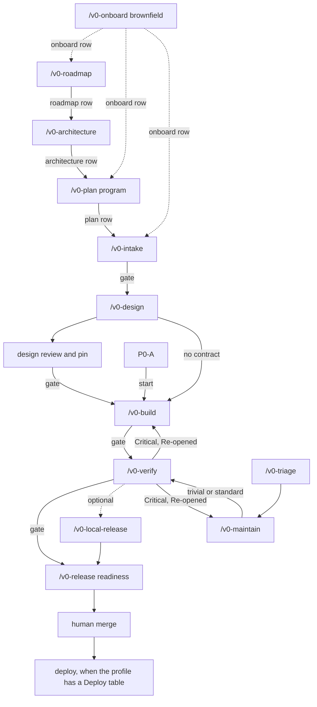

# Kit reference

Engineer's map of the agents-v0 delivery kit: the workflow, the records, and what is actually checked. Approvers use [user-guide.md](user-guide.md). This file describes the kit as installed; each phase command (`core/commands/`) is the procedure, and this page is how the pieces fit.

The kit targets **Cursor**. `scripts/install.sh` copies the core into `.cursor/`. Gates, approvals, and CI checks are documented here. Git hosting is on-prem GitLab (`glab`, `.gitlab-ci.yml`).

## Workflow



A standard story is the solid path: Intake, Design, Build, Verify, Release, then a person merges. Optional `/v0-local-release` may sit after Verify. After that checkpoint the next story may start, and `/v0-release` still ships this story later. Verify may also go straight to `/v0-release`. A new program of more than one story runs Roadmap, Architecture, and Plan before that path. `/v0-deliver` runs one story by following each phase command and stopping at every gate that applies. It does not run `/v0-export` or `/v0-deck`. It holds no phase steps of its own. P0-A skips Intake and Design: Build copies the milestone story and AC-1 through AC-4, writes the N/A design, and pins it. One approval at Release writes the five rows after the test report and the merge-request URL exist. Optional `/v0-local-release` may write Intake, Design, Build, and Verify first; Release then writes only the Release row. A later story with no `/api/v1` operation, no UX spec, and no public route pins and continues, unless it is `Material: yes`. The Build approval writes its Design row when that shortcut applies.

| Edge | What it means |
|------|----------------|
| Onboard, dotted | An existing repo is documented as it is before any feature work. A new repo skips this. |
| Roadmap | A new program of more than one story. The person points `/v0-roadmap` at a discovery file anywhere in the repo. The kit sequences it and does not rediscover the problem. A named ticket, a milestone that already has a `plan` row, Maintain, and Trivial skip this. |
| Architecture | After the roadmap and before any story. C4 through operations, then the ARC pack, checked by `ci/check-architecture-pack.sh` and reviewed by `design-reviewer`. One approval records the `architecture` row, sets the pattern ADR to `Accepted`, and names the ARC file. An `arc` row is a later amendment that supersedes that ADR. Who skips this command: `workflow-orchestration.mdc` Architecture. |
| Plan, dotted into the story path | The approved roadmap and architecture pack become milestones and an ordered backlog index (Surface and Size on each story). Plan does not rewrite the pack. One story skips Plan. P0-A does not require a roadmap or an architecture pack. |
| Design review and pin | `design-reviewer` writes `review.md` when the story has a contract, a UI, or a public route other than `/health`, `/ready`, or `/live`. That design, including the cited ADR, is hashed into `design.lock` after the Design approval. The pin requires the ADR's Status to be `Accepted`. A design with none of those is pinned without `review.md` and without a Design stop; the Design row is written with the Build approval. `Material: yes` still stops at Design. It cites the program ARC file when the `architecture` row already names it. An `arc` row is added only when the story changes that recommendation, and that change supersedes the pattern ADR. |
| P0-A start | Prefer `bootstrap-greenfield.sh --scaffold-app` so the bundled app archive seeds `app/backend` and `app/frontend`. The skeleton does not run Intake or Design. Build copies the milestone story and AC-1 through AC-4, writes the N/A design, and pins it — prove the template; do not reinvent it. Release writes the five rows. Optional `/v0-local-release` may write the first four. |
| Local release, dotted | Optional after Verify. Decision `Local` is not `Approved`. The next story may start. `/v0-release` does not require this edge. |
| Verify back to Build | A Critical finding sets that phase's approval to `Re-opened`. It is open until the user approves the re-run. |
| Maintain into Verify | A fix, patch, upgrade, or hotfix has its own note and then Verify. Trivial uses the abbreviated Verify. |
| Verify back to Maintain | A Critical finding on a fix re-opens Maintain, not the original feature's Build. |
| Triage | Docs-only or version-only, and only when `ci/classify-change.sh` says so and a person confirms. |
| Deploy | Optional, after the merge, one environment at a time. Records go in a later docs-only merge request. |

`/v0-status` does not move the work. It reads the state file and names the next command. For a program it also reports the `roadmap`, `architecture`, `plan`, and `arc` rows. An approved roadmap with no `architecture` row names `/v0-architecture`. It does not treat the Jira CSV or a deck as the next step.

## Commands

| Command | When | Record |
|---------|------|--------|
| `/v0-onboard` | An existing repo, once | `docs/agents-v0/onboarding/report.md` |
| `/v0-roadmap` | A new program. Pass the discovery file path | `docs/agents-v0/roadmap/<program>.md` |
| `/v0-architecture` | After the roadmap, before any story | `docs/agents-v0/architecture.md`, `docs/agents-v0/design/system/arc-record.md` |
| `/v0-plan` | More than one story, after architecture | `docs/agents-v0/milestones/<milestone>.md` |
| `/v0-intake` | One story's requirements, Gherkin `AC-*` with a failure case, or `Negatives: N/A` when no security trigger applies | `docs/agents-v0/requirements/<feature>.md` |
| `/v0-design` | Contract and design before code. ARC when `Material: yes` | `docs/agents-v0/design/<feature>/`, and `docs/agents-v0/design/system/arc-record.md` when material |
| `/v0-export` | When someone asks for a Jira copy | `docs/agents-v0/backlog/tickets.csv` |
| `/v0-deck` | When someone asks for a briefing from an approved story, or from the approved program | `docs/agents-v0/presentations/<name>.md` |
| `/v0-build` | Implement against the approved design | `docs/agents-v0/build/<feature>/` |
| `/v0-verify` | Tests, security, review | `docs/agents-v0/verify/<feature>/` |
| `/v0-local-release` | Optional, after Verify. Decision `Local`. The next story may start. Skip it to run `/v0-release` | `release` row with Decision `Local` |
| `/v0-release` | After Verify, or after Decision `Local`. Merge request, then a human merge | `Approved` `release` row, then the merge |
| `/v0-maintain` | Fix, CVE, upgrade, refactor, doc drift | `docs/agents-v0/maintain/<id>/note.md` |
| `/v0-triage` | A change the classifier calls trivial | the same note, `Tier: trivial` |
| `/v0-deliver` | One story. Stops at every gate that applies. P0-A stops once, at Release. `/v0-local-release` is optional | the feature's state file |
| `/v0-status` | Where the work is, and what to run next | read only |

Resume is the same in every phase. `scripts/sync-feature-state.sh` writes the state file. `lastApprovedPhase` comes only from an `Approved` row. `activeStatus` is `in_progress`, `awaiting_approval`, or `blocked`. Re-entering a command continues from the files on disk. It does not recreate them and it does not approve anything. Two features in one checkout stop when they would edit the same shared file. The usual fix is `scripts/feature-worktree.sh <feature>`, which needs one explicit authorization.

## Records

| Work | State file | Approval lives in |
|------|------------|-------------------|
| Feature | `docs/agents-v0/requirements/<feature>.state.json` | the requirements artifact, one row per phase |
| Onboarding | `docs/agents-v0/onboarding/state.json` | `docs/agents-v0/onboarding/report.md`, phase `onboard` |
| Maintenance | `docs/agents-v0/maintain/<id>/state.json` | the note, phases `maintain` and `verify` |
| Program | none | a `roadmap` row, then an `architecture` row on `docs/agents-v0/architecture.md`, then a `plan` row on each milestone manifest |
| ARC | none | an `arc` row on `docs/agents-v0/design/system/arc-record.md`, only when a material story amends the recommendation |
| Milestone go/no-go | none | a `milestone` row on the manifest |

The approvals table is five columns: Phase, Artifacts, Approver, Decision, Date. CI accepts `Approved`, `approved`, `yes`, or `pass` as the decision, and rejects `Not approved` and `Re-opened`. The Approver cell is the person's GitLab username (`@ada`), because the final job matches it to the real merge-request approval. Build and Verify evidence paths in that row must exist on disk and start with a `commit:` line for the tree that was tested. A later code change makes the line stale, and CI rejects it until the phase is re-run on the new commit.

`docs/agents-v0/requirements/<feature>.phase-result.md` is the handoff the next phase reads. It names the phase, the status, the artifacts, and one blocker per line. An Intake result also copies the user story, the acceptance-criterion count, the failure-scenario count, the regulations, and the open questions.

## Change tiers

| Tier | Fits when | Path |
|------|-----------|------|
| Trivial | `ci/classify-change.sh` says eligible: docs only, or a version bump that replaces lines one for one. No security surface, schema, major bump, or delivery artifact. A person confirms. | `/v0-triage`, then abbreviated Verify |
| Standard | A feature, or a fix within 800 changed source lines | Full chain, or `/v0-maintain` then full Verify |
| Major | A new service, an auth model, or a cross-cutting change | Standard, plus system design and threat-model notes |
| Emergency | A production incident. A person confirms. Rollback and a follow-up date are required. | May merge on the `maintain` row. Full Verify is owed by that date |

The classifier reads the diff. An agent does not get to call a code change trivial. CI runs the classifier again on the merge request.

## Design

Design writes, and does not touch the org catalog:

| File | Contents |
|------|----------|
| `docs/agents-v0/design/<feature>/openapi.yaml` | Only when the story adds a `/api/v1` operation. OpenAPI 3.0, unique `operationId`s, security, `Idempotency-Key` on POST, one error envelope. Otherwise `design.md` records `N/A: no /api/v1 operation` and this file is absent |
| `docs/agents-v0/design/<feature>/asyncapi.yaml` | Optional when the story publishes or consumes messages. AsyncAPI 2.x/3.x; channels align with `events/` |
| `docs/agents-v0/design/<feature>/events/` | Event schemas with `eventVersion`. Changes are additive |
| `docs/agents-v0/design/<feature>/design.md` | Every AC traced, data model, one authorization row per operation, failure modes, observability, rollout |
| `docs/agents-v0/adr/<NN>-<slug>.md` | A decision with at least two alternatives and Status `Proposed` or `Accepted`. A later decision supersedes it (`Superseded by ADR <NN>`) instead of rewriting it. `ADR: N/A: no product decision` when the reviewer is skipped |
| `docs/agents-v0/design/<feature>/ux-spec.md` and `mockups/` | UI only. Every control has `data-component` and a row. Mockups do not call the API |
| `docs/agents-v0/design/<feature>/review.md` | `design-reviewer` when there is a draft, a UX spec, or a public route other than `/health`, `/ready`, or `/live`. No open Critical, and the hash matches this design. Absent for an `N/A: no /api/v1 operation` design with no UI |
| `docs/agents-v0/design/<feature>/design.lock` | Date, hash, and reason. The hash includes the cited ADR. A contract, a UI, or a public route is pinned after that Design approval, and the pin requires Status `Accepted`. A no-contract design and P0-A are pinned first; the Approved row comes with the Build approval, or at Release for P0-A |

When `openapi.yaml` exists, `ci/check-openapi.sh lint` checks the draft and `compat` checks it against the catalog it will merge into. A missing draft is allowed. When `asyncapi.yaml` exists, `ci/check-asyncapi.sh lint` runs (also from `ci/check-design-contracts.sh` in CI). Build merges with `ci/check-openapi.sh merge` and proves it with `merged`. A service repo uses `openapi/<service>-v1.yaml`. A single-service repo uses `openapi/api-v1.yaml`.

A later edit to an approved design is an amendment, not a quiet change. Build or Verify stops, the design files change, the reviewer runs again, the user approves a row in `amendments.md`, and `ci/check-design.sh --pin` records the new hash. The pin includes the cited ADR. A changed decision supersedes that ADR. `ci/check-adr.sh` rejects a rewrite once an `Accepted` revision is in git history; before that commit it checks status and successors only. CI rejects a design that drifted from its lock.

## Architecture pack

`/v0-architecture` writes these files. The pack is complete when `sh .agents-v0/ci/check-architecture-pack.sh` passes and `design-reviewer` has no open Critical. After the `architecture` row, CI re-runs the check with `--approved` through `ci/check-milestone.sh`. A section that does not apply says `N/A: <reason>`; the heading stays.

| File | Contents |
|------|----------|
| `docs/agents-v0/architecture.md` | C4 Context and Container (no product names), Data flow (the Container nodes, edges relabelled `transport / payload`), Data models (conceptual, logical, physical `erDiagram`), State machine, Failure domains and degradation, MVP and future state |
| `docs/agents-v0/network.md` | Target topology: zones, protocol-labelled edges, security boundaries |
| `docs/agents-v0/adr/<NN>-<slug>.md` | The pattern ADR: two or more real options, a `Patterns considered` table compared on cost, security, reliability, and operability |
| `docs/agents-v0/design/system/context-map.md` | Bounded contexts and the service map: service root, contract, sequence diagram, component plan, status |
| `docs/agents-v0/design/system/components/<service>.md` | One component plan per context (from `_component.template.md`), or `N/A: <reason>`. Links its parent and never contradicts it |
| `docs/agents-v0/design/system/nfr-slo.md`, `threat-model.md` | SLO and RPO/RTO targets; assets, trust boundaries, STRIDE risks |
| `docs/agents-v0/design/system/ops-readiness.md` | Build-and-run ownership, error budget policy, database maintenance and operation, the P5 readiness checklist, a runbook template |
| `docs/agents-v0/design/system/arc-record.md` | Recommendation, plus structural fitness functions (principle, check, threshold, on failure). SLO targets stay in `nfr-slo.md` |
| `docs/agents-v0/design/system/architecture-review.md` | `design-reviewer` report on the pack |

## Build and verify

Build starts from a green baseline. A clean checkout of the default branch tip skips the pre-edit verify. It writes `docs/agents-v0/build/<feature>/plan.md` with one row per approved `AC-*`, and works red then green. Each attempt appends a card to `build-report.md`. The same test red twice goes to `debug-investigator` before a third try. A third red stops. The phase also has a total budget of failed attempts, default 8 (`scripts/check-attempt-budget.sh`).

The Build gate is not only the agent's report. CI checks:

| Check | Fails when |
|-------|------------|
| `ci/check-build-plan.sh` | An AC has no row, a done row names a test that does not exist, or that test was never red first |
| `ci/check-endpoint-auth.sh` | A new Spring mapping has no security annotation. `@PermitAll` marks a public one on purpose |
| `ci/check-frontend-calls.sh` | The frontend calls an `/api/` path the catalog does not list |
| `ci/check-openapi.sh merged` | The catalog is missing an operation or component from the approved draft |
| `ci/check-design.sh --verify-lock` | The design, including the cited ADR, changed after it was approved |
| `ci/check-gate-metrics.sh` | No tests ran, tests failed, changed-line coverage is under 80%, or an unsuppressed HIGH or CRITICAL CVE remains |

Verify runs `test-engineer` first. When `HEAD` is still the build report's commit and Verify adds no tests, it quotes that run and adds only diff coverage and the CVE report. Then `security-reviewer` and `code-reviewer` run together and write separate reports. Any applicable VAPT item left unchecked is Critical. A Critical list goes back to Build or Maintain. The reports are stamped with the commit that contains the tests, so the commit happens before the stamp. A trivial maintenance note skips the two reviewers and the UX and end-to-end checks. It still runs the build, the gate metrics, and a CVE scan. P0-A (`Story: P0-A`, `Milestone: P0`) runs only `test-engineer`, the full verify command, and the gate metrics. It skips `security-reviewer`, `code-reviewer`, the UX audit, and end-to-end tests. Its approval is the one Release approval.

## Release

`/v0-release` renders the merge-request body from the evidence (`scripts/render-mr-body.sh`) and dry-runs the local delivery gate with `scripts/check-delivery-gate-local.sh <feature>` (linkage with `CHECK_MR_APPROVER=0`, design contracts, build plan, endpoint authorization). It does not edit `architecture.md` or `network.md`; those stay a docs-only follow-up. When the build and verify reports already name `HEAD`, it does not commit them again. Copy `.agents-v0/hooks/pre-push` to `.git/.agents-v0/hooks/pre-push` to run that gate on push when the branch name matches `docs/agents-v0/requirements/<feature>.md`. The body names either `Feature-Artifact:` or `Maintain-Note:`, not both. Opening the merge request, and every commit and push, each need their own authorization. The CI fix loop stops after three rounds. A code fix in that loop goes back through Verify, because it makes the evidence commit stale.

After Verify or Release approval, teams may run `scripts/export-audit-pack.sh <feature>` to write `docs/agents-v0/release/<feature>/audit-manifest.json` (SHA-256 hashes of delivery evidence) for compliance archives.

The `release` row is written on the merge-request branch before the merge, with the GitLab username of the person who will approve it. A person merges. `glab mr merge` and `glab mr approve` are blocked. After the approval, someone plays the manual `delivery-approval` job (`glab ci trigger delivery-approval`). It matches that username to the `release` or `verify` row, using the CI scripts from the default branch.

The merge is the completion of the change. When the profile has a Deploy table, each environment after that needs its own authorization, a smoke check, and a rollback. Those records are a later docs-only merge request, not a commit on the default branch. The release owner picks the version and tag. `scripts/release-notes.sh` fills `CHANGELOG.md` from stories that have an Approved release row.

## Onboarding an existing repo

`/v0-onboard` does not move source and does not invent a future design. It runs the baseline, then `scripts/generate-repo-map.sh`, `scripts/collect-dependency-graphs.sh`, and `scripts/discover-codebase.sh`. The discovery files under `docs/agents-v0/discovery/` list endpoints, entities, migrations, messaging, configuration key names, frontend routes, and a security snapshot. When FastAPI, Express, Nest, or Go routers are present, `docs/agents-v0/discovery/endpoint-stacks.md` proposes rows for **Endpoint authorization** and, if that table is still empty, copies them into `docs/agents-v0/project-profile.md` for a person to confirm. Values of secrets are never written.

Each module gets `docs/agents-v0/onboarding/modules/<module>.md`. Every statement cites `path/File.java:42` or says `UNVERIFIED`. `scripts/check-onboarding-docs.sh` rejects a citation that does not resolve and any leftover `TEMPLATE:` line. Architecture, network, the context map, inherited decisions, and the flows the user names are written as they are. `/v0-intake` and `/v0-plan` wait for the `onboard` row.

## Maintenance

`docs/agents-v0/maintain/<id>/note.md` is the record. It has the tier, the trigger, what "done" means, the classifier output, and its own approvals. Evidence is `docs/agents-v0/build/<id>/` and `docs/agents-v0/verify/<id>/`. The merge request says `Maintain-Note:`. A code change that only points at an old feature artifact is rejected: that artifact's old Build row is not evidence for this fix.

| Tier | CI requires |
|------|-------------|
| trivial | A person's confirmation, the classifier still agrees, an Approved `verify` row |
| standard | Size within the limit, an Approved `verify` row |
| emergency | A person's confirmation, a rollback, a `Follow-up verify due` date. The `verify` row may come after the merge. `scripts/delivery-metrics.sh` marks it OVERDUE once the date passes |

A bug fix writes the reproducing test and shows it fail before the fix. A dependency upgrade records the release notes and a before/after dependency graph. A doc sync re-checks onboarding citations, because a code edit moves line numbers.

## Multi-service repos

The profile Layout lists `Service roots` (for example `services/order, services/inventory`). CI builds, measures, and scans each root. Each service has its own catalog, `openapi/<service>-v1.yaml`, and its own database. A story names `Service root:` and stays in one service. A call between two services is a third story, the integration story, and it depends on both. `docs/agents-v0/workspace.manifest.json` lists other git repositories. CI does not cross repository boundaries.

## Agents and models

The model is chosen by role. Cursor IDs are the role table in `docs/agents-v0/model-routing-matrix.md`. The Kit agent mapping in that file names which agent uses which role. `.cursor/model-config.json` holds the same defaults and is seeded on install. `scripts/install.sh` rewrites `.cursor/agents/*/model:` from that file by running `sh .agents-v0/scripts/update-agents-model.sh`. `KIT_MODEL_PLAN`, `KIT_MODEL_BUILD`, and the other `KIT_MODEL_*` variables override the file for that run. After install, edit `.cursor/model-config.json` and run that script again. Kit source under `core/agents/` keeps the matrix defaults.

| Role | Does |
|------|------|
| Plan | Program planning, requirements, architecture |
| Build | Services, BFF, frontend, tests, maintenance, release |
| Build (critical) | Auth, uploads, public routes, sagas, consumers — launched with the Plan model |
| Review | Design review, security review, code review — not the Build model |
| Explore | Repo exploration |
| Debug | Runtime failure root-cause |
| Schemas | Schema and unit-test sub-tasks |
| Docs | Doc drafting |
| Documenter | Brownfield onboard as-is documentation |
| Orchestrator | `/v0-deliver`, `/v0-status`, `/v0-onboard` |
| UX Designer | UX design |

Phase agents do not launch other agents. They write a helper brief and return. The main session launches `explore-researcher`, `schema-author`, `debug-investigator`, or `docs-author`, and passes the result back. The same brief a second time is a loop, and the session stops.

## What CI checks at merge

`ci/check-delivery-linkage.sh` is the front door. A merge request that changes code names a feature artifact or a maintenance note.

| Script | Checks |
|--------|--------|
| `check-approvals.sh` | The named phase has an explicit approval |
| `check-evidence.sh` | Recorded evidence exists, has `commit:`, and is not stale |
| `check-approver-gitlab.sh` | The Approver matches a human who approved the merge request |
| `check-milestone.sh` | Every story in a manifest has the phase approval, in dependency order |
| `check-design.sh` | The design is complete, and still matches its lock |
| `check-architecture-pack.sh` | The architecture pack is complete: C4 names no product, Data flow matches the Container nodes, data models, state machine, failure domains, target topology, ops readiness, a structural fitness function, component plans, and a clean architecture review. `--approved` also needs an Accepted pattern ADR |
| `check-design-contracts.sh` | Every feature draft: OpenAPI lint/compat, lock, UX spec, optional AsyncAPI lint |
| `check-openapi.sh` | The contract lints, is compatible, and was merged |
| `check-asyncapi.sh` | Optional `asyncapi.yaml` meets channel and message rules |
| `check-ux-spec.sh` | Spec rows and mockups agree |
| `check-build-plan.sh` | The plan matches the ACs and the tests were red first |
| `check-endpoint-auth.sh` | No new unannotated endpoint |
| `check-frontend-calls.sh` | Frontend calls match the catalog |
| `check-event-schemas.sh` | Event schemas stay additive |
| `check-gate-metrics.sh` | Tests, diff coverage, CVEs, from the build output |
| `classify-change.sh` | Whether a trivial note is still trivial |
| `check-layout-roots.sh` | A build with a `pom.xml` resolved a module to build |
| `check-coverage-ratchet.sh` | A coverage exception is approved and not expired |
| `check-known-failures.sh` | Failures stay inside the documented budget |

On GitLab the gate scripts are read from the default branch, so a merge request cannot rewrite the check that judges it. `.gitlab-ci.yml` supports `CI_IMAGE_PREFIX` for air-gapped container mirrors. `scripts/verify-gitlab-ci-prereqs.sh` checks the scoped token and documents DinD vs host Docker socket. `CODEOWNERS` covers the delivery records, `docs/agents-v0/design/`, `docs/agents-v0/adr/`, `openapi/`, `ci/`, and the installed commands, skills, agents, and rules.

## Hooks

Cursor runs the hook scripts via `.cursor/hooks.json`. They block force-push, hard reset, recursive delete, reading secret files, and commands that dump environment variables. They block edits to `ci/*.sh`, `scripts/check-delivery-gate-local.sh`, `scripts/verify-gitlab-ci-prereqs.sh`, `scripts/delivery-metrics.sh`, `scripts/export-audit-pack.sh`, `.agents-v0/hooks/pre-push`, and the installed commands, skills, agents, and rules. They block `glab mr merge` and `glab mr approve`. They ask before commit, push, `git rebase`, `git merge`, `git cherry-pick`, `git revert`, `git stash pop`/`drop`/`clear`, a new branch or worktree, `glab mr create`, `git tag`, and a mutating `glab api` call. Optional `.agents-v0/hooks/pre-push` skips branch-delete pushes (zero SHA). `after-edit.sh` warns on common VAPT mistakes and on new approval rows in delivery artifacts. CI and `CODEOWNERS` enforce the merge contract.

## Rules and skills

Three rules load in every Cursor session: `workflow-orchestration.mdc`, `project-delivery-core.mdc`, and `ai-agent-conduct.mdc`. Their combined size is capped at 32 KB. The other rules load with the files they apply to: Java, frontend, API and events, security, VAPT, quality, architecture, UX, code review.

Skills are the phase playbooks (`core/skills/*/SKILL.md`). The command names the skill. The skill does not restate the whole command.

## Install

```bash
./scripts/install.sh /path/to/repo
./scripts/install.sh --with-starters /path/to/repo
./scripts/install.sh --update /path/to/repo
./scripts/bootstrap-greenfield.sh --profile app --scaffold-app /path/to/new-repo
./scripts/pack-app-template.sh   # after editing templates/app/{backend,frontend}
./scripts/validate-kit.sh
```

`--with-starters` adds Maven quality snippets, Dockerfiles, and an OpenAPI starter. It does **not** copy `templates/app/` (the P0 codebase). Without `--with-starters`, the repo gets the rules, the commands, CI, and this documentation. `--update` refreshes kit-managed files and does not overwrite project-owned templates that already exist. Edit `.cursor/model-config.json` when remapping models to your enterprise allowlist, then run `sh .agents-v0/scripts/update-agents-model.sh`.

A new repo starts with `bootstrap-greenfield.sh --scaffold-app` to install the kit and extract `templates/app/p0-platform-skeleton.tar.gz` into `app/backend` and `app/frontend` ([greenfield-onboarding.md](greenfield-onboarding.md)). Default stack: Java 21, Spring Boot 4.1.1, Tomcat 11.0.26, Spring Security, PostgreSQL 15, Flyway, React 19, TypeScript 5.9, Vite 7, Vitest 3 — health/shell only. An existing repo starts with install (no `--scaffold-app`), then `/v0-onboard` ([brownfield-onboarding.md](brownfield-onboarding.md)).

## Read next

| Question | Document |
|----------|----------|
| How do I approve a phase? | [user-guide.md](user-guide.md) |
| How do I start a new repo? | [greenfield-onboarding.md](greenfield-onboarding.md) |
| Design fill-in snippets (less invent) | [snippets/README.md](snippets/README.md) |
| Should we thin always-on rules? | [token-optimization-assessment.md](token-optimization-assessment.md) |
| Which check enforces which rule? | [compliance-matrix.md](compliance-matrix.md) |
| Which model runs which role? | [model-routing-matrix.md](model-routing-matrix.md) |
| How do we measure a first run? | [benchmark/reference-project.md](benchmark/reference-project.md) |
| What command do I run? | `core/commands/<phase>.md` |
