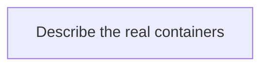

# Architecture

> System context for this service. `/v0-onboard` or the P0 build fills this file. A later feature updates it in a docs-only follow-up (`doc-sync`).
> Brownfield: `/v0-onboard` rewrites this file as-is. Every statement cites code (`path/File.java:42`) or says `UNVERIFIED`. Delete each `TEMPLATE:` line once it is replaced.

## Context

<!-- TEMPLATE: one paragraph — what this system is and who uses it. -->

## Containers

<!-- TEMPLATE: replace with a Mermaid flowchart of the services, BFF, frontends, data stores, and messaging that exist. Draw only what the code and config show. -->

## Service boundaries

| Service | Owns | DB | API |
|---------|------|----|----|
| <!-- TEMPLATE: e.g. order-service --> | <!-- Order aggregate --> | <!-- order_db --> | <!-- /api/v1/orders --> |

## Cross-cutting

<!-- TEMPLATE: how correlation ID, tracing, logging, auth, and health work in this system today, each with a citation. Kit defaults for new work: X-Correlation-ID header + MDC, W3C Trace Context (traceparent), JWT for users and X-API-Key or service Bearer for S2S, /health /ready /live. -->

## ADRs

See `docs/agents-v0/adr/`.
