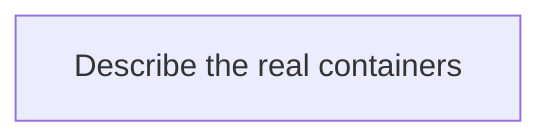
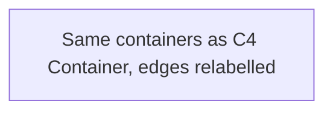

# Architecture

> System context for this service. `/v0-onboard` or the P0 build fills the as-is sections. `/v0-architecture` adds the target sections (C4, data flow, data models, state machine, failure domains, MVP and future state) and the `architecture` approval before any story. A later feature updates as-is text in a docs-only follow-up (`doc-sync`).
> Brownfield: `/v0-onboard` rewrites the as-is sections. Every statement cites code (`path/File.java:42`) or says `UNVERIFIED`. `/v0-architecture` keeps those citations and adds the target sections beside them. Delete each `TEMPLATE:` line once it is replaced.

## Context

<!-- TEMPLATE: one paragraph — what this system is and who uses it. -->

## Containers

<!-- TEMPLATE: replace with a Mermaid flowchart of the services, BFF, frontends, data stores, and messaging that exist. Draw only what the code and config show. -->

## Service boundaries

| Service | Owns | DB | API |
|---------|------|----|----|
| <!-- TEMPLATE: e.g. order-service --> | <!-- Order aggregate --> | <!-- order_db --> | <!-- /api/v1/orders --> |

## Cross-cutting

<!-- TEMPLATE: how correlation ID, tracing, logging, auth, and health work in this system today, each with a citation. Kit defaults for new work: X-Correlation-ID header + MDC, W3C Trace Context (traceparent), JWT for users and X-API-Key or service Bearer for S2S, /health /ready /live. -->

## ADRs

See `docs/agents-v0/adr/`.

## C4 Context

<!-- /v0-architecture: people and external systems. No product, database, or broker names. -->

## C4 Container

<!-- /v0-architecture: containers only, still technology-agnostic. The pattern ADR chooses technology. -->

## Data flow

<!-- /v0-architecture: the C4 Container diagram again, with the same node IDs. Relabel the edges only, as `transport / payload` (for example `HTTPS / JSON order request`, `async / order-created event`). Technology names are allowed once the pattern ADR is Accepted. `N/A: <reason>` when there is a single container. -->

## Data models

<!-- /v0-architecture: three levels. A level that does not apply says `N/A: <reason>`; do not delete the heading. -->

### Conceptual

<!-- /v0-architecture: domain entities, their relationships, and which bounded context owns each. A Mermaid erDiagram when there are two or more entities, otherwise a short table. -->

### Logical

<!-- /v0-architecture: a Mermaid erDiagram listing every field of every entity, with PK and FK marked and cardinality on the relationships. No store-specific types. -->

### Physical

<!-- /v0-architecture: a Mermaid erDiagram listing every field with its physical type (use underscores in type tokens: varchar_255, timestamptz). Table or schema names in the entity titles. Name who owns the migrations and how retention and soft delete apply. -->

## State machine

<!-- /v0-architecture: a Mermaid stateDiagram-v2 for each primary aggregate that has a lifecycle: states, transitions with their trigger (API call, event, scheduler), and terminal states. `N/A: <reason>` when nothing has a lifecycle. -->

## Failure domains and degradation

<!-- /v0-architecture: one row per dependency (database, cache, broker, outbound API, identity provider). Say what degrades, what halts, and what the user sees. Name how the row is validated (dependency-kill test, game day, or `not validated yet` with a milestone). -->

| Dependency | Failure | Blast radius | Degraded behaviour | Validation |
|------------|---------|--------------|--------------------|------------|
| | | | | |

## MVP and future state

<!-- /v0-architecture: the simplest topology that meets today's requirements, then what changes later and the trigger that would force it (for example "second team owns checkout", "p95 above target for two weeks"). -->

## Delivery approvals

| Phase | Artifacts | Approver | Decision | Date |
|-------|-----------|----------|----------|------|

> `/v0-architecture` appends the `architecture` row after one explicit approval. The Artifacts cell names `docs/agents-v0/design/system/arc-record.md`. An `arc` row is only for a later story that amends the recommendation. `/v0-plan` waits for the `architecture` row. Who skips this command: `workflow-orchestration.mdc` Lifecycle.
