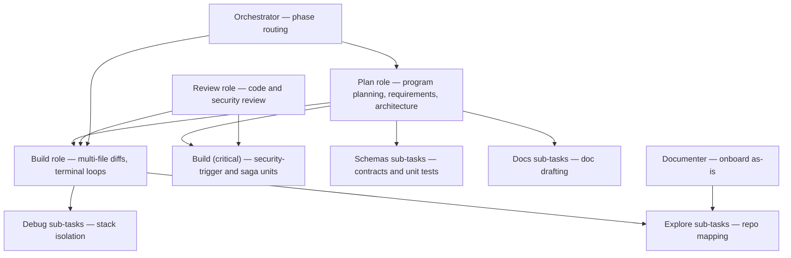

# Model routing matrix (agents-v0)

The kit routes by **role**. Each row lists the Cursor model ID for that role. Agent frontmatter carries `model:`; `scripts/validate-kit.sh` checks it against this matrix. Live model availability in Cursor is not verified.

Role IDs and defaults match `templates/.cursor/model-config.json` (installed to `.cursor/model-config.json` on the target repo).

| Role                 | Purpose                                                          | Cursor ID                                                  |
| -------------------- | ---------------------------------------------------------------- | ---------------------------------------------------------- |
| **Plan**             | program planning, requirements, architecture                     | `claude-sonnet-5-5-high`                                   |
| **Build**            | services, BFF, frontend, tests, maintenance, release             | `composer-2.5[fast=false]`                                 |
| **Build (critical)** | units that hit a security-review trigger, and sagas or consumers | the Plan model                                             |
| **Review**           | code review and security review, independent of the Build role   | `grok-4.7[context=500k,reasoning_effort=xhigh,fast=false]` |
| **Explore**          | repo exploration sub-tasks                                       | `composer-2.5[fast=false]`                            |
| **Debug**            | runtime failure root-cause                                       | `grok-4.7[context=500k,reasoning_effort=xhigh,fast=false]` |
| **Schemas**          | schema/unit-test sub-tasks                                       | `composer-2.5[fast=false]`                                 |
| **Docs**             | doc drafting sub-tasks                                           | `gemini-3.8-flash[reasoning_effort=high]`                  |
| **Documenter**       | brownfield onboard as-is documentation                           | `gemini-3.8-flash[reasoning_effort=high]`                  |
| **Orchestrator**     | `/v0-deliver`, `/v0-status`, `/v0-onboard` session routing       | `gemini-3.8-flash[reasoning_effort=high]`                  |
| **UX Designer**      | UX design                                                        | `gemini-3.8-flash[reasoning_effort=high]`                  |

## Task execution architecture

## Critical units

The Build role is a fast, inexpensive model. Some units are where a wrong answer is costly: authentication and authorization, uploads, public routes, sagas, and event consumers. A unit is **critical** when the requirements artifact lists a security-review trigger for it, or when the story implements a saga or a consumer (`implement-messaging`). `/v0-build` launches the build agent for a critical unit, and `/v0-maintain` the maintenance agent for a fix that touches one, with the **Build (critical)** row: pass the **Plan** model ID as the launch override. The agent file is unchanged. Other units stay on the Build role.

## Independence of the reviewers

A reviewer should not be the model that wrote the code. The Review role uses the `review` value in `.cursor/model-config.json`, not the Build model. The test author (`test-engineer`) stays on the Build role; the Review role judges its tests in the code review.

## Kit agent mapping (19 agents)

| Kit agent            | Role         |
| -------------------- | ------------ |
| program-planner      | Plan         |
| requirements-analyst | Plan         |
| solution-architect   | Plan         |
| ux-designer          | UX Designer  |
| codebase-documenter  | Documenter   |
| orchestrator         | Orchestrator |
| security-reviewer    | Review       |
| code-reviewer        | Review       |
| design-reviewer      | Review       |
| backend-engineer     | Build        |
| bff-engineer         | Build        |
| frontend-engineer    | Build        |
| test-engineer        | Build        |
| maintenance-engineer | Build        |
| release-manager      | Build        |
| explore-researcher   | Explore      |
| debug-investigator   | Debug        |
| schema-author        | Schemas      |
| docs-author          | Docs         |

## Skill-launched tasks (no agent file)

| Skill                               | Role        | Purpose                          | Cursor ID                                                  |
| ----------------------------------- | ----------- | -------------------------------- | ---------------------------------------------------------- |
| spec-intake, bugfix-triage          | Explore     | repo exploration                 | `composer-2.5[fast=false]`                            |
| bugfix-triage                       | Debug       | runtime failure root-cause       | `grok-4.7[context=500k,reasoning_effort=xhigh,fast=false]` |
| contract-first-design, quality-gate | Schemas     | schemas + single-file unit tests | `composer-2.5[fast=false]`                                 |
| ux-design                           | UX Designer | UX spec authoring                | `gemini-3.8-flash[reasoning_effort=high]`                  |
| doc-sync                            | Docs        | doc drafting                     | `gemini-3.8-flash[reasoning_effort=high]`                  |

## Notes

- Chat-mode / picker models in Cursor cannot be enforced by the kit — agent frontmatter and command routing hold regardless of the picker.
- The Build (critical) override is applied by the launcher (`/v0-build`), not by a second agent file. The override ID is the `plan` value in `.cursor/model-config.json` when that file exists, otherwise the Plan row above.
- Edit `.cursor/model-config.json` to remap role IDs (seeded from `templates/.cursor/model-config.json` on install). Then run `sh .agents-v0/scripts/update-agents-model.sh` to rewrite each installed agent's `model:` and the Cursor ID column of the role table and the skill table in this file. `scripts/install.sh` runs that script. Env overrides: `KIT_MODEL_PLAN`, `KIT_MODEL_BUILD`, `KIT_MODEL_REVIEW`, `KIT_MODEL_EXPLORE`, `KIT_MODEL_DEBUG`, `KIT_MODEL_SCHEMAS`, `KIT_MODEL_DOCS`, `KIT_MODEL_DOCUMENTER`, `KIT_MODEL_ORCHESTRATOR`, and `KIT_MODEL_UX_DESIGNER`. Kit source agents in `core/agents/` keep the matrix defaults until install applies the target config.
- `/v0-deliver` prefers the `orchestrator` agent (Orchestrator role), which launches phase agents so role routing holds regardless of the picker.
- Rules and skills reference roles and `docs/agents-v0/model-routing-matrix.md`, not concrete model IDs in prose.

