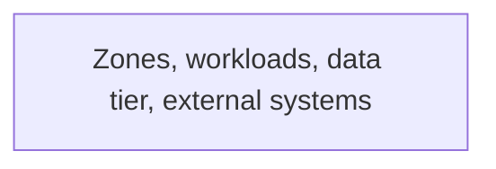

# Network

> Ports and dependencies for this service. `/v0-onboard` or the P0 build fills this file. A later feature updates it in a docs-only follow-up (`doc-sync`).
> Brownfield: `/v0-onboard` rewrites this file as-is from `docs/agents-v0/discovery/config.txt` and `docs/agents-v0/discovery/ci-deploy.txt`. Every row cites a file or says `UNVERIFIED`. Delete each `TEMPLATE:` line once it is replaced.

## Ports

| Service | Port (dev) | Exposes | Status | Citation |
|---------|-----------|---------|--------|----------|
| <!-- TEMPLATE: svc --> | <!-- 8080 --> | <!-- /api/v1, /health --> | planned | |

## Dependencies

| Dependency | Address (env var) | Purpose | Status | Citation |
|------------|-------------------|---------|--------|----------|
| <!-- TEMPLATE: e.g. PostgreSQL --> | <!-- DB_HOST, DB_PORT --> | <!-- primary store --> | planned | |

Status is `planned` or `built`. A `planned` row is a target written at plan time. It has no citation. A `built` row cites a file in the commit that shows the process running (config, compose, or source). Add a dependency row only for a database, cache, identity provider, broker, or outbound API the plan or the code names.

`doc-sync` copies a row into `docs/agents-v0/architecture.md` only when Status is `built` and the citation is in the commit being documented. A `planned` row stays here. It is not described as running.

## Target topology

<!-- /v0-architecture: a Mermaid flowchart LR of the target platform, after the pattern ADR is Accepted. Subgraphs for the zones (public ingress, private workloads, data tier, external). Label every edge with protocol and direction, and show the security boundaries (security group, network policy, gateway). Target only: a row stays `planned` in the tables above until the code shows it running. `N/A: <reason>` when the platform is unchanged. -->

## Outbound timeouts and resilience

<!-- TEMPLATE: the timeouts, retries, and circuit breakers the outbound clients use today, with citations (see docs/agents-v0/discovery/outbound.txt). Kit defaults for new work: about 10s timeout, retry with backoff, circuit breaker (Resilience4j); event consumers use bounded backoff, a DLQ after max failures, and are idempotent. -->
