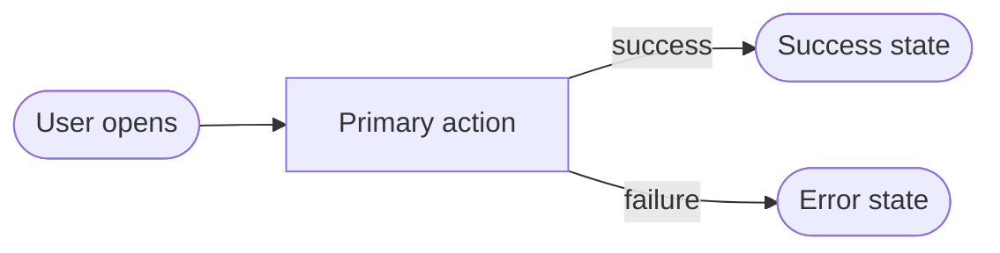

# UX Spec — <feature>

> One primary screen. Copy from `docs/agents-v0/snippets/ux-spec-one-screen.md`. Add mockups under `docs/agents-v0/design/<feature>/mockups/`. Run `sh .agents-v0/ci/check-ux-spec.sh <feature>`.

## UX requirements (from Intake)

- **Accessibility target:** WCAG 2.1 AA
- **Device/browser matrix:** <desktop Chrome/Edge/Firefox/Safari; mobile Safari iOS; Android Chrome>
- **Design system:** <tokens/library or N/A: greenfield shell>

## User flows

## Screen inventory + state matrix

### <Screen>

| State | Trigger | Mockup | UI |
|-------|---------|--------|----|
| Loading | Initial fetch or submit in flight | mockups/<screen>-loading.html | Skeleton; no layout shift |
| Error | 4xx/5xx or client validation | mockups/<screen>-error.html | Message + retry |
| Empty | No rows / no selection | mockups/<screen>-empty.html | Empty copy + next action |
| Success | Data present / action done | mockups/<screen>-success.html | Content per AC-* |

## HTML mockups

Static HTML/CSS only. One file per state above. Every interactive control has `data-component="<Name>"` matching a row below.

## Component defaults

| Component | Screen | Mockup | Operation | Default behavior | Override |
|-----------|--------|--------|-----------|------------------|----------|
| <Primary> | <Screen> | mockups/<screen>-success.html | <operationId or —> | <submit/navigate; map 401/4xx/5xx to states> | |

## Accessibility (WCAG 2.1 AA)

| Screen | Keyboard path | Focus | ARIA | Contrast | Motion |
|--------|---------------|-------|------|----------|--------|
| <Screen> | Tab order through controls | Visible focus; trap only in modal | Native first | ≥ 4.5:1 text | Honor prefers-reduced-motion |

## UX acceptance criteria

| ID | Screen | Mockup | Criterion |
|----|--------|--------|-----------|
| UX-1 | <Screen> | mockups/<screen>-success.html | <observable on built UI> |
| UX-2 | <Screen> | mockups/<screen>-error.html | <error visible; retry available> |
