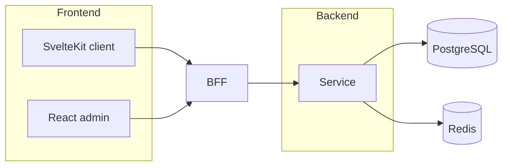

# Architecture

> System context for this service. Update when topology changes (`architecture-and-diagrams.mdc`).

## Context

<!-- One paragraph: what this system is and who uses it. -->

## Containers

<!-- Mermaid flowchart of services, BFF, frontends, data, messaging. -->

## Service boundaries

| Service | Owns | DB | API |
|---------|------|----|----|
| <!-- e.g. order-service --> | <!-- Order aggregate --> | <!-- order_db --> | <!-- /api/v1/orders --> |

## Cross-cutting

- Correlation ID: `X-Correlation-ID` (header + MDC).
- Tracing: W3C Trace Context (`traceparent`), OpenTelemetry.
- Auth: JWT for users; S2S via `X-API-Key` or service Bearer.
- Health: `/health`, `/ready`, `/live`.

## ADRs

See `docs/adr/`.
