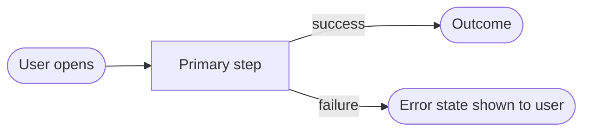

# UX Spec — <feature>

> Contract per `ux-design.mdc`. Produced in Design by `ux-designer` (skill `ux-design`); approved at the Design gate together with the HTML mockups; implemented by `frontend-engineer` in Build; audited by `test-engineer` on the built UI (`docs/verify/<feature>/ux-report.md`). Mockups do not call the API.

## UX requirements (from Intake)

- **Accessibility target:** WCAG 2.1 AA (`docs/requirements/<feature>.md`).
- **Device/browser matrix:** <desktop Chrome/Edge/Firefox/Safari; mobile Safari iOS; Android Chrome>.
- **Design system:** <tokens/component library reference>.

## User flows

## Screen inventory + state matrix

### <Screen 1>

| State | Trigger | Mockup | UI |
|-------|---------|--------|----|
| Loading | <data fetch in flight> | mockups/<screen>-loading.html | <skeleton/spinner; no layout shift> |
| Error | <fetch fails / 4xx / 5xx> | mockups/<screen>-error.html | <user-visible message; retry path> |
| Empty | <no data> | mockups/<screen>-empty.html | <empty-state copy + next action> |
| Success | <data present> | mockups/<screen>-success.html | <content per acceptance criteria> |

### <Screen 2>

| State | Trigger | Mockup | UI |
|-------|---------|--------|----|
| Loading | | mockups/<screen>-loading.html | |
| Error | | mockups/<screen>-error.html | |
| Empty | | mockups/<screen>-empty.html | |
| Success | | mockups/<screen>-success.html | |

## HTML mockups

Static HTML and CSS under `docs/design/<feature>/mockups/`. One file per screen state. No fetch and no API client. Every interactive control on a mockup has a component row below. Every component row links to a mockup that exists. If the mockup and the row disagree, Design is not approvable until both match.

## Component defaults

Shared components are defined once. Another screen references that component name instead of restating the behavior.

| Component | Screen | Mockup | Operation | Default behavior | Override |
|-----------|--------|--------|-----------|------------------|----------|
| <Display name> | <Create> | mockups/create-error.html | — | Required. On submit, if empty, show an error under the field and do not call the API. | |
| <Save> | <Create> | mockups/create-success.html | <POST /api/v1/...> | Submit the form. Success shows mockups/create-success.html. Validation error shows field errors. 401 goes to sign-in. 5xx shows mockups/create-error.html with retry. | |

Operation is `—` when the component does not call the API. Otherwise it is an operation in the approved OpenAPI contract. Do not invent an endpoint. The result mockups stay static. Build writes the real client.

## Accessibility (WCAG 2.1 AA)

| Screen | Keyboard path | Focus | ARIA | Contrast | Motion |
|--------|---------------|-------|------|----------|--------|
| <Screen 1> | <tab order; shortcuts> | <focus order; trap/restore in modals> | <aria-expanded/aria-live as needed> | <≥ 4.5:1 text> | <reduced-motion behavior> |

## Responsive + devices

| Breakpoint | Layout | Notes |
|------------|--------|-------|
| <≥ 1024px> | <multi-column> | |
| <768–1023px> | | |
| <≤ 767px> | <stacked> | |

## Design-system conformance

| Element | Token/component | Deviation (ADR) |
|---------|-----------------|-----------------|
| <button> | <design-system token> | <none / ADR link> |

## UX acceptance criteria

| # | Screen | Mockup | Testable criterion |
|---|--------|--------|--------------------|
| UX-1 | <Screen 1> | mockups/<screen>-empty.html | <Given/When/Then> |

## N/A determinations

| Surface | N/A reason |
|---------|------------|
